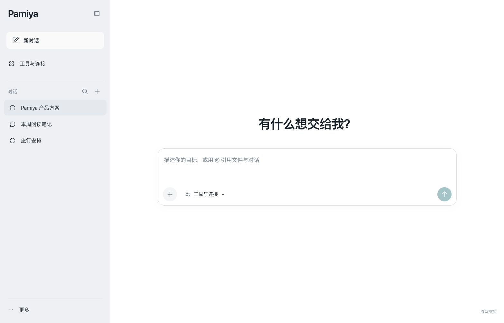
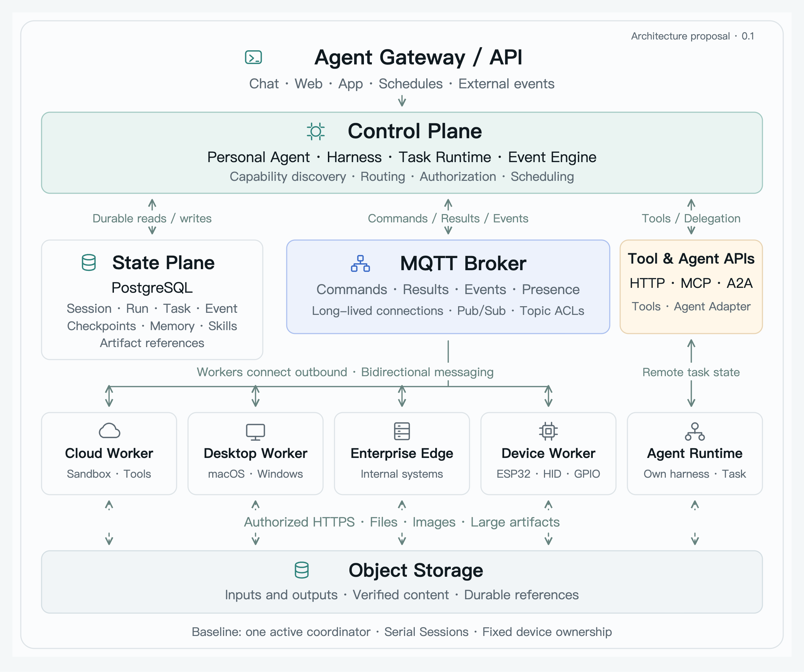
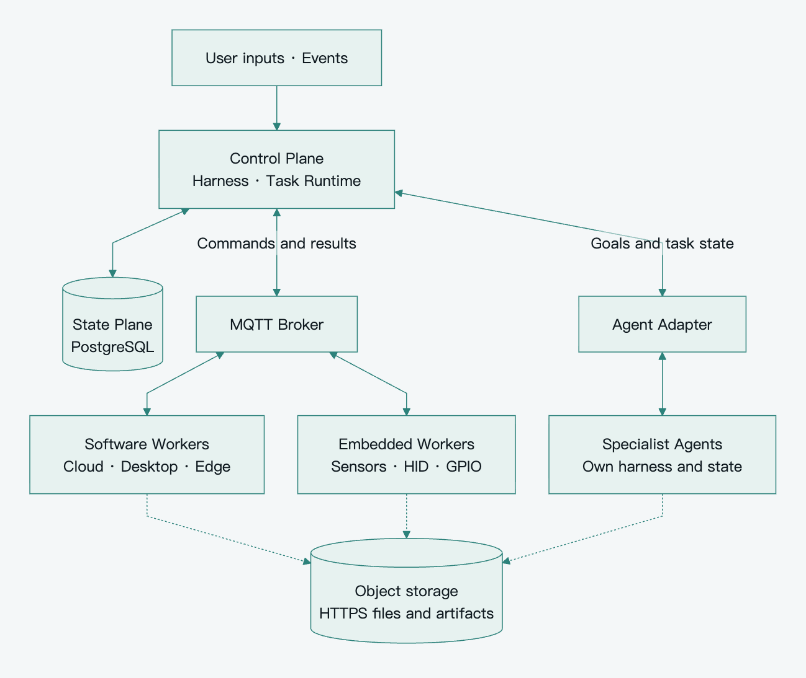

**English** · [简体中文](README.zh-CN.md)

Pamiya is a **personal Agent for ongoing work**: express a goal, provide context, let it advance the work, and refine a useful result together. Its architecture connects cloud services, desktops, enterprise networks, and devices through a logically centralized Control Plane, durable State Plane, and heterogeneous Execution Network.

**DSH plugin 0.1 · Interaction prototype 0.2 · Architecture baseline 0.1.** The plugin uses real MQTT and Workers. The standalone prototype remains a simulation, and platform extension proposals are distinct from implemented capabilities.

## Install into DSH

[Self-service quickstart](docs/en/quickstart.md) · [Give this document to DSH](docs/en/install-with-dsh.md) · [All installation options](INSTALL.md)

Open **Plugins → Add plugin** in DSH, paste this URL, install and enable:

```text
https://github.com/UllrAI/pamiya/releases/download/v0.1.1/pamiya-dsh-plugin-0.1.1.tgz
```

The prebuilt Desktop plugin needs no Git, source checkout or separate Node.js. Open **Pamiya → Connection** to set up the test connection; this computer joins automatically. [Full usage and implementation guide](docs/en/dsh-plugin.md).

<details>
<summary>Build and install from source</summary>

From this repository root, with Node.js 22.19 or newer:

```sh
npm ci
node scripts/install-dsh-plugin.mjs --demo
```

`--demo` explicitly enables first-time public RunMQTT setup and a local connection check. Use a private broker for personal files and commands.

</details>


[Recorded verification and pending checks](docs/en/dsh-verification.md).

## Product and prototype

Start with the [requirements and interaction documents](docs/product/en/README.md), the [Chinese edition](docs/product/zh-CN/README.md), or the [runnable prototype](prototype/README.md). They cover conversation, autonomous progress, editable artifacts, recovery, connections, memory, and continuing responsibilities.



The home stays quiet and direct. Activity and artifacts appear in context; infrastructure and task tracking support the experience. See the [visual QA](prototype/design-qa.md) for verification and simulation limits.

[Open-source foundation review](docs/product/en/open-source-foundation.md): first validate a Pamiya extension bundle inside DSH, reusing its Agent and UI; the prototype is an experience reference, not a reason to rebuild the runtime.

## Start with a small, complete baseline

The DSH plugin uses one Host, multiple Workers and existing Host persistence. The architecture below describes distributed deployment; it is not a mandatory stack for installing the plugin.

One active coordinator advances each Session serially. Multiple Workers connect outbound; each stateful device or Environment has a fixed execution owner. PostgreSQL stores intent, Attempts, results, and checkpoints. MQTT carries small commands/events; HTTPS and object storage carry files.

Keep durable Task/Attempt tracking, business result acknowledgement, deduplication, identity and scope checks, short-task validity, cancellation records, and reconciliation of uncertain important effects. Existing authorization covers ordinary work. Resource fencing, renewable leases, signed grants, and spending reservations enter when their requirements appear.



[View SVG](assets/diagrams/readable-overview.en.svg) · [Layout source](scripts/render_readable_architecture.py)

<details>
<summary>View the detailed connection map</summary>



[View SVG](assets/diagrams/baseline-architecture.en.svg) · [Editable Mermaid](assets/diagrams/baseline-architecture.en.mmd)

</details>

## Read the architecture

| Document | Covers |
|---|---|
| [Reading guide](docs/en/README.md) | Baseline, terminology, and reading order |
| [Architecture patterns](docs/en/architecture-patterns.md) | Harness/execution/state separation and MQTT fit |
| [Platform architecture](docs/en/platform-architecture.md) | Modules, domain model, environments, and event activation |
| [Capabilities and protocol](docs/en/capabilities-and-protocol.md) | Discovery, MQTT Topics, JSON contracts, artifacts, and delegation |
| [Reliability](docs/en/reliability.md) | Delivery, recovery, retries, cancellation, and failure acceptance |
| [Technology and roadmap](docs/en/technology-and-roadmap.md) | BifroMQ, optional Tenon, ESP32 integration, standards, and phases |
| [Scope and decisions](docs/en/scope-and-decisions.md) | Required boundaries and conditional complexity |

The [Chinese set](docs/zh-CN/README.md) follows the same structure and uses identical machine-readable examples. Both sets distinguish proposed platform contracts from external standards and verified third-party capabilities.

## Two execution semantics

| Tool execution | Agent delegation |
|---|---|
| Receives a concrete operation | Receives a goal |
| Parent harness decides the next step | Specialist Agent owns its loop |
| Worker reports Task/Attempt state | Adapter tracks the remote task and its limits |
| Example: browser capture or bound-device HID | Example: a coding or research task |

Always-on responsibilities use durable events, simple rules, and on-demand activation. They do not require continuous model execution. MQTT is the preferred remote Worker transport; HTTP, MCP, and A2A remain available through adapters.

## Maintain the documents

[Contributing](CONTRIBUTING.md) explains bilingual updates, local checks, and diagram rendering. [Visual assets](assets/brand/README.md) records the banner, social preview, palette, and generation prompt; [diagram sources](assets/diagrams/README.md) remain editable.

Released under [Apache-2.0](LICENSE).
