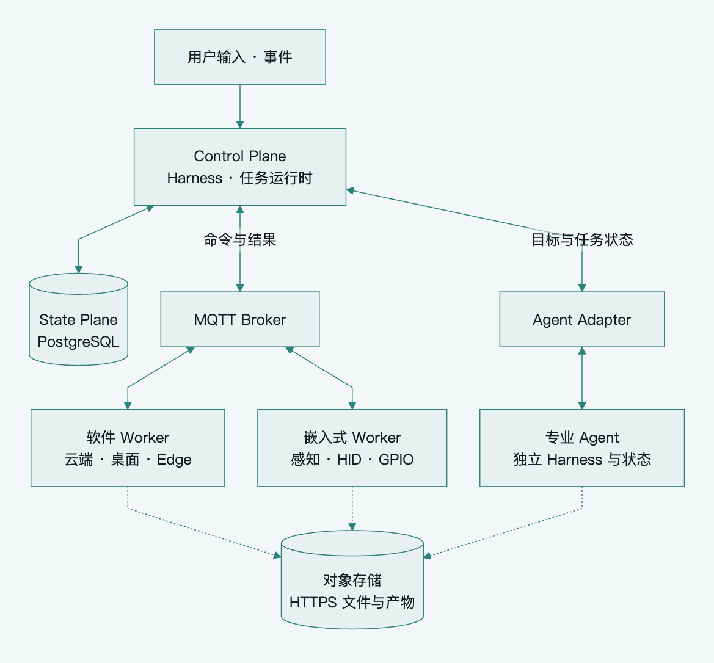

[English](README.md) · **简体中文**

Pamiya 是一套面向 **Personal Agent 的平台架构**，让 Agent 协调云端、桌面、企业内网和实体设备上的工作。平台分离逻辑集中的 Control Plane、持久化的 State Plane 和异构 Execution Network，通过能力发现与路由连接 Harness、工具和专业 Agent。

**架构设计提案 · 基线 0.1 · 2026-10-14。** 当前仓库交付架构文档与视觉资产，尚未实现生产运行时。

## 从小而完整的首版开始

一个活跃协调者串行推进每个 Session；多个 Worker 主动建立出站连接，每个有状态设备或 Environment 有固定执行归属。PostgreSQL 保存意图、Attempt、结果和检查点，MQTT 传递小型命令与事件，HTTPS 和对象存储承担文件数据通道。

首版保留 Task/Attempt 持久化、业务结果确认、去重、身份与范围检查、短任务时限、取消记录，以及未知重要效果的核对。普通工作沿用已有授权；资源 fencing、续租、签名授权和预算预留在相应需求出现时引入。

[查看 SVG](assets/diagrams/readable-overview.zh-CN.svg) · [布局源码](scripts/render_readable_architecture.py)

查看详细连接图

[查看 SVG](assets/diagrams/baseline-architecture.zh-CN.svg) · [可编辑 Mermaid](assets/diagrams/baseline-architecture.zh-CN.mmd)

## 阅读完整架构

| 文档 | 内容 |
|---|---|
| [阅读指南](docs/zh-CN/README.md) | 首版基线、术语和阅读顺序 |
| [架构形态](docs/zh-CN/architecture-patterns.md) | Harness、执行、状态分离与 MQTT 的适用范围 |
| [平台架构](docs/zh-CN/platform-architecture.md) | 模块、核心模型、环境与事件激活 |
| [能力与协议](docs/zh-CN/capabilities-and-protocol.md) | 发现、MQTT Topic、JSON 契约、产物与委托 |
| [可靠执行](docs/zh-CN/reliability.md) | 投递、恢复、重试、取消与故障验收 |
| [技术与路线](docs/zh-CN/technology-and-roadmap.md) | BifroMQ、可选 Tenon、ESP32、标准与实施阶段 |
| [范围与取舍](docs/zh-CN/scope-and-decisions.md) | 必须保留的边界及条件增强机制 |

[英文文档](docs/en/README.md) 与中文版逐章对应，机器可读示例完全一致。两种语言都区分平台提案、外部标准和已经核实的第三方能力。

## 两种执行语义

| 工具执行 | Agent 委托 |
|---|---|
| 接收具体操作 | 接收目标 |
| 父 Harness 决定下一步 | 专业 Agent 自主推进循环 |
| Worker 上报 Task/Attempt 状态 | Adapter 跟踪远程任务及其限制 |
| 例如浏览器截图、绑定设备 HID | 例如开发或研究任务 |

Always-on 职责通过持久化事件、简单规则和按需激活实现，无需持续调用模型。MQTT 是远程 Worker 的首选传输，HTTP、MCP 和 A2A 通过适配器接入。

## 维护文档

[贡献说明](CONTRIBUTING.md) 提供双语维护、检查和架构图渲染方法。[视觉资产说明](assets/brand/README.md) 记录 banner、分享图、配色与生成提示词；[架构图源码](assets/diagrams/README.md) 保持可编辑。

采用 [Apache-2.0](LICENSE) 许可。
