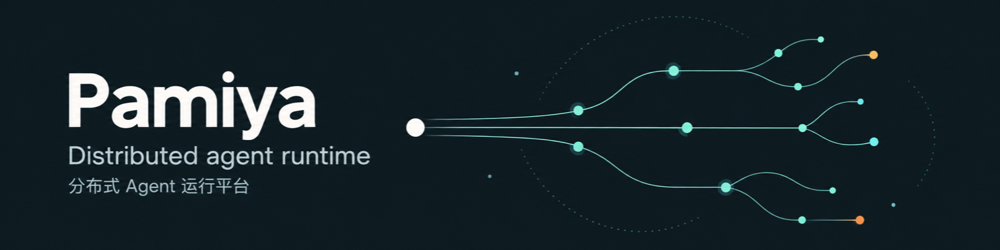
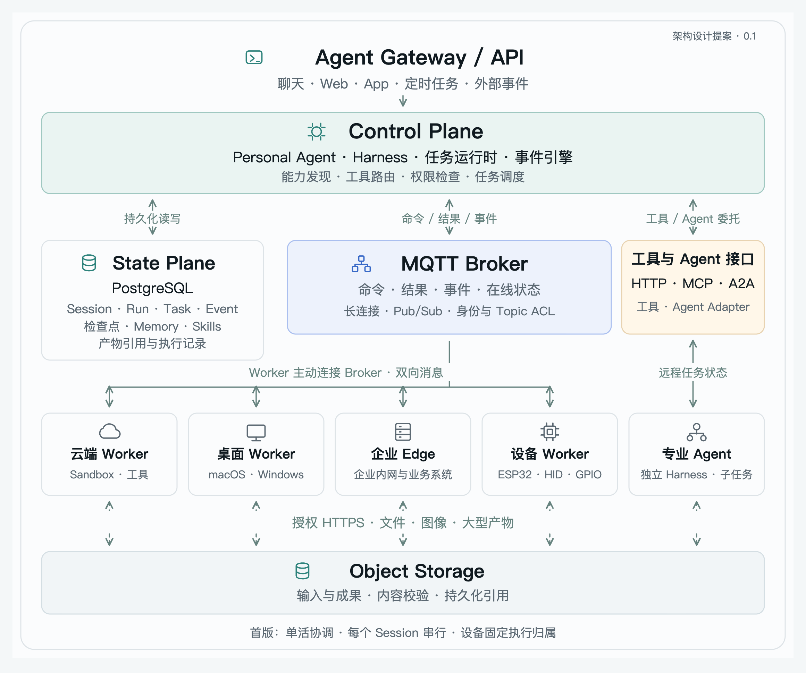

[English](README.md) · **简体中文**

**让 DSH 带着你需要的能力，在合适的电脑上完成工作。**

Pamiya 是 DeepSeek Harness（DSH）的插件。沿用熟悉的对话、模型和成果界面，把任务交给本机或远端的 DSH、Codex、Claude Code、Pi，也能调用用户定义的脚本动作。

## 能力跟着任务走

在本机装好的 Skill，换到另一台电脑时不应只剩一段提示词。Pamiya **按需同步完整 Skill，检查依赖，准备好后继续原任务**：

1. 在对话中指定节点和 Skill，或打开 **Pamiya → 节点 → Skills**。
2. 同步 `SKILL.md`、脚本与资源；检查声明的命令、环境变量、Node/Python 依赖及平台要求。
3. 有缺项时明确显示“需要准备”。选择 **准备并继续**，在节点的独立环境安装可准备的依赖，然后继续同一个任务。
4. Agent 使用同步的能力执行工作；进度、结果和回调回到原对话。

远端 Skill 文件走 HTTPS 中转，双方只需出站连接，MQTT 只传小型文件引用。内容按版本缓存，同一版本无需重复传输；已有会话固定使用原版本，新任务才采用更新。本地 Skill、远端 Skill、模型鉴权各自有清晰的归属，无需复制整份用户配置。

[Skills 完整使用指南与依赖声明](docs/zh-CN/skills.md) · [S3 首次配置引导](docs/zh-CN/file-storage.md) · [实际验收记录](docs/zh-CN/dsh-verification.md)

## 还有什么

| 能力 | 使用体验 |
|---|---|
| 本机即节点 | 安装后自动加入，通过本地 IPC 工作；不必先配置 MQTT |
| 对话选择电脑 | 输入框中选择节点，也可直接说要在哪台电脑执行 |
| 四种完整 Agent | DSH、Codex、Claude Code、Pi 保留自己的工具和执行循环，支持会话续接 |
| 默认复用模型 | 通过 DSH 共享模型通道；也可为节点上的 Agent 选择独立配置 |
| 自定义能力 | 声明脚本动作和输入 schema，供 Agent 调用 |
| 任务有着落 | 持久化进度、业务结果确认、停止与核对；完成后回到原对话 |

## 几分钟开始

在 DSH 的 **插件 → 添加插件** 中粘贴，安装并启用：

```text
https://github.com/UllrAI/pamiya/releases/download/v0.3.0/pamiya-dsh-plugin-0.3.0.tgz
```

桌面安装不需要 Git、源码或额外的 Node.js。打开 **Pamiya** 即可使用本机；添加其他电脑时再配置 MQTT，并复制界面给出的接入命令。

第一次体验 Skills，可打开节点的 **Skills → 运行合成示例**。示例只使用内置测试资源，能看到依赖检查、准备、脚本执行和真实回传全过程。

[自助上手](docs/zh-CN/quickstart.md) · [交给 DSH 代装](docs/zh-CN/install-with-dsh.md) · [全部安装方式](INSTALL.md) · [Agent 与自定义动作](docs/zh-CN/agent-workers.md)

## 当前边界

当前发布 **插件 0.3 预览版**。macOS DSH 桌面和 Linux Worker 已实际验收；Windows 实机待验收。Skills 依赖检查依据可选 `pamiya.json`，不会从任意自然语言说明中推断所有依赖。系统命令和环境变量缺失会给出明确处理项；MCP、插件、个人凭据和项目文件不随 Skill 自动迁移。

公共 RunMQTT 仅用于内置合成验证。个人 Skills 和真实远端任务使用私有连接；本机工作不经过 MQTT。

## 文档与架构

[插件使用与实现](docs/zh-CN/dsh-plugin.md) · [架构阅读指南](docs/zh-CN/README.md) · [需求与交互](docs/product/zh-CN/README.md) · [独立交互原型](prototype/README.md)

插件使用一个 DSH Host、持久化任务和多个 Worker。下图描述可扩展的平台架构；PostgreSQL、对象存储等不是安装插件的前置条件。独立原型仍为模拟，平台扩展提案与运行能力分别记录。



[详细架构图](assets/diagrams/baseline-architecture.zh-CN.png) · [可编辑架构图](assets/diagrams/README.md) · [范围与取舍](docs/zh-CN/scope-and-decisions.md)

## 从源码运行

需要 Node.js 22.19 或更新版本：

```sh
npm ci
node scripts/install-dsh-plugin.mjs
npm run plugin:test
npm run docs:check
```

[贡献说明](CONTRIBUTING.md) · [视觉资产](assets/brand/README.md) · [Apache-2.0](LICENSE)
