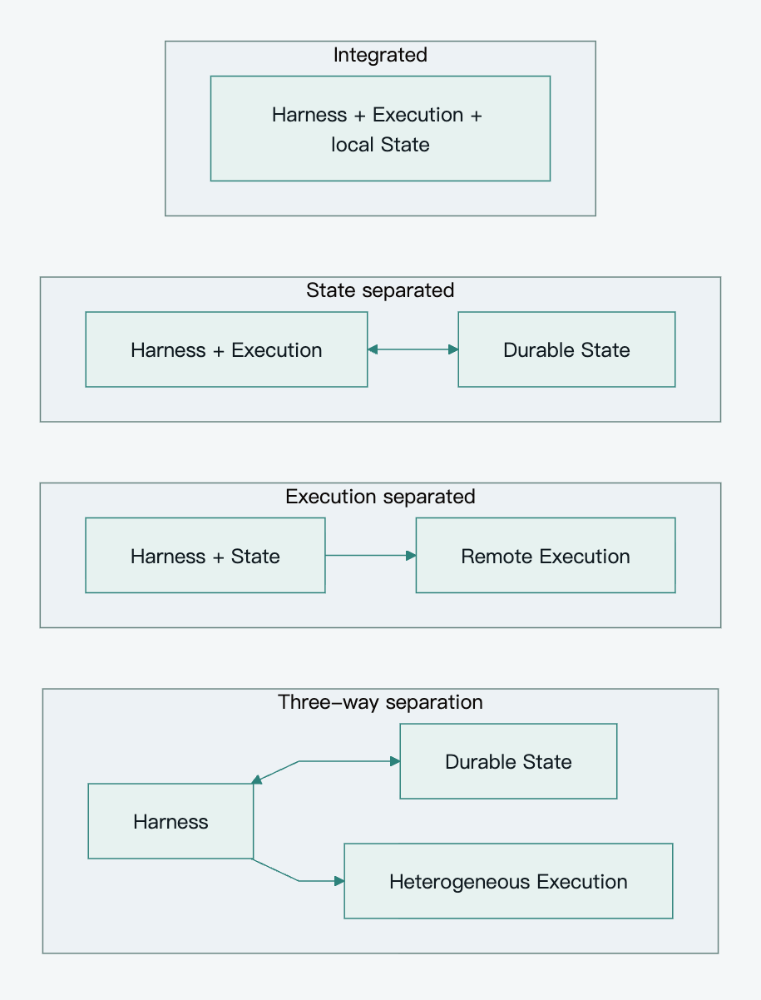

[简体中文](../zh-CN/architecture-patterns.md) · **English**

# Pamiya architecture patterns and decisions

Pamiya targets multi-tenant Personal Agents that can work in the cloud, on user computers, inside enterprise networks, and through physical devices. It uses separated control, durable state, and execution as its target architecture. Most baseline modules can share one application; establish ownership, execution boundaries, and recovery semantics before separating deployments.

Navigation: [Index](README.md) · [Platform architecture](platform-architecture.md)

## Three fundamental boundaries

| Layer | Responsibility | Question |
|---|---|---|
| Harness | Assemble context, call models, interpret tool calls, advance or suspend the loop | Who decides the next action? |
| Execution | Run code, manipulate files and browsers, call business APIs, operate devices | Where do effects happen? |
| State | Store events, progress, results, approvals, checkpoints, and artifact references | How does a new instance learn what happened? |

Harness is used in its narrower sense. Identity, scheduling, policy, and state services do not all need to belong to the harness. Model inference placement is another decision: a local harness can call a remote model, and a cloud harness can use local execution resources.

## Four engineering patterns

This is an engineering comparison framework, not a vendor standard or a reliability rating.

| Pattern | Control and execution | State ownership | Strength | Cost | Typical use |
|---|---|---|---|---|---|
| Integrated | One process group or work unit | Bound to the local workspace | Direct debugging and file access | Recovery and migration depend on that workspace | Local development, personal tools |
| State separated | Still share a runtime unit | External durable store | Release idle instances and resume later | Files and pending effects also need persistence | Intermittent SaaS work |
| Execution separated | Harness calls remote executors | May still belong to the control instance | Execution isolation and multiple environments | Harness recovery remains a separate problem | Sandboxes, user devices, enterprise nodes |
| Three-way separation | Control and execution are independent | Independent durable storage | Scale, replace, and recover components separately | Concurrency, delivery, and reconciliation | Multi-tenancy, long tasks, heterogeneous execution |

[View SVG](../../assets/diagrams/architecture-patterns.en.svg) · [Editable Mermaid](../../assets/diagrams/architecture-patterns.en.mmd)

Claude Agent SDK hosting describes a CLI subprocess with a working directory and local session files. Hybrid sessions load and save through an external SessionStore; workspace artifacts still require their own persistence. [Claude Agent SDK Hosting](https://code.claude.com/docs/en/agent-sdk/hosting)

Anthropic Managed Agents separates the Session log, harness, and sandbox behind replaceable interfaces. Recovery from an external log is a useful reference, but Pamiya still owns concurrency and uncertainty around external effects. [Managed Agents architecture](https://www.anthropic.com/engineering/managed-agents)

SDK, CLI, Gateway, and managed service describe delivery or integration, not the underlying topology. Always-on describes responsibilities and activation, not a fifth topology.

## Logically centralized management and distributed execution

The platform manages tenant identity, policy, Sessions, Tasks, and the capability directory. Execution happens where the required resources live: a user's desktop for local files, an enterprise Edge for an internal API, or a bound Worker for phone control.

Logical centralization permits multiple API, Scheduler, and Harness instances. They coordinate through durable state, versions, and ownership mechanisms rather than a permanently alive main process. Three-way separation does not require three business services on day one: start with a modular application plus PostgreSQL, object storage, and a Broker, and separate deployments when isolation or scale demands it.

## Initial implementation baseline

Start with **one active scheduling coordinator and multiple Workers**. Advance each Session serially. Give each device or stateful Environment one fixed execution owner. Control stores intent and results; Workers establish outbound Broker connections. They execute short tool Tasks or accept goal delegation to a remote Runtime. Losing a connection does not automatically transfer uncertain side-effecting work to another node.

This is a minimal deployment choice, not a limit on the target platform. Fixed ownership, database occupancy, Task/Attempt conditional updates, and a local Worker queue handle baseline concurrency without a resource lease service or fencing protocol.

Keep task persistence, result acknowledgement, deduplication, validity limits, authentication/ACLs, cancellation records, file references, and reconciliation of uncertain important effects. Approval is conditional on existing authorization and impact. Reads, navigation, and recoverable workspace operations run directly within scope. Read-only or reconstructible work may retry; uncertainty on one device does not stop unrelated work.

Add stronger mechanisms when a second active coordinator, automatic resource takeover, migration, offline autonomy, or strict shared spending limits are required. [Scope and decisions](scope-and-decisions.md) records these triggers.

### Harness compatibility

Changing a model, replacing the loop implementation, and migrating an in-progress vendor session are different capabilities. The baseline stabilizes platform objects and tool contracts; it does not promise lossless migration of arbitrary vendor-internal state.

A central harness must route platform-managed side-effecting tools through Task Runtime and preserve tool correlations, checkpoints, and suspension. If a CLI/SDK requires built-in Shell execution in its own workspace and cannot fully intercept or disable those operations, integrate it as a delegated Remote Agent Runtime. Wrapping it in an adapter does not itself separate execution. [SDK process model](https://code.claude.com/docs/en/agent-sdk/hosting)

Migrating a running Run requires an explicit converter and compatibility checks. Without them, complete or stop the existing Run with its original Runtime and use the new harness for new Runs. Portable platform events do not imply portable vendor reasoning state.

## MQTT responsibilities and fit

Remote Workers establish outbound long-lived connections without exposing public inbound ports. MQTT fits bidirectional commands, status, heartbeats, and small events from devices and enterprise networks. Files, images, and long logs use authorized HTTPS data paths; video and hard real-time control use transports that meet their latency needs.

For interchangeable cloud services in one region, HTTP, gRPC, or a durable queue may be simpler. Pamiya prefers MQTT for heterogeneous connectivity and long-term reachability, not because every Task needs a Broker.

| Requirement | Choice |
|---|---|
| Remote commands and events | MQTT as the preferred transport |
| Ownership, retry, recovery, final task state | PostgreSQL-backed Task Runtime |
| Cloud or third-party Agent delegation | Agent Adapter using the provider's API or A2A |
| External business tools | HTTP or MCP Adapter |
| Large inputs and outputs | Object storage and controlled HTTPS |
| Measured database dispatch bottleneck | Evaluate a dedicated durable queue |

MQTT QoS concerns protocol delivery, not application completion or a transaction with external effects. The platform still needs business acknowledgement and reconciliation. [MQTT 5.0 §4.3](https://docs.oasis-open.org/mqtt/mqtt/v5.0/os/mqtt-v5.0-os.html)

## Decisions to preserve

| Decision | Baseline or target choice | Reason or trigger |
|---|---|---|
| Authoritative state | State Plane owns platform Session, Run, Task, Event, and artifact references | Broker and executors can restart independently |
| Session concurrency | Serial baseline queue plus versions and uniqueness | Add leases/ownership for multiple active harnesses |
| Shared resources | Fixed ownership, occupancy; pause only conflicting uncertain resources | Add resource fencing for automatic cross-node takeover |
| Tool entry | Capability Resolver plus unified Router | Decouple harness from transport |
| Scheduling | Explicit selection by capability, authorization, capacity, and environment | Shared subscriptions do not encode business constraints |
| Dispatch | Task table and Dispatcher first; Outbox for domain events | Durable intent remains rediscoverable |
| Return path | RESULT_ACK after result commit | Do not lose completed work at Control |
| Retries | Operation-specific rules and effect reconciliation | Deduplication does not undo effects |
| Remote Agent | Separate Delegation contract and Adapter | It owns decisions and internal state |
| Harness integration | Intercept platform-managed tools or delegate the Runtime | Avoid untracked execution paths |
| Proactive activation | Event Engine accepts sources beyond MQTT | No model loop for every event |
| Broker | Evaluate BifroMQ first behind MQTT boundaries | Keep business state independent |
| Tenon | Optional integration PoC | Not the durable execution core |

These decisions preserve responsibility and semantics. They do not require every mechanism in the first release. Protocol, reliability, and roadmap define the baseline, conditional enhancements, and acceptance criteria.
