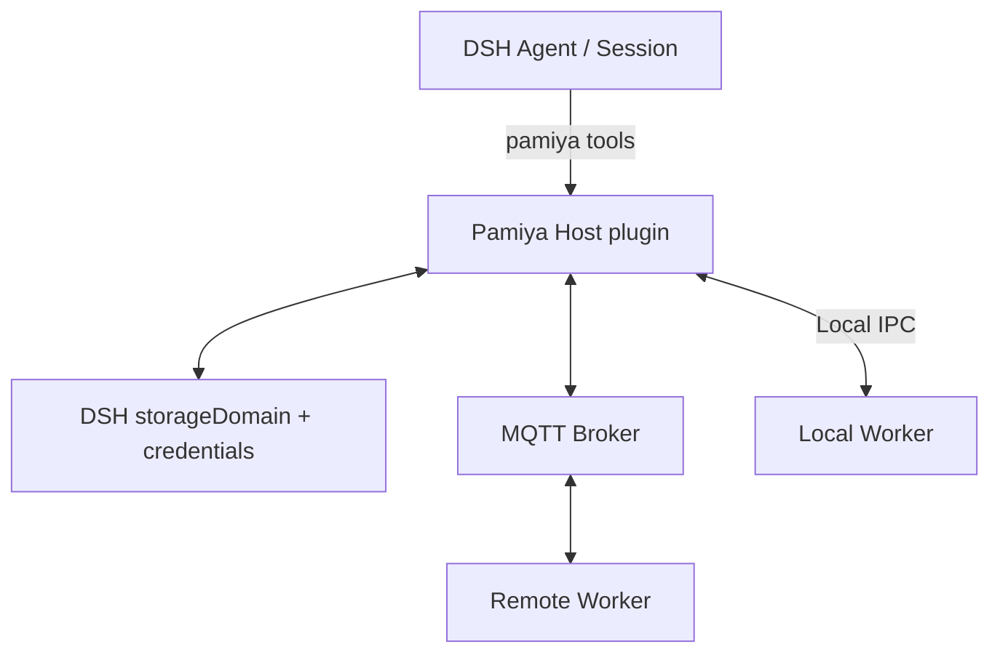

# Pamiya DSH plugin: installation, usage and implementation boundary

[Index](README.md) · [简体中文](../zh-CN/dsh-plugin.md)

Start with the [quickstart](quickstart.md), or give DSH the [installation task](install-with-dsh.md). This page covers source installation, full usage and implementation boundaries.

This documents the implementation in `packages/dsh-plugin`. DSH owns conversation, models, the Agent loop and Sessions. Pamiya adds remote tools, configuration, worker management and execution records. `prototype/` remains a separate simulated interaction prototype.

## Implemented composition



The Host and local Worker run on the same computer as separate processes. Local workers use process IPC; remote workers initiate outbound broker connections; arrows show message flow. DSH supplies the Agent and authoritative conversation history.

## Install

Use an existing DeepSeek Harness installation and Node.js 22.19 or newer. Source builds use npm. The downloadable Worker bundles its runtime dependencies, including the MQTT client.

```sh
npm ci
npm run plugin:test
node scripts/install-dsh-plugin.mjs
```

On macOS the installer prefers the official Desktop application's bundled CLI without requiring a global command. Set `--dsh` for another CLI and `--profile web` for Web. It backs up the existing profile patch and changes only its own marked section. A user-owned Pamiya override is never overwritten. Fully quit and reopen DSH if it does not reload automatically.

Accepted Host versions are `0.2.0-rc.2` and `0.2.1-alpha.4`. At verification, the official Desktop updater and npm `latest` still supplied the former; the latter came from npm `alpha`. Installing the alpha CLI is not a Desktop application update. Alpha validation uses a separate Harness home to avoid mixing personal data.

For a test deployment, `node scripts/install-dsh-plugin.mjs --demo` loads current public RunMQTT parameters only when the connection is unconfigured, starts a local worker and checks it. Normal installation does not automatically select an external broker.

## First use

1. Open **Pamiya → Workers**. The local worker joins automatically without MQTT, a separate terminal or pairing; an intentionally stopped worker stays stopped.
2. Wait for Ready, check its connection or try a demo. Results and status come from the real worker.
3. Worker details detect, install and configure DSH, Codex, Claude Code and Pi. Share DSH model/authentication by default, or choose independent settings.
4. Use `pamiya_workers` to discover capabilities, `pamiya_execute` for actions and `pamiya_delegate` for full agents. Long-task completion returns to the originating conversation.

Local jobs use IPC. Configure MQTT only for remote computers; public RunMQTT supports synthetic tests only. Credentials are read from the official page instead of hardcoding rotating passwords. Use a private connection for real remote work. [RunMQTT parameters and limits](https://runmqtt.com/public-broker)

See [Agents and custom actions](agent-workers.md) for model sources, onboarding, configuration, continuation, callbacks and artifacts.

## Add another computer or server

Choose **Add worker → Another computer or server**, name it and create pairing. The interface supplies a single-file Worker download, Node.js installation link, macOS/Linux and Windows PowerShell commands and a 30-minute pairing expiry. If the clipboard is unavailable, select **Show command for manual copy**. The command contains connection credentials and a worker key. Share it only with your own computer, never public docs, issues or screenshots. Create a separate pairing for each computer.

The Worker saves configuration and execution history in its user directory, using private permissions supported by the platform. An already paired worker continues after its original pairing code expires. Restart it with the ID shown in the interface:

```sh
node pamiya-worker.mjs start --id <worker-id>
```

A remote worker goes offline when its process exits. DSH-managed local workers start with DSH. A remote server can use its own process manager to supervise the same `start` command; no browser-side background scheduler is implied.

Changing broker addresses, modes or credentials preserves identities and journals; settle in-flight work first. The Host reconnects while local IPC remains separate. Use **Update connection / pair again** for remote workers, stop the old process, then run the new command while retaining the worker identity and execution journal.

## Conversation execution worker

In the composer’s bottom toolbar, choose Automatic or pin a worker. Each conversation persists its own choice. The Host enforces the selected target for Pamiya execution and rejects conflicting tool IDs. Auto allows explicitly named workers and otherwise prefers this computer. Changes affect new tasks; retries of the same tool call read the original task rather than replaying on a new target. Offline, paused, busy, removed or unsupported workers never silently fall back.

The Host adds the current selection and capabilities to model context, explaining that native DSH tools still run on the Host. This is model guidance, not interception or migration of every native DSH tool. Manage workers opens configuration. Use Auto for multi-worker comparisons. See the [quickstart](quickstart.md).

## Manage workers

- Search by name, filter status, rename, pause/resume assignments, check connections, start/stop local processes, re-pair and remove workers.
- Pause blocks new assignments; it does not stop in-flight work. Removal retains history and first requires resolving unfinished or uncertain tasks. Stop remote processes on their own computers.
- A tool action binds one worker, boot and Attempt. An explicitly selected worker is never silently replaced; in Auto without an explicit ID, prefer this computer, then a ready worker offering the action.
- **Try multiple workers** sends the same synthetic text to every available worker and compares real results. It requires two ready workers and never fabricates nodes.
- Each Worker currently has capacity 1. Agents can call different workers concurrently. Busy, paused, offline or unresolved workers receive no new actions.

## Files and commands

Local IPC or a private MQTT connection enables `fs.list`, `fs.read` and `fs.write`. Local worker details let you choose an existing folder and explicitly enable commands. Saving restarts the worker; settle unfinished or uncertain tasks first. Add `--workspace` to the remote pairing command to select a directory. Path checks reject traversal and symlink escape; directory-scoped file access is not OS isolation.

`shell.run` additionally requires an explicit `--allow-shell` at Worker startup. Commands run as the Worker's user, and the working directory is not a system sandbox. Pair only a trusted Host. Nonzero exits retain output and report failure. Four full agent adapters are implemented, using each agent’s native environment. Separate browser engines, desktop control and ESP32 firmware are not bundled.

## State and recovery

| State | Meaning |
|---|---|
| Sent | Host persisted intent/ownership and attempted delivery |
| Running | Worker durably recorded and acknowledged the action |
| Completed/failed | An actual business result reached Host persistence |
| Stop requested | No definitive Worker settlement yet |
| Stopped | Worker confirmed a cancellable action stopped; previous effects remain |
| Unknown | Disconnect, timeout or restart left no certain result; no automatic replay or reassignment |

DSH Sessions remain authoritative for chat. Resources and Task/Attempt records use the `pamiya` DSH `storageDomain`, currently on the installed Host's JSON backend without another PostgreSQL deployment. Broker credentials and worker keys use DSH's credential store and are excluded from snapshots/model tools. The Worker records acceptance atomically before acknowledging it and republishes results until Host acknowledges persistence.

Native tools pass through DSH's tool pipeline. UI RPC uses authenticated Host `/api` Fetch routes, without an unauthenticated control server. MQTT carries QoS 1, small, non-retained messages. Per-worker AES-256-GCM keys bind direction; tampered and expired messages are rejected. Duplicate dispatches query the same journal instead of executing again.

Checking a result only queries the Worker. A human can record an uncertain outcome with a verification note only after checking the real state. This records provenance without re-execution. Cancelled commands/writes and crashed processes may already have produced effects and remain unknown until reconciled.

## Implemented wire contract

This plugin implements a small version-1 contract. The broader [platform protocol proposal](capabilities-and-protocol.md) is not its wire format.

- Topics: `sandbox/pamiya/<namespace-id>/workers/<worker-id>/down` for Host commands and `/up` for Worker events; QoS 1, no retained messages.
- Plaintext envelope: `v`, unique message `id`, timestamp `at`, `workerId`, `bootId`, `kind`, optional `taskId`, and `payload`. `kind` is `status`, `dispatch`, `accepted`, `result`, `resultAck`, `query`, `cancel`, `progress` or `model`.
- Encrypted transport envelope: AES-256-GCM `iv`, `tag`, `data` encoded in Base64url; authenticated data is `<namespace>|<workerId>|<up-or-down>`. Messages must belong to the selected Worker and be within 120 seconds of local time. Keep machine clocks synchronized.
- An Agent Session and DSH `callId` derive the persisted intent key. A Task UUID binds one Worker, boot and Attempt 1. Duplicate dispatches consult the Worker journal; transport message IDs are not business deduplication keys.
- Dispatch payload: `{action, input, deadline}`. A result carries `{status, result?, error?, bootId?}` and is acknowledged only after Host persistence. Status includes advertised actions and capacity; heartbeats occur every 5 seconds and the Host considers presence stale after 18 seconds.
- Input is limited to 24 KB. The receiver rejects packets over 96 KB; large results carry a truncated preview while retaining the action outcome. Model context is framed over the existing encrypted connection with a 4 MB limit per model request/response. Registered artifacts support chunked reads; see the agent guide.
- Broker and Worker identities persist across reconnects. The implementation does not introduce renewable leases, fencing, signed grants, automatic replay, or a second scheduler.

The normative implementation is `src/protocol.js`, `src/controller.js` and `src/worker.js` in `packages/dsh-plugin`.

## Verification and limits

Automated tests cover real local MQTT with two Workers, intent/message deduplication, confirmed cancellation, assignment pause, Host restart, forced Worker process death, path boundaries, private file/command execution, Host API contracts and preservation of installation settings. Two independent Workers have also exchanged actual results through public RunMQTT; that does not establish deployment to every remote computer.

Browser acceptance uses an actual DSH Host, not the simulated prototype. Multi-tenant hosting, active-active controllers, automatic reassignment, OS sandboxing, fleet-scale scheduling, cross-domain transactions and production deployment are outside this delivery. Physical-machine deployment, end-to-end model calls and cross-platform support require their own recorded evidence rather than being inferred from unit tests.


[Recorded acceptance evidence and remaining checks](dsh-verification.md).
