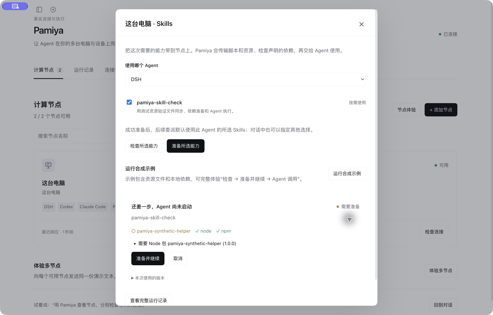
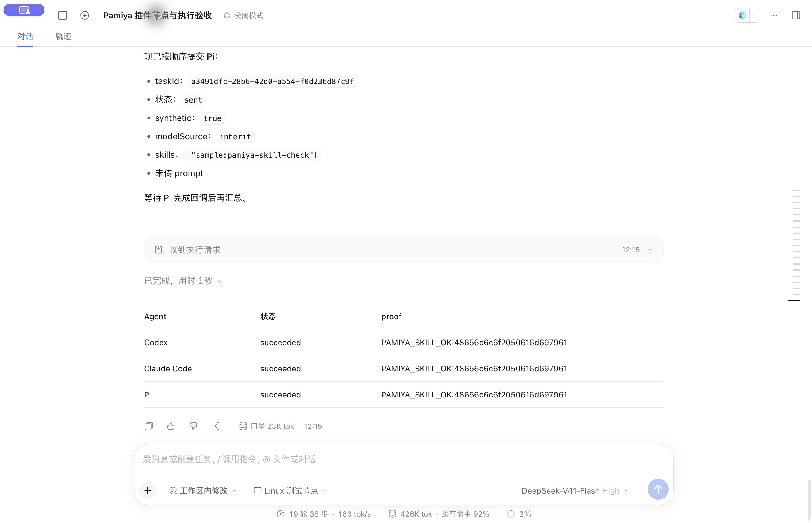

# DSH plugin verification record

[Usage guide](dsh-plugin.md) · [简体中文](../zh-CN/dsh-verification.md)

Verified: 2026-10-16. The public screenshots show an actual DSH Web Host, not `prototype/`; native Desktop and model acceptance results are recorded below.

## Verified

- Both the `0.2.0-rc.2` and `0.2.1-alpha.4` DSH Web compositions loaded the plugin, sidebar, authenticated API and tools. Native Desktop `0.2.0-rc.2` also passed plugin loading, automatic local enrollment, remote pairing and actual two-worker execution.
- In `0.2.1-alpha.4`, a local macOS Worker and an independent Linux x64 server Worker connected through public RunMQTT. Both completed statistics on the same synthetic text and returned real results.
- A remote 90-second wait was started and stopped through the UI. The UI received Stopped, and the remote journal recorded cancellation with the Host acknowledgement.
- The Linux Worker uses a separate Node.js 24.22.0 runtime from the official release with SHA-256 verification and a systemd service. Restarting the service restored its connection and retained the execution journal. Configuration/journal permissions are 600.
- Plugin reload restored the managed local Worker. Automated tests also verify that a deliberately stopped Worker remains stopped and that the local identity is not duplicated.
- Chinese/English switching, default remote pairing, prevention of duplicate local workers, task lists and status feedback were exercised in the real Host.
- Fifteen automated tests cover real MQTT workers, deduplication, confirmed cancellation, pause, Host restart, forced Worker death, path scope, private files/commands, local capability settings, pre-aborted tools, Host API and installation settings.
- Plugin production dependencies have zero audit findings. Existing low-severity KaTeX/Mermaid findings in documentation tooling remain separate; this implementation does not introduce an unrelated major upgrade.

## Public package installation verification

The public GitHub Release URL for `v0.1.0` was verified in a fresh, isolated DSH `0.2.0-rc.2` Web profile. URL installation succeeded with `@pamiya/dsh-plugin@0.1.0` and selected the plugin configuration layer. A separate public download matched the published SHA-256. Source builds are unnecessary for users; see the [quickstart](quickstart.md) for Desktop UI installation.

## Native Agent end-to-end verification

The Desktop Host used its existing DeepSeek-V41-Flash / High configuration in minimal mode. The Agent called Pamiya tools, executed `system.check` and `text.stats` on both physical computers, and returned the real results to the conversation. All four Host tasks retained the same DSH Session correlation and settled as `succeeded`; the remote journal received Host acknowledgements.

| Worker | Platform | Node.js | Statistics for `Hello Pamiya` |
|---|---|---|---|
| This computer | darwin | 24.18.1 | 12 characters, 1 line, 2 words |
| Linux test worker | linux | 24.22.0 | 12 characters, 1 line, 2 words |

Manual pairing-command display/hiding was also exercised in the native window. The Linux service was moved from the isolated alpha test Host to the Desktop Host, retaining its existing systemd service and earlier test journals.

## Conversation worker selection (v0.1.1)

After publication, the complete public `v0.1.1` URL also installed successfully in a fresh isolated DSH Web profile; the installed package version was confirmed as `0.1.1`.

Native DSH verification covered the Execution worker picker, direct Manage workers navigation, and selection before a new conversation’s first message, and target retention after a full Desktop restart. With Linux selected, a request to check “the selected computer” and count Hello Pamiya produced two new successful Linux-bound tasks without naming the worker in the message (linux / Node.js 24.22.0). In a separate new conversation, the model explained that ping was unavailable without shell capability and produced no substitute Pamiya execution task.

New automation covers conversation isolation, persisted selection, execution binding, conflicting IDs, no reassignment for paused/removed targets, and retries reading the original task after selection changes. Model context explains execution location; the plugin does not intercept every native DSH tool.

## Pending verification

Windows/other desktop process behavior remains pending. Real-model testing used the Desktop Host’s existing configuration without copying personal API keys into an isolated test Host. All inputs were synthetic. Private files and explicitly enabled commands passed local real-process tests and were not exercised through the public service.

This evidence establishes the current implementation path, not a multi-tenant production platform, OS sandbox or automatic failover.

[Confirmed remote stop](../../packages/dsh-plugin/design/remote-cancel.zh-CN.png).

## Agent delegation and local IPC (v0.2.0)

Verified on 2026-10-16 with native DSH 0.2.0-rc.2 and a physical Linux worker:

- The managed local worker starts over IPC. A fresh test instance with MQTT disabled performed an actual file write. Default workspace files are separate from worker configuration and authentication files.
- Native DSH management UI ran a DSH synthetic job with its default model and received `PAMIYA_AGENT_OK`.
- The conversation delegated DSH, Codex, Claude Code and Pi to the selected Linux worker using fixed synthetic jobs through public RunMQTT. All four ultimately returned `PAMIYA_AGENT_OK`. Completion callbacks reached the originating conversation and woke its report; jobs ran sequentially on the same worker.
- Codex’s first real-model attempt exposed tool-name compatibility. Namespaced tools are now mapped to provider-compatible names and restored on return; a new task passed. The original failed task remains in history.
- Executable versions were checked on both computers: DSH `0.2.0-rc.2`, Codex `0.162.1`, Claude Code `2.1.296`, Pi `1.3.0`.
- All 23 checks passed, including real first-run/continuation for all four official CLIs, actual file/command tool results returned to the shared model, model framing, UTF-8, cancellation and local files without MQTT. CLI integration uses controlled model responses; physical Linux acceptance separately uses the actual DSH model and public MQTT.
- RunMQTT credentials were refreshed while retaining both worker identities and journals. No private broker or additional server port was created.

Personal independent third-party logins and Windows hardware were not exercised. No real business files or free-form agent jobs were sent over the public connection. The shared interface currently accepts text and tool calls; proprietary media/hosted tools use independent agent configuration. See the [agent guide](agent-workers.md).

## On-demand Skills and HTTPS file transfer (v0.3.0)

Verified on 2026-10-16 using native DSH Desktop and the existing physical Linux Worker:

- The worker UI downloaded the complete built-in Skill from HTTPS pinned to a GitHub commit, detected the missing `pamiya-synthetic-helper` and paused at Needs preparation. Prepare and continue installed its bundled dependency and continued the same task. DSH read the Skill/resource and executed the script, returning the real proof.
- Conversation called `pamiya_skills list`, then delegated to Linux DSH. A missing-dependency callback returned to the conversation and waited for the user. “Prepare and continue” retained Task ID `2c5ea05d-d34a-4497-acd5-785997bd94ab`; it succeeded with preparation revision 1 and a business-result ACK.
- Codex, Claude Code and Pi subsequently executed the same Skill sequentially on Linux. All succeeded, returning `PAMIYA_SKILL_OK:48656c6c6f2050616d697961` with result acknowledgements. Claude Code completed its native permission check without disabling its permission mechanism.
- The first real DSH tool round-trip exposed a missing top-level tool-call identity in the shared model bridge. After repair, UI and conversation retests passed; the original failed record remains.
- All 36 automated checks passed, including four real CLIs loading Skills, reading resources and executing scripts; standard Skills without extension manifests; complete directories/executable bits; versions/cache; CJS/ESM dependencies; Host restart; same-task continuation; stale result/ACK isolation; and a real MQTT Worker pausing for missing storage and confirming cancellation.
- S3 automation uses the official SDK with a controlled object-storage adapter: a 3 MB encrypted Skill upload, signed HTTPS reference, decryption and hash verification. Configuration verifies a signed download before saving; failure retains valid settings. Skill bodies are not sent in MQTT.

Physical remote tests used fixed public synthetic files only, without personal Skills, cloud-storage credentials or real business files. A private S3 bucket is not configured in the user environment; adapter tests do not replace physical private-bucket or cross-provider verification. See [first-time file storage setup](file-storage.md).

Native DSH also verified the S3 preparation step, connection form and invalid-endpoint error. Errors retain the form; closing leaves storage unconfigured, without saving synthetic keys. Additional checks use a real Python venv and commands supplied by Skill dependencies.

The local Worker also completed the native-UI synthetic Skill check, dependency preparation, continuation and actual script result. It read the local snapshot without MQTT or S3.
