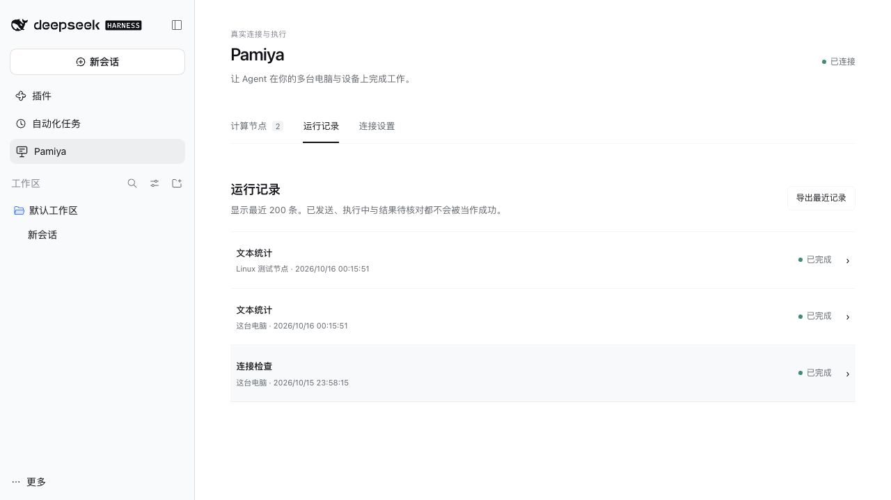

# DSH plugin verification record

[Usage guide](dsh-plugin.md) · [简体中文](../zh-CN/dsh-verification.md)

Verified: 2026-10-16. The public screenshots show an actual DSH Web Host, not `prototype/`; native Desktop and model acceptance results are recorded below.

## Verified

- Both the `0.2.0-rc.2` and `0.2.1-alpha.4` DSH Web compositions loaded the plugin, sidebar, authenticated API and tools. Native Desktop `0.2.0-rc.2` also passed plugin loading, automatic local enrollment, remote pairing and actual two-worker execution.
- In `0.2.1-alpha.4`, a local macOS Worker and an independent Linux x64 server Worker connected through public RunMQTT. Both completed statistics on the same synthetic text and returned real results.
- A remote 90-second wait was started and stopped through the UI. The UI received Stopped, and the remote journal recorded cancellation with the Host acknowledgement.
- The Linux Worker uses a separate Node.js 24.22.0 runtime from the official release with SHA-256 verification and a systemd service. Restarting the service restored its connection and retained the execution journal. Configuration/journal permissions are 600.
- Plugin reload restored the managed local Worker. Automated tests also verify that a deliberately stopped Worker remains stopped and that the local identity is not duplicated.
- Chinese/English switching, default remote pairing, prevention of duplicate local workers, task lists and status feedback were exercised in the real Host.
- Fifteen automated tests cover real MQTT workers, deduplication, confirmed cancellation, pause, Host restart, forced Worker death, path scope, private files/commands, local capability settings, pre-aborted tools, Host API and installation settings.
- Plugin production dependencies have zero audit findings. Existing low-severity KaTeX/Mermaid findings in documentation tooling remain separate; this implementation does not introduce an unrelated major upgrade.

## Public package installation verification

The public GitHub Release URL for `v0.1.0` was verified in a fresh, isolated DSH `0.2.0-rc.2` Web profile. URL installation succeeded with `@pamiya/dsh-plugin@0.1.0` and selected the plugin configuration layer. A separate public download matched the published SHA-256. Source builds are unnecessary for users; see the [quickstart](quickstart.md) for Desktop UI installation.

## Native Agent end-to-end verification

The Desktop Host used its existing DeepSeek-V41-Flash / High configuration in minimal mode. The Agent called Pamiya tools, executed `system.check` and `text.stats` on both physical computers, and returned the real results to the conversation. All four Host tasks retained the same DSH Session correlation and settled as `succeeded`; the remote journal received Host acknowledgements.

| Worker | Platform | Node.js | Statistics for `Hello Pamiya` |
|---|---|---|---|
| This computer | darwin | 24.18.1 | 12 characters, 1 line, 2 words |
| Linux test worker | linux | 24.22.0 | 12 characters, 1 line, 2 words |

Manual pairing-command display/hiding was also exercised in the native window. The Linux service was moved from the isolated alpha test Host to the Desktop Host, retaining its existing systemd service and earlier test journals.

## Conversation worker selection (v0.1.1)

Native DSH verification covered the Execution worker picker, direct Manage workers navigation, and selection before a new conversation’s first message, and target retention after a full Desktop restart. With Linux selected, a request to check “the selected computer” and count Hello Pamiya produced two new successful Linux-bound tasks without naming the worker in the message (linux / Node.js 24.22.0). In a separate new conversation, the model explained that ping was unavailable without shell capability and produced no substitute Pamiya execution task.

New automation covers conversation isolation, persisted selection, execution binding, conflicting IDs, no reassignment for paused/removed targets, and retries reading the original task after selection changes. Model context explains execution location; the plugin does not intercept every native DSH tool.

## Pending verification

Windows/other desktop process behavior remains pending. Real-model testing used the Desktop Host’s existing configuration without copying personal API keys into an isolated test Host. All inputs were synthetic. Private files and explicitly enabled commands passed local real-process tests and were not exercised through the public service.

This evidence establishes the current implementation path, not a multi-tenant production platform, OS sandbox or automatic failover.

[Confirmed remote stop](../../packages/dsh-plugin/design/remote-cancel.zh-CN.png).
