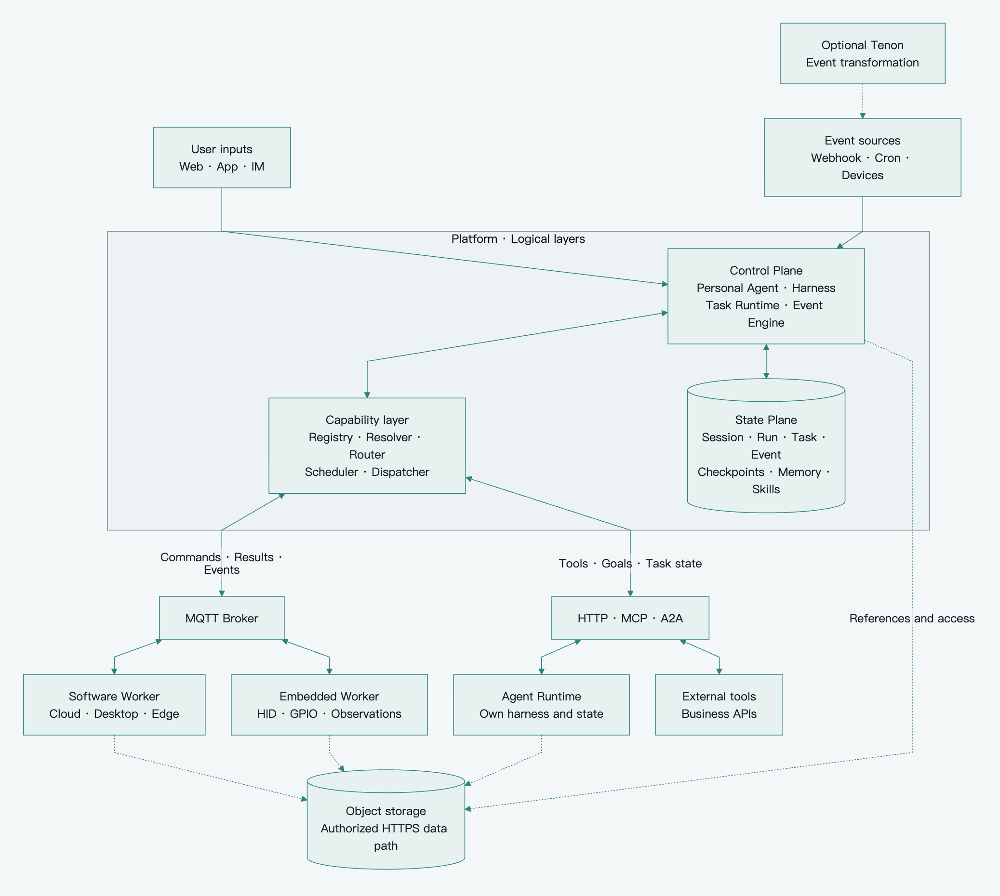
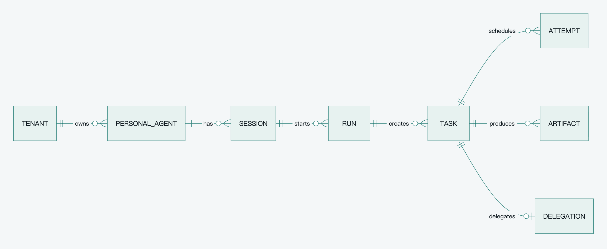
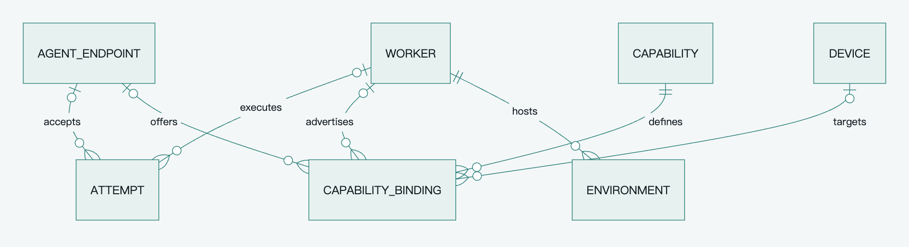
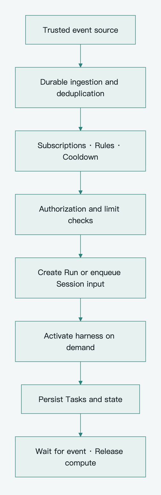

[简体中文](../zh-CN/platform-architecture.md) · **English**

# Pamiya platform architecture and domain model

The platform combines ingress and event activation, Control Plane, State Plane, capability discovery/routing, transports, and Execution Network. A Personal Agent retains responsibilities over time, harnesses run on demand, and the capability network executes tools or delegated Agent goals.

Navigation: [Index](README.md) · [Patterns](architecture-patterns.md) · [Protocol](capabilities-and-protocol.md)

## System architecture

[View SVG](../../assets/diagrams/readable-overview.en.svg) · [Layout source](../../scripts/render_readable_architecture.py)

Control reads State directly. MQTT handles Worker control and reporting; tool/Agent adapters use their provider interfaces. Authorized HTTPS carries files for every execution type. The overview shows the target topology; execution types enter in roadmap stages, with single-active coordination and fixed device ownership as the initial baseline.

### Detailed module view

[View SVG](../../assets/diagrams/platform-overview.en.svg) · [Editable Mermaid](../../assets/diagrams/platform-overview.en.mmd)

These are logical modules, not mandatory services. State Plane and Broker are peers: Control accesses durable state directly, while the Broker carries executor messages. The HTTPS data path is shared by execution types. The baseline verifies uploads and records references; a separate finalize pipeline is not mandatory. See the [execution sequence](reliability.md#complete-execution-sequence).

## Module responsibilities

| Module | Owns or handles | Boundary |
|---|---|---|
| Gateway | Ingress protocols, user identity, tenant and Session routing | No process-local long-task truth |
| Personal Agent Manager | Goals, responsibilities, Session relationships, activation configuration | Does not manage MQTT connections directly |
| Harness Adapter | Context, model/tool loop, tool translation, checkpoints | Not Broker- or device-specific execution |
| Event Engine | Validation, deduplication, rules, trigger records and Run creation | No model call for every telemetry sample |
| Task Runtime | Task states, approvals, cancellation, result ingestion and recovery | Arrival alone is not business success |
| Registry and Resolver | Metadata, resource ownership, authorized discovery | A declaration is not an authorization |
| Scheduler | Capability match, capacity, affinity and Attempt ownership | Broker subscriptions are not a scheduler |
| Dispatcher and Router | Recoverable publishing, protocol binding, correlation | Not a replacement for commits or business ACKs |
| State Plane | Platform facts, Tasks, checkpoints, artifact references | Does not own all third-party internal state |
| Worker | Acceptance, local tools, progress and result retransmission | No global cross-tenant scheduling authority |
| Remote Agent Runtime | Delegated goals, own loop and internal state | Reports queryable task state and artifacts |
| Tenon | Optional transformation, aggregation and source integration | Does not replace Harness, Scheduler or database |

## Personal Agent and harness

A Personal Agent is a long-lived delegation subject associated with identity, goals, rules, policy and memory. A harness is the engine for a particular progression: load context, call the model, issue tool Tasks, suspend or finish.

One Agent can have several Sessions and Runs. Release the harness after a Run while preserving responsibilities and future triggers. A supported migration moves context, pending work, approvals, artifacts and effect records. Vendor-session portability is constrained by [harness compatibility](architecture-patterns.md#harness-compatibility).

## Core objects and relationships

These are baseline domain relationships, not one table or service per concept. Capability definitions, trigger state, approvals and checkpoints may be structured fields in existing records.

[View SVG](../../assets/diagrams/domain-model.en.svg) · [Editable Mermaid](../../assets/diagrams/domain-model.en.mmd)

The model is shown as work and execution views for readability. ATTEMPT is the same entity in both figures.

[View SVG](../../assets/diagrams/execution-model.en.svg) · [Editable Mermaid](../../assets/diagrams/execution-model.en.mmd)

| Object | Meaning | Suggested fields |
|---|---|---|
| PersonalAgent | Long-term goals and responsibilities | tenant_id, owner_id, policy_ref, harness_config, memory_scope |
| Session | Continuous interaction/context boundary | agent_id, version, current Run, pending messages |
| Run | One goal progression or event activation | session_id, trigger_event_id, status, limits, checkpoint, completion_evidence |
| Task | One tool intent or delegated goal | run_id, tool_call_id, kind, capability_version, binding_id, args or payload_ref, action_id, approval, deadlines |
| Attempt | One execution assignment | task_id, attempt_no, worker_id or agent_endpoint_id, environment_id, status, start/end times |
| Worker | Execution capability node | identity, tenant_id, protocol_version, recovery_profile, capacity, boot_id, connection_id, heartbeat_at |
| AgentEndpoint | A remote endpoint with delegation semantics | tenant_id, adapter, endpoint_ref, agent_card_ref, auth_scope, supported_operations |
| Environment | Workspace, browser session, or device operating context | worker_id, owner_scope, type, status, generation, snapshot_ref |
| Device | Physical phone, controller or camera | owner, device_id, model, firmware, association, revocation_state |
| Capability | Definition and input/output contract | name, version, description, input_schema, output_schema, execution_mode |
| CapabilityBinding | Provider-specific implementation | worker_id or agent_endpoint_id, capability_version, device_id, environment_constraints, readiness |
| Event | Deduplicable fact | event_id, source, occurred_at, received_at, processing state; optional source_event_id/source_epoch |
| Event trigger record | One rule's handling, possibly embedded in Event | event_key, rule_id, run_id, disposition |
| Artifact | Durable input/output reference | tenant_id, object_key, digest, size, media_type, retention; object_version where supported |
| Delegation | Local/remote task correspondence | task_id, delegation_id, remote_task_id, remote_context_id, adapter, remote_state, cursor, cancel_state |

Use association tables when multiple devices/providers actually require them. Tool Bindings and Attempts point to a Worker; Delegation points to an AgentEndpoint, with mutually exclusive provider references. A third-party Agent need not have a MQTT boot_id or Worker heartbeat. Devices have fixed owners in the baseline; Environment records the occupying Task. Device and Environment retain different meanings even with shared storage. Tenant scope belongs in relationships, uniqueness and queries.

A task_id identifies intent, attempt_no an execution round, and action_id an effect unit. Retrying the same effect preserves action_id; an intentional repeat receives new IDs. Composite tools may use stable child action_ids for independently reconcilable effects. Delegation uses delegation_id for remote creation, not one action_id for every action inside an Agent.

A Task represents the upper-level tool intent or delegated goal. Mouse calibration, sampling, key scan codes and network fragments inside a Worker are not separate Tasks. Split effect records only where independent retry or reconciliation needs them; recoverable tools do not need a generic multi-step journal first.

### Persistence constraints

Enforce uniqueness for `(tenant_id, run_id, tool_call_id)`, `(tenant_id, task_id, attempt_no)`, source/event identity, and delegation_id to remote-task mapping. A tool-call ID is stable and unique within its Run. Preserve correlations and checkpoints in Task, Run and event records without a separate RuntimeStep subsystem. Update current_attempt and versions conditionally.

Relationships must check tenant_id together with object identity. Separate foreign keys for tenant and object do not prevent accidental cross-tenant links. Use composite constraints or an equivalent database guarantee and explicit null semantics for non-device Bindings. [PostgreSQL Constraints](https://www.postgresql.org/docs/current/ddl-constraints.html)

Store approval digest, scope, state and expiry on Task; registry metadata may share a table; model replies belong in Run events/checkpoints. Split tables when history, concurrency or rules justify it.

Multi-active loops add Session ownership/leases; automatic resource takeover adds resource fencing; offline authority adds signed grants; strict parallel spending adds BudgetReservation. None is a mandatory field on every baseline Task.

## Run states and goal completion

Runs distinguish running, waiting, cancellation and terminal outcomes. WAITING_TASKS, WAITING_INPUT, WAITING_APPROVAL and RECONCILING are used by implemented flows rather than building every future transition in advance. Persist checkpoints and release compute while waiting; never hold a long database transaction.

A successful tool Task meets its own contract. A Run succeeds with goal-completion evidence and no required Task or child Agent still able to produce unresolved effects. Explicitly detached work needs its own ownership. Failure/cancellation stops new descendants and tracks in-flight children; ending a parent must not silently leave autonomous work running.

Persist the model reply and stable tool correlation, then create Tasks and checkpoints under version protection. An unsaved reply may require another model request. Already registered intent is reused rather than producing another effect. The baseline uses a serial Session queue and releases execution resources while waiting.

## Worker, Environment, and Device

A cloud Worker may host several isolated browser Environments. Consecutive Shell commands share one workspace and must not randomly move between nodes unless that environment is restored or portable.

A desktop exposes files, browsers and UI within its user's authorized context. An ESP32 may control a bound phone; the phone is a Device and calibration/operating context is an Environment. MQTT connectivity does not imply HID or camera readiness.

Environment lifecycle covers creation, readiness, occupancy, invalidation, recovery and destruction. Migration must address files, login state, calibration and pending effects. Reusing a Worker ID does not prove the Environment generation stayed unchanged.

Pin binding_id, Worker and Environment where affinity requires it. For interchangeable work, select another implementation of the same capability contract and constraints. Discovery candidates do not replace a durable assignment.

## Tool execution and Agent delegation

| Dimension | Tool Execution | Agent Delegation |
|---|---|---|
| Input | Concrete click, capture or file operation | A development or research goal |
| Next-action authority | Parent harness | Child harness |
| Task state | Platform Task/Attempt | Platform mapping of remote task |
| Internal state | Platform or corresponding harness | May belong to remote Runtime |
| Platform tracks | Inputs, assignment, output, effects | Goal, remote IDs, scope, limits, progress, artifacts |
| Recovery | Query, result retransmission, environment recovery, safe retry | Query and resume tracking by remote identity |

The platform need not copy a child's reasoning context or workspace. The Adapter supplies create, query, additional input, cancel and tracking recovery; unsupported operations are explicit limitations.

Child authority cannot exceed the parent scope. Limit depth, concurrency, duration, calls and provider spending where available; record usage. Atomic shared-budget reservations are needed only for strict parallel caps. A provider without a hard cap cannot justify a no-overrun promise.

## Event-driven always-on activation

[View SVG](../../assets/diagrams/event-activation.en.svg) · [Editable Mermaid](../../assets/diagrams/event-activation.en.mmd)

Sources include MQTT, user messages, Webhooks, schedules and timers. Atomically record trigger handling and Run creation. Telemetry may be sampled under its declared loss policy; important facts use a replayable source or [EVENT_ACK](capabilities-and-protocol.md#event-ingress-and-reliable-activation).

Store occurred_at and received_at; stale observations must not trigger current device actions. Begin with simple event matching and schedule occurrence deduplication. Choose skip or coalesce for missed ticks. Windows, historical replay and rule-version migration follow actual requirements.

An event is input, not new authority. Automatic activation respects current ownership, permission, applicable approvals and limits.

## Memory, Skills, and recovery state

Memory stores reusable knowledge; Session records interaction facts; Task records intent and progress. Persist authoritative Memory content and provenance. Its index/cache may be rebuilt; irreplaceable memory and effect records cannot be replaced by an index rebuild.

Skills are versioned definitions/resources. Runs pin the used version so updates do not change unfinished intent. Harness-specific resume data remains behind the Adapter; platform Tasks are not tied to one vendor's format.

Skills, retrieved Memory, tool output and observations can contain untrusted content and cannot grant authority. Coordinate deletion, authorization and references. Approved inputs need fixed content or a verified digest, not a mutable object silently replaced after approval.

## Execution isolation and credential boundaries

Authentication establishes the reporting node, not result correctness. Ordinary queries and recoverable work use tool results. Important external publication, irreversible business effects and physical actions add verification appropriate to impact. Tool output remains external data, not authorization.

Generated untrusted cloud code uses filesystem, process, network and resource isolation. Platform-management credentials, command-publishing authority and other tenants' secrets stay outside that sandbox. A Worker host/proxy grants minimal tool access. Different working directories alone are not isolation.

Desktops and enterprise Edge use their authorized workspace/network boundaries. Embedded firmware usually uses fixed instructions, identities and local guards rather than containers. Shared Worker modeling does not imply equal isolation guarantees for Shell, desktop and HID execution.
