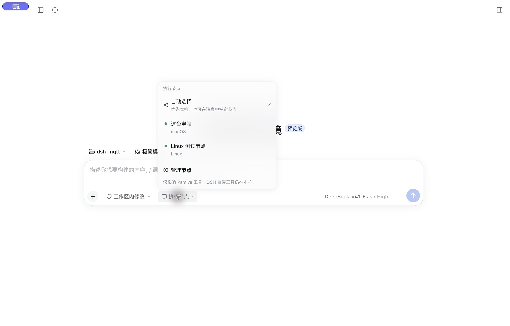
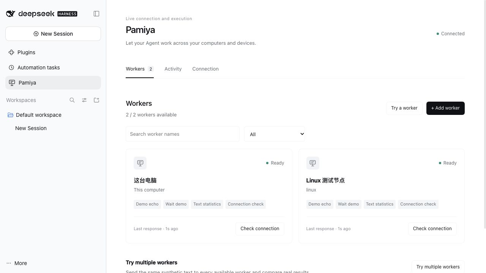

# Getting started with Pamiya

[简体中文](../zh-CN/quickstart.md) · [Ask DSH to install](install-with-dsh.md) · [Full usage guide](dsh-plugin.md)

Pamiya lets DSH work across your computers. Keep using DSH’s conversations, models and account. This computer becomes the first Worker automatically.

## Before you start

Install and open [DeepSeek Harness](https://www.deepseek.com/harness/). Verified Hosts are Desktop `0.2.0-rc.2` and Web `0.2.1-alpha.4`. **Desktop UI installation needs no Git, source checkout or separate Node.js installation.** Only standalone Workers on other computers require Node.js 22.19 or newer.

The current release is the `v0.2.0` preview on [GitHub Releases](https://github.com/UllrAI/pamiya/releases/tag/v0.2.0). It is not published to npm; use the complete installation URL below.

## 1. Install the plugin

1. Open **Plugins → Add plugin** in DSH’s sidebar. Some versions label this **Install third-party plugin**.
2. Paste this complete URL into the package/installation field and select **Install**:

```text
https://github.com/UllrAI/pamiya/releases/download/v0.2.0/pamiya-dsh-plugin-0.2.0.tgz
```

3. Select **Enable now** when installation finishes. If DSH requests a restart, fully quit and reopen it; closing a window may leave the application running.
4. **Pamiya** appears in the sidebar once its UI loads.

Prefer the Agent to handle this? Give it the [installation task document](install-with-dsh.md).

## 2. Use this computer

1. Open **Pamiya → Workers**. This computer joins automatically without configuring MQTT or adding it again.
2. Wait for **Ready**, select **Check connection**, and view the real result in **Activity**.
3. Worker details show DSH, Codex, Claude Code and Pi under **Agent capabilities**. Install missing agents, then run a synthetic test.

The local worker uses a DSH-managed local channel. Share DSH model/authentication by default, or select independent agent settings; see [Agents and custom actions](agent-workers.md).

## 3. Give your Agent its first task

Send this in a DSH conversation:

> Use Pamiya to list ready workers, check the connection on this computer, and count the text Hello Pamiya. Report the actual results.

Expect the local operating system and Node.js version, plus **12 characters, 1 line and 2 words**. Conversations require DSH’s model login/configuration; Pamiya does not add a separate model account.

## Choose a computer in a conversation

The **Execution worker** selector in the composer’s bottom toolbar lists this computer and connected workers. No IDs to memorize.

- **Automatic**: say “Use Pamiya to check the system on Linux test worker.” Without a named target, prefer this computer, then an available worker supporting the action.
- **Pin a worker**: select the Linux worker, then say “Check the selected computer’s system information.” Each conversation remembers its own selection. Switch to Auto before comparing multiple computers.
- **Manage workers**: opens configuration to add, rename, pause workers or change this computer’s capabilities.

Changes affect future tasks. Offline, busy or unsupported targets report an error without switching computers. Removed targets remain visibly selected until you choose again.

**The selector controls only Pamiya tools.** Native DSH bash, file and browser tools still run on the DSH host; the Agent itself has not moved. The public test connection only supports demos and system checks. Selecting Linux does not enable commands such as `ping`: use a private MQTT connection and enable shell execution on that Worker first.



## 4. Optional: connect another computer

1. First open **Connection → RunMQTT public test connection → Load current test parameters → Save and connect**. Then choose **Add worker → Another computer or server**, name it and create pairing.
2. Install [Node.js 22.19 or newer](https://nodejs.org/en/download) on that computer and put the downloaded Worker in its Downloads folder.
3. Choose its operating system in Pamiya, copy the start command and run it in the terminal **on that other computer**. If clipboard access fails, select **Show command for manual copy**.
4. Wait for the second Worker to become **Ready**, then select **Try multiple workers**.

Public connections support fixed synthetic agent tests, echo, wait, text statistics and system checks. Use a private connection for real remote jobs. Local capabilities are independent of public MQTT settings.

Do not install another Worker for this computer. Pair each remote computer separately and share its code only with that computer. Closing the terminal or sleeping the computer can take it offline. Long-running servers can use a process manager as described in the [usage guide](dsh-plugin.md).



## Troubleshooting

| Situation | What to do |
|---|---|
| No Pamiya sidebar entry | Enable the plugin, then fully quit and reopen DSH. |
| Installation URL cannot download | Download the `.tgz` from Releases and enter its absolute local path in the same installation field. An npm mirror cannot fix an unreachable GitHub download host. |
| DSH version incompatibility | Use a compatible Host version. This guide does not require a compatibility exemption. |
| Public connection fails | Reload current test parameters and save again. Credentials can rotate and the public service can be temporarily unavailable. |
| Local Worker is stopped | Open its details and select Start local worker. A deliberately stopped Worker does not restart automatically. |
| Remote Worker keeps waiting | Check the command is running on the intended computer, its Node.js version is supported and pairing has not expired. Reissue expired pairing in worker details. |
| Conversation has no model | Complete DSH model login/configuration first. The worker UI tests do not require a model. |

Full Desktop acceptance used macOS with a Linux remote Worker. Windows process behavior remains unverified on physical hardware; see the [verification record](dsh-verification.md).

## Updates and disabling

New releases provide a new installation URL. Use DSH’s plugin manager; when it requires removing the installed package first, remove the package and install the new URL without deleting the DSH data directory. Disable Pamiya under **Plugins** to stop its managed local Worker. Stop remote Workers on their own computers.

Source and CLI installation are in the [full guide](dsh-plugin.md). For a Web profile, use `dsh plugin --profile web add <installation-URL-above>` and enable the plugin.
