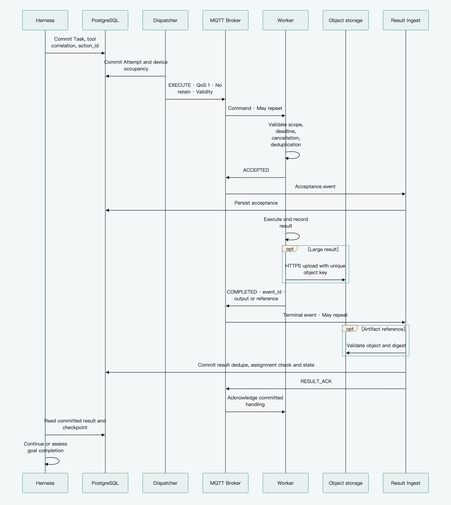
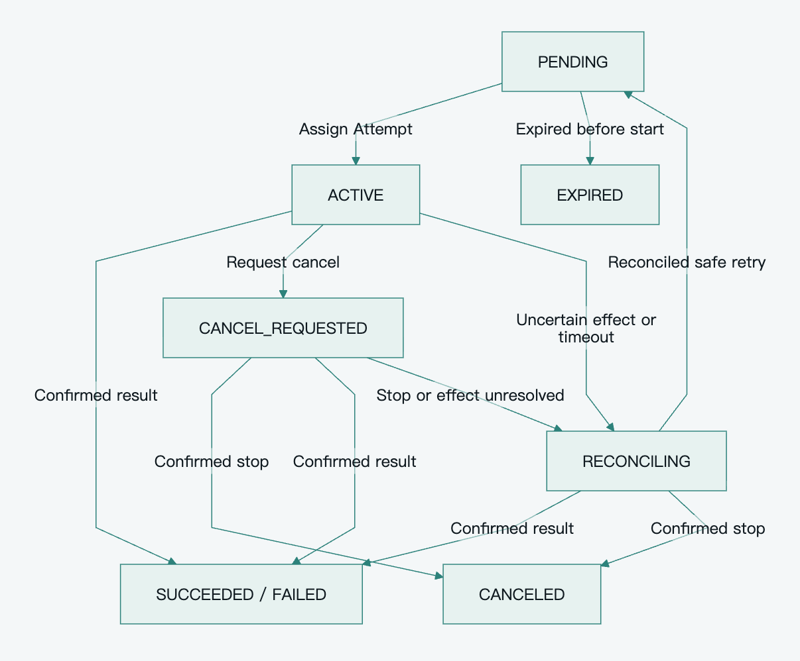

[简体中文](../zh-CN/reliability.md) · **English**

# Pamiya reliable execution and recovery

Reliability comes from durable intent, explicit ownership, business acknowledgement and operation-specific retries. Start with [one active coordinator and fixed device ownership](architecture-patterns.md#initial-implementation-baseline), not simultaneous multi-active takeover, offline authority and automated disaster recovery. Delivery is at least once; arbitrary external effects are not guaranteed exactly once.

Navigation: [Index](README.md) · [Protocol](capabilities-and-protocol.md) · [Roadmap](technology-and-roadmap.md)

## Baseline guarantees

1. Commit Task intent before publishing; rediscover unfinished work after a crash.
2. Retransmitting an Attempt does not execute it again. Reconcile uncertain important effects first.
3. Send RESULT_ACK only after result persistence; protocol ACK is not completion.
4. Serialize a Session and stateful device; old results cannot overwrite a new Attempt.
5. After Worker records cancellation, old execution for that Task is refused. A cancel request is not proof of stopping.
6. Distinguish tool completion, goal completion, uncertain effects and communication timeout.

These are business-correctness requirements. Existing tables, conditional updates and local execution records can implement them without a service for each concept.

## Durable intent drives execution

Persist Task, stable tool_call_id, input, action_id, target and deadlines before dispatch. Assignment records Attempt, Worker, Environment and occupancy, checks current authority/cancellation, commits, then publishes. Never hold database row locks while waiting for the network.

One baseline Dispatcher claims through conditional updates. Add FOR UPDATE SKIP LOCKED when several consumers scan concurrently; it reduces contention on queue-like tables but is not a complete business queue. [PostgreSQL SELECT](https://www.postgresql.org/docs/current/sql-select.html)

Persist delivery state, next retry, count and error. Scan after publishing failure or crash. Resend with unchanged task_id, attempt_no and action_id. Missing PUBACK/ACCEPTED does not justify a second effect: retry the same intent or query the node.

Outbox fits business transactions that publish domain events to several systems, not a redundant second recovery path for Task delivery already covered by scanning. Bound message size, concurrency, retries and runtime; stop permanent errors with a recorded reason. Fair queues, priority classes and dead-letter replay follow actual backlog needs.

## Complete execution sequence

[View SVG](../../assets/diagrams/execution-sequence.en.svg) · [Editable Mermaid](../../assets/diagrams/execution-sequence.en.mmd)

Wakeup notifications are optimizations; durable checkpoints/scanning recover missed notifications. If upload succeeded before database commit, verify and associate the existing object. If upload failed, retransmit the file rather than rerunning the effect.

## Business acknowledgement and execution records

One Worker Task record holds acceptance, result and canceled state. Duplicate Attempts return current state or the same terminal event_id. Reject inconsistent content. Persist intent before important effects; read-only work may use a light cache. A volatile device reports uncertainty after power loss rather than promising a complete durable ledger.

Control atomically commits inbox identity, result fact and Task transition before RESULT_ACK. Lost ACKs produce a duplicate that can be confirmed again. event_id deduplicates messages; current_attempt/version isolates execution rounds. Neither substitutes for the other.

Late results retain reconciliation value. They can resolve a RECONCILING Task, but cannot directly overwrite a later execution. Record conflicts and errors in queryable storage; no separate quarantine service is needed initially.

Small execution, deduplication and cancellation records survive the command-expiry, offline-reporting and retry window. ACK releases large retransmission buffers, not immediate deduplication state. Begin with one retention policy and add tiered archives for actual storage/audit requirements.

## Task and Attempt states

Task is intent; Attempt is assignment. Keep distinct identity/semantics even if storage shares an implementation. Waiting for input belongs to an implemented child-Agent flow, approval to a policy that needs it; do not build future workflows merely to populate an enum.

| Task state | Meaning |
|---|---|
| PENDING | Stored, waiting for assignment |
| WAITING_APPROVAL | Parameters/resource scope need approval |
| WAITING_INPUT | An existing delegated task needs information |
| ACTIVE | Assigned or executing |
| RECONCILING | Effects need reconciliation |
| CANCEL_REQUESTED | Cancellation recorded; stopping unresolved |
| SUCCEEDED | Capability contract succeeded and result persisted |
| FAILED | Known failure with no further retry |
| CANCELED | Not started or confirmed stopped; existing effects remain recorded |
| EXPIRED | Start validity elapsed and no start is confirmed |

Attempt records ASSIGNED, ACCEPTED, RUNNING, COMPLETED, FAILED, REJECTED, LOST or CANCELED. LOST is communication/ownership uncertainty, not proof of failure. effect_status records not_started, confirmed, partial or unknown independently; failed work may have partial effects.

[View SVG](../../assets/diagrams/task-lifecycle.en.svg) · [Editable Mermaid](../../assets/diagrams/task-lifecycle.en.mmd)

The figure shows core execution and reconciliation paths. The state table and following text define input, approval, and individual terminal-state rules.

Use version-guarded transitions. Late RUNNING cannot revive a terminal Task; execution timeout cannot be labeled an unstarted EXPIRED. Before assignment, approval returns to PENDING; after remote creation, it resumes the existing Delegation. Rejection of an existing task first requests stopping.

A return to PENDING requires current authority, no cancellation, remaining retries and a safe retry class. Unknown does not inherently require a human: new observations, queries or safe retries may resolve it automatically. Human reconciliation is for important effects that cannot otherwise be established.

## Operation-specific retries

| Class | Examples | Baseline behavior |
|---|---|---|
| Read-only | Query, capture, file read | Automatic retry within validity |
| Recoverable | UI navigation/scroll, workspace creation/editing | Observe and continue/redo without per-step approval |
| Target state or external idempotency | Set explicit configuration, idempotent API | Preserve action_id and retry/converge while conditions hold |
| Important one-shot effect | External send, important deletion, payment or physical action | Query/observe first; no blind replay if unresolved |

Capability, parameters and context define risk. Navigation clicks and a Send button do not share an approval rule. Re-capturing a frame and rotating a motor by a relative amount do not share a retry rule.

Pause only potentially conflicting Device/Environment work. Other devices, independent Runs and read-only abilities continue. Physical controls use local timing/stopping constraints, not a central model's real-time loop.

## Serial Sessions and devices

One active controller processes each Session serially with durable pending messages, checkpoints and Tasks. Checkpoint and release the harness while waiting for tools, input or approval. Stable tool_call_id/uniqueness prevents rebuilding intent; Session/Run versions protect checkpoint writes.

Devices have fixed execution owners. Control records occupancy, Worker applies capacity and a serial local queue. Stateful Shell/browser/phone work preserves Environment affinity. Read-only or reconstructible environments may switch nodes; LWT/loss of connection does not transfer uncertain important effects automatically.

Add Session leases/Actor ownership for simultaneous harness instances, resource fencing for automatic cross-node takeover. A process queue does not solve multi-instance ownership, but a single-active baseline does not need a takeover protocol first.

## Approval and cancellation

Execute authorized reading, navigation, document creation and recoverable workspace edits directly. External publication, important deletion and impactful physical action must have appropriate authority; explicit authorization for the concrete action already satisfies it. Request approval only for insufficient scope or an additional policy requirement. Bind approval to Task/parameters/resources and recheck material changes rather than signing or querying authorization for every call.

Control persists CANCEL_REQUESTED, stops new EXECUTE, then sends CANCEL. Unassigned work can cancel immediately; absent ACCEPTED for published work does not prove it never began. Worker stores canceled on Task, including cancellation received before execution. Once recorded, late EXECUTE is refused. Repeat intent uses a new Task, so neither cancel_generation nor a tombstone subsystem is needed.

Report cancellation registration separately from actual stop. In-flight one-shot actions can still occur: baseline cancellation is observable best effort. Strict immediate revocation requires an additional pre-execution authority check or resource-control contract. Unknown effects constrain the relevant resource, not all user work.

A child awaiting input/authority keeps remote_task_id. Parent cancellation stops new descendants and tracks in-flight work; an uncancelable Runtime declares that limitation. Ordinary screen drift is handled through fresh observation; pause when the target is unclear and a mistaken action has significant impact.

## Conditional enhancements

| Trigger | Add | Baseline alternative |
|---|---|---|
| Several controllers take over a Session | Session Lease and stale-owner write isolation | Single active control, versions |
| Different Workers take over a Device/shared Environment | ResourceLease, resource_fence, shared enforcement point | Fixed ownership, occupancy, no uncertain conflicting takeover |
| Long tasks need renewable/revocable authority | Explicit renewal and lease_revision | Start deadline, local max_runtime_ms |
| Offline autonomy or cross-organization transport distrust | Signed ExecutionGrant and revocation window | TLS, ACL, fixed capability scope |
| Strict parallel spending or usage billing | BudgetReservation and idempotent settlement | Iteration/time/child/concurrency limits and usage records |
| Automated disaster recovery or surviving stale controllers | control_epoch, automatic ledger reconciliation and isolation | Stop dispatch, reconcile manually before restart |

Resource fences increase in resource scope and are checked at the real write endpoint; an Attempt number is not a resource fence. An expired lease does not prove stopping. These mechanisms need their triggering requirements rather than default short-task overhead.

## Data recovery and completion

Stop dispatch before restoring an older database, confirm old Control is stopped, reconcile Worker records/business effects, and isolate stale commands before resuming. Never immediately replay an old PENDING queue. Begin with an operational procedure, not an automated disaster-recovery system.

Bound Run iterations, time, descendant count and concurrency and record usage. A provider without enforced caps cannot support a no-overrun promise. Release compute while waiting, and judge completion against the goal and required Tasks. Report unresolved effects clearly while allowing unrelated goals to continue.

## Failure acceptance matrix

| Baseline injection | Required observation |
|---|---|
| Crash after Task commit, before publish | Scanner rediscovers work |
| Lost command ACK or duplicate delivery | Same Attempt returns stored state; no repeated registered effect |
| Power loss between effect and result record | Important effect is unknown and reconciled; reads may retry |
| Crash after result commit, before RESULT_ACK | Result retransmission is deduplicated and acknowledged |
| Old Attempt or late progress | No overwrite of current ownership/terminal state |
| Old LWT after same-process reconnect | Current connection_id and business heartbeat govern presence |
| EXECUTE after registered CANCEL | Refuse old execution; distinguish request from stopping |
| Two Tasks target the same device | Occupancy plus local serialization prevents conflicts |
| Upload completes before result commit | Reverify/reassociate without rerunning the tool |
| Duplicate durable event or trigger-creation crash | Durable fact deduplication and atomic Run mapping recover it |
| Unauthorized source or out-of-scope parameters | Reject without advancing work |
| Ordinary UI drift | Reobserve automatically; pause unclear important submissions |
| Restore an older database | Suspend and reconcile before dispatch resumes |

Add conditional fault tests only for implemented features: stale-owner isolation for multi-active takeover, cross-Task fence scope, renewal version ordering, signed-authority validity/revocation, and atomic spending reservations. They are not baseline gates while those capabilities are absent.

Initially record delivery/execution time, failure/duplicate counts, pending ACKs, uncertain important effects and Run usage. Percentile SLOs, fairness, long-term audit indexes and comprehensive tracing follow operations needs.
