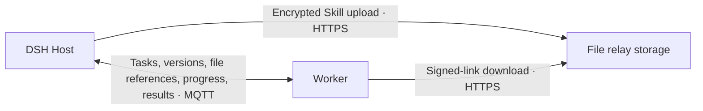

# Prepare Skills on demand

[简体中文](../zh-CN/skills.md) · [Quickstart](quickstart.md) · [Agents and workers](agent-workers.md)

Pamiya brings selected Skills, scripts and resources to the execution worker, checks declared dependencies, then makes them available to DSH, Codex, Claude Code or Pi. Users do not need to copy their entire Skills directory onto every computer.

## First experience

1. Open **Pamiya → Workers → Skills** and choose an Agent.
2. Select **Run synthetic sample**. On first use, files transfer and the missing sample dependency produces “Needs preparation; the agent has not started.”
3. Choose **Prepare and continue**. The Worker installs the bundled dependency in an isolated directory and continues the same task. The Agent reads the Skill and resource, then executes its script.
4. The returned JSON contains `proof: PAMIYA_SKILL_OK:48656c6c6f2050616d697961`. Activity retains the worker, versions, checks and execution progress.

A cached, prepared worker runs directly. The sample uses fixed `Hello Pamiya` test resources, without personal files or external service credentials. Public connections allow only this fixed Skill.

## Use your own Skill

The library reads file-backed Skills visible to DSH. To add another, expand **Add from a local folder** and enter its folder or `SKILL.md` path. Select the Skills you need, then choose **Check selected Skills** or **Prepare selected Skills**.

- Checking transfers files and checks the environment; it neither installs dependencies nor changes the default selection.
- Successful preparation sets the default selection for that worker and Agent. A conversation can provide a different list; `[]` means no managed Skills for this task.
- Missing installable Node/Python packages can be prepared automatically. Missing system commands, environment variables or platform/Agent compatibility are shown explicitly; resolve them on the worker, then continue.
- Select up to 8 Skills per task. Each Skill supports up to 64 MB of raw files and 5,000 files. Use file references or dedicated data storage for large datasets, videos and models rather than repeatedly including them in capability bundles.

A standard Skill needs YAML frontmatter with `name` and `description`, and may include `scripts/`, `references/`, `assets/` and other directories. Executable bits are preserved. Generated/environment directories such as `.git`, `node_modules`, `.venv` and `.env` are excluded, as are links outside the Skill directory.

## Trigger it in conversation

For example:

> List Skills for the Linux test worker and run the built-in Skill sample using DSH. Tell me first if dependencies are missing.

After receiving “Needs preparation”:

> Prepare and continue that task.

Use `pamiya_workers` to identify the target. `pamiya_skills` with `list` returns opaque Skill IDs; `operation=import, path=...` imports a local folder. For real work, call `pamiya_delegate` with the worker, goal and selected IDs. Public connections require `synthetic=true` and execute only the fixed sample.

```json
{
  "operation": "check",
  "workerId": "worker-uuid-from-pamiya_workers",
  "agent": "dsh",
  "skills": ["sample:pamiya-skill-check"]
}
```

These are `pamiya_skills` arguments. Continue preparation with `pamiya_task`:

```json
{
  "operation": "prepare",
  "taskId": "task-uuid-from-the-previous-result"
}
```

This retains the original task, worker and version. Preparation status and completion each return a callback to the originating conversation. An unavailable worker is not silently replaced, and uncertain Agent tasks are not replayed.

## File transfer across networks



Both ends need outbound connections only. They do not need mutual reachability, SSH, port forwarding or a new listening port.

- Local workers read the Host’s pinned snapshot directly, without MQTT or object storage.
- Remote Skill content downloads over HTTPS. MQTT `files` control messages carry small references, never Skill bodies.
- Personal remote Skills use S3-compatible storage. The Host encrypts each bundle with the existing worker key; the Worker decrypts and verifies its content hash. Workers receive no storage Access Key. Download links expire after 15 minutes; references can be requested again.
- The public sample downloads from an HTTPS URL pinned to a public commit, containing synthetic resources only. This does not establish that a private bucket has been deployed or verified.
- Content-version caching avoids repeated reference requests and downloads. Interrupted transfers do not start an Agent; retry downloads the file again. Multipart range resumption is not implemented.

**Configure once on the Host: Pamiya → Connection → File transfer → Configure file storage.** Enter the HTTPS endpoint, existing Bucket, Region, Access Key ID and Secret Access Key, choose the addressing style, then select **Test and save**. The bucket must already exist. The account needs read/write access under `pamiya/`, and deletion permission to clean up temporary connectivity-check objects. Credentials stay in the DSH credential service; the Secret is never returned to the interface.

Saving actually uploads and downloads a synthetic check object. The worker’s network must also reach the signed-link domain. Configure lifecycle cleanup for `pamiya/` objects. Workers need no separate storage accounts. Missing configuration produces a clear error; there is no MQTT file fallback.

This is the Skills file channel. The existing model channel still uses encrypted MQTT frames. Existing small file/artifact read APIs have strict size limits and are not a large-file transfer solution.

## Declare dependencies

The Agent Skills `compatibility` field is human/Agent-readable guidance, not a dependency lock. Add an optional `pamiya.json` at the Skill root to declare requirements Pamiya can check:

```json
{
  "version": 1,
  "agents": ["dsh", "codex", "claude", "pi"],
  "platforms": ["darwin", "linux"],
  "requires": {
    "commands": ["node", "python3"],
    "env": ["EXAMPLE_SERVICE_TOKEN"],
    "node": [{"name": "example-helper", "version": "^1.0.0"}],
    "python": ["example-parser>=1,<2"]
  }
}
```

Package names illustrate the contract; they are not installation recommendations. A Node package may use `source` to reference a bundled directory, such as the sample’s `dependencies/helper`.

Preparation runs npm in a directory isolated by the selected version set, and creates a Python venv. Node CJS/ESM, dependency commands and Python scripts use that environment. It does not install globally or overwrite worker-owned Skills. Package installation may execute dependency lifecycle scripts; use Skills and dependencies you trust.

Checks follow explicit declarations. Without `pamiya.json`, complete content still transfers, but Pamiya does not claim to infer every dependency. `compatibility` notes remain visible for judgment. System software, credentials and undeclared requirements may still need user setup.

## Versions and sessions

Each delegation pins content hashes, including across preparation waits and process restarts. Source changes produce an “Update available” indicator; new tasks obtain the new version. Existing Agent sessions retain their Skill set. Start a new session when changing capabilities rather than replacing instructions mid-session.

Agents receive a file-path index and use native read/command tools to load the Skills. Full Skill text is not forced into every model round. MCP, plugins, login state, project files and personal credentials do not migrate automatically. Worker-owned native capabilities continue to follow the selected Agent’s rules.

[First-time S3 setup, permissions and troubleshooting](file-storage.md). Missing storage pauses the task for configuration; return and continue the original task after setup.

Omit `skills` when resuming a session. The Host retains that session’s previously pinned snapshots even if the source changed; new sessions resolve current content.
