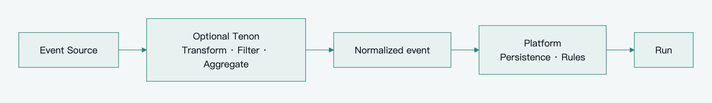

[简体中文](../zh-CN/technology-and-roadmap.md) · **English**

# Pamiya technology choices and delivery roadmap

Begin with a single-active modular Control application, PostgreSQL, object storage, MQTT Broker and lightweight Workers. Establish fixed ownership, recoverable Tasks and necessary authority first. Remote Agents, active takeover and event integration follow actual requirements. All baseline references use the [same assumptions](architecture-patterns.md#initial-implementation-baseline).

Navigation: [Index](README.md) · [Architecture](platform-architecture.md) · [Reliability](reliability.md)

## Technology choices and triggers

| Capability/component | Baseline | Enhancement trigger |
|---|---|---|
| PostgreSQL | Authoritative state, Task scanning, Inbox and trigger records | Measured throughput, latency and recovery needs |
| S3-compatible storage/R2 | Inputs, files and artifacts behind reference/permission interfaces | Select by region, cost and access constraints |
| Harness Adapter | Choose a loop that routes managed effects through Task Runtime | Delegate Runtimes whose built-in tools cannot be intercepted |
| Task Runtime/Scheduler | Necessary task states, explicit assignment and scanning | Consider workflow infrastructure for actual complex long flows |
| MQTT Broker | Evaluate BifroMQ behind MQTT 5 boundaries | Compare real connectivity, authentication, recovery and operations |
| Registry/Resolver | Database directory and authorized Bindings | Add cross-protocol indexes/semantics when needed |
| Event Engine | Basic ingestion, deterministic filters, deduplication, activation | Many source types or complex processing |
| Transactional Outbox | Task scanning handles Task dispatch first | One business transaction publishes several domain events |
| Dedicated durable queue | No second queue initially | Measured dispatch bottleneck or independent backlog management |
| A2A/MCP Adapter | Stabilize internal objects without forcing every endpoint to implement a standard | Pin and test real third-party integrations |
| Tenon | Optional second-stage PoC | Multiple sources, transformation pipelines or Edge integration |

Necessary capabilities do not imply one service each or a mandatory vendor.

## BifroMQ's role

BifroMQ is the preferred MQTT infrastructure candidate. It supports native multi-tenancy and MQTT 3.x/5.0; Pamiya still implements Tasks, discovery, approval and Agent Sessions. [Apache BifroMQ](https://github.com/apache/bifromq)

Configure production authentication/authorization. Official connection documentation says that without an AuthProvider, default behavior does not enforce them. A tenant prefix in username is not a trusted identity. Bind authentication, Worker credentials, Topic ACL and platform task authority. [BifroMQ connection/security](https://bifromq.apache.org/docs/user_guide/basic/connect/)

Test target connection counts, reconnect peaks, TLS/authentication cost, expiration, Broker restart, limits and cross-tenant rejection. Shared subscriptions/vendor extensions are local optimizations; the core contract does not depend on internal Broker storage.

## Tenon responsibilities and limits

Tenon is an Apache BifroMQ satellite project with a standalone Runner, Source/Sink plugins and Lua processing. Suitable plugins can connect systems independently of BifroMQ. Build targets are Linux/macOS on x86-64/AArch64, not ESP32 firmware. [Tenon project](https://github.com/apache/bifromq-tenon)



[View SVG](../../assets/diagrams/event-integration.en.svg) · [Editable Mermaid](../../assets/diagrams/event-integration.en.mmd)

Queues, Lua state and timers are volatile. Delivery completion depends on plugin acknowledgement/replay; Tenon does not provide a durable message log, distributed transactions or end-to-end exactly-once effects. It reduces event integration code, not Task Runtime or State Plane responsibility. [Tenon Documents/delivery](https://apache.googlesource.com/bifromq-tenon/+/HEAD/guide/tenon-document.md)

Lua can filter, debounce, aggregate windows and normalize data. State resets lose in-memory context. Keep important source facts durable/replayable or persist them before transformation; persistence only after Tenon output cannot recover earlier lost input. [Lua state/timers](https://apache.googlesource.com/bifromq-tenon/+/HEAD/guide/lua.md)

Management writes control executable workloads. Default management lacks request-level authorization; mTLS alone does not assign operation permissions, and plugins are not automatically placed in isolated containers/filesystems. Use trusted operator control and deployment isolation for mutually untrusted parties. [Tenon security model](https://apache.googlesource.com/bifromq-tenon/+/HEAD/SECURITY.md)

### Two integration locations

Cloud integration filters telemetry, normalizes fields/units and forwards cross-system events. Agent goals and recovery remain with Control/State.

Enterprise Edge integrates internal protocols and formats. Tenon and Worker may share a host but retain different credentials, responsibilities and acknowledgement paths.

### Tenon PoC acceptance

Use one explicit path: raw ESP32 event → transformation/filter → normalized Topic → platform persistence → Event Engine → Run. Configure durability and replay according to whether facts may be lost.

| Scenario | Evaluate |
|---|---|
| Runner/plugin restart | Lost state, upstream replay, platform deduplication |
| Source/Sink disconnect | Backpressure, bounded backlog and recovery |
| Lua update/failure | Window loss and correlation across updates |
| Duplicate/out-of-order input | Stable event/source/time semantics |
| Configuration/plugin access | No untrusted workload rewrites or cross-tenant secret access |
| Bypass Tenon | Core task dispatch, result ACK and recovery still work |

Adopt production traffic after the PoC, recording exact versions/commits. HEAD documentation is a lookup link; production dependencies and tested behavior must be pinned.

## ESP32 iPhone Worker integration

The existing project keeps planning, vision and control logic on a computer. UxPlay receives AirPlay; ESP32-S3 receives simple Wi-Fi commands and acts as USB HID. It demonstrates a computer controller plus embedded bridge, not a complete Agent on ESP32. [Original project](https://github.com/onehumanbeing/esp32-iphone-agent)

| Path | Change | Value and limit |
|---|---|---|
| Wrap the computer service | Add Worker or Delegation Adapter to Python service | Fast phone-task validation; host/AirPlay dependency |
| Lightweight MQTT firmware | Authentication, command/result contract | General embedded integration; reasoning stays above |
| Camera plus HID | Capture, upload, calibration and observation | Independent observation; hardware/firmware/quality need testing |

Wrap the service first to test task/ownership semantics. Then validate embedded resources, storage, power loss and recovery. Camera support is a separate milestone, not an assumed existing feature.

Target loop: capture → upload → vision reasoning → HID input → capture again → assess outcome. Pin the phone, Environment generation, calibration and observation freshness; serialize the device.

A camera reduces reliance on AirPlay but cannot see hidden lock-screen content or bypass unlocking. Power, USB/HID connection/wakeup, BLE and camera integration require tests on the target hardware/iOS environment.

Embedded requirements include device ownership, TLS/credentials, connection identity, readiness, acceptance/result deduplication, cancellation records, validity, revocation and local stopping. If storage cannot support durability, declare volatile and reconcile uncertain important effects after power loss. OTA adds signature/version checks and rollback as that feature is implemented; Session/Run truth stays centrally durable. Safety-critical local control is not delegated to a cloud model loop.

## Dot and Codex as a delegation example

OpenAI's public documentation describes Dot starting cloud work, using background Agents, and creating Work/Codex tasks on a connected computer. Cloud coding can use a configured Codex environment. [Dot tasks](https://learn.chatgpt.com/docs/dots#tasks-and-conversations)

This behavior can be mapped to Personal Agent → Delegation Adapter → professional Agent Runtime → Environment. The platform tracks goal/relationship/state/artifacts; the specialist owns its loop.

This is a product analogy, not a claim about OpenAI's internal MQTT use. Validate create, query, follow-up input, cancel, limits and tracking recovery against the actual integration API.

## Standards and interoperability

| Reference | Useful concepts | Adoption |
|---|---|---|
| MQTT 5.0 | Connectivity, QoS, sessions, expiry, Will, request correlation | Baseline remote transport |
| MCP | Tool descriptions, Schemas, discovery/calls | Harness-facing interface and Adapter |
| A2A | Agent Cards, goal tasks, states, artifacts | Delegation mapping |
| EMQX MQTT for AI | MQTT profiles for A2A/MCP | Validate compatibility; keep durable Tasks internal |
| Sparkplug | Topic/Birth/Death and device lifecycle | Reference; adapt industrial devices when needed |
| W3C WoT | Properties, Actions, Events, Thing Description | Conditional multi-vendor device semantics |
| Ditto/AsyncAPI | Twin modeling and message-interface description | Candidates, not assumed dependencies |

Sparkplug provides industrial Topic/payload/state contracts and WoT device descriptions. They do not replace Agent approval, delegation or durable execution. [Sparkplug](https://sparkplug.eclipse.org/specification/), [WoT TD 1.1](https://www.w3.org/TR/wot-thing-description11/)

MQTT 5 support does not automatically implement A2A/MCP. Validate bindings independently and isolate version changes from embedded firmware. [MQTT for AI](https://github.com/emqx/mqtt-for-ai)

## Delivery stages and acceptance

### Stage one: minimum reliable loop

Run one active Control application, PostgreSQL, object storage, Broker and a software Worker. Implement identity/ACL, Task/Attempt, Manifest, connection IDs, scanning, result acknowledgement, cancellation records and serial Sessions/devices. One execution record holds acceptance, cancellation and results; separate lease, signature and budget systems are unnecessary.

Support one event source or timer with Event processing state/run_id and atomic activation. Large artifacts use unique keys with native create-once/version or digest validation and result association, not a mandatory staging/finalize pipeline.

Accept when Tasks complete, processes restart with trackable work, duplicate registered effects do not recur, registered cancellation rejects old commands, devices serialize, pending results/artifacts/triggers recover, and uncertain important effects are not blindly repeated. Prepare a suspend-and-manually-reconcile backup recovery procedure; Epoch/automated disaster recovery is not a release gate. [Baseline failure tests](reliability.md#failure-acceptance-matrix)

### Stage two: heterogeneous execution and delegation

Add desktop or enterprise Edge for cross-network authority/affinity/backpressure. Integrate one Agent with remote_task_id tracking and expose authorized MCP tools where useful.

Start ESP32 with limited reconcilable abilities and test TLS, reconnect, power loss, buffers and revocation. Evaluate Tenon when real transformations are needed, outside core task confirmation.

Accept software/device/Agent coordination, continuation of the original task after input, and tracking after cancellation. Limit depth/count/duration/iterations/concurrency; add reservations only for strict shared spending. Declare third-party cancellation/hard-limit gaps.

### Stage three: measured scale

When multi-active Control or takeover is required, expand Harness/Scheduler/ingestion with Session ownership, resource-scoped fencing and corresponding failure tests. Renewable long-task authority triggers leases; automatic disaster recovery triggers Epoch. Ordinary API scaling is not bundled with every enhancement.

A measured database dispatch bottleneck justifies a durable queue. Cross-organization trust, offline autonomy or strong content review may justify signed grants, authority proxies, staging/finalize and richer policy.

Environment migration adds workspace snapshots, login-state handling and restoration. Actual device interoperability may justify WoT, twins or MQTT Profiles. Each change must solve a measured recovery, scale or integration need.

## Baseline deployment

```text
Platform Application
  Gateway / Personal Agent Manager / Harness Adapter
  Event Engine / Capability Registry / Resolver
  Task Runtime / Scheduler / Dispatcher / Result Ingest

PostgreSQL             Object Storage
MQTT Broker           Worker Runtime / SDK
```

Keep interfaces inside one application; Workers run separately on authorized devices. Local health and physical control do not wait on every central step. Database/object backup and restoration need operational validation beyond process restart.

## Parameters and decisions before implementation

| Area | Decide | Validate |
|---|---|---|
| Load | Tenants, connections, Task concurrency, event frequency, artifact size | Business samples and load tests |
| Recovery | Maximum uncertainty window, restoration time, acceptable event loss | Faults and restore procedure |
| MQTT lifecycle | Keep Alive, Session Expiry, Will Delay, packet limits | Disconnection/backlog tests |
| Trusted ingress | Tenant Control path, ClientID/ACL binding, bridge identity | Spoofing and cross-tenant tests |
| Time limits | Start/max runtime/query retry first; leases when takeover is enabled | Ability latency and impact |
| Authority | Scope, ownership, sensitive parameters, revocation | Rejection and cancellation races |
| Harness | Interception, checkpoints, migration boundary | Bypass, restart and replacement PoCs |
| Remote Agent | Version, create deduplication, query/input/cancel, limits, retention | Adapter contract tests |
| Embedded | Hardware/storage/TLS/clock/OTA/local safety | Power-loss, upgrade and resource tests |
| Retention | Execution/cancellation/event/artifact window | Stale commands, digests, cleanup and recovery |
| Disaster recovery | Manual suspension/reconciliation initially, Epoch for automation | No blind replay after restoration |

Test only enabled features. No cross-Worker takeover means no fencing gate; no offline grant means no revocation subsystem; no hard-spending promise means no billing-grade reservations. Preserve the target/triggers without paying all complexity up front. Derive production values from actual workload, not message examples.
