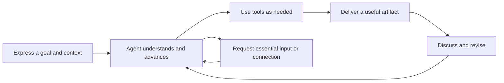

# Pamiya product and interaction design

[简体中文](../zh-CN/README.md) · [Repository](../../../README.md) · [Architecture](../../en/README.md)

**Design baseline 0.2 · 2026-10-15 · A modern personal Agent.** Pamiya is first a persistent Agent to work with: express a goal, provide context, let it use tools and advance the work, then receive and improve a useful result. Task tracking, execution nodes, and protocols support this experience.

These implementation-ready decisions start from the approved home-screen visual and cover requirements, domain/navigation, interactions, visual rules, and acceptance. They are design hypotheses, not validated user-research findings. Production requirements and the local prototype are explicitly distinguished.

| Document | Purpose |
|---|---|
| [Requirements and scope](requirements.md) | Positioning, use cases, priorities, acceptance goals, baseline boundary |
| [Information architecture and model](information-architecture.md) | Entry points, relationships, UI/runtime mapping, ownership |
| [Interaction specification](interactions.md) | First use, collaboration, artifacts, connections, memory, schedules, recovery |
| [Visual system and components](design-system.md) | Approved visual, sizing, components, responsiveness, accessibility |
| [Prototype and acceptance](prototype-and-acceptance.md) | Implemented scope, walkthrough, acceptance matrix, production integration |
| [Open-source foundation](open-source-foundation.md) | MIT candidates, DSH reuse, compatibility gaps and adoption gate |

[Prototype guide](../../../prototype/README.md) · [Approved home](../../../prototype/design/selected-home.png)

The implemented DSH extension is documented in [installation and usage](../../en/dsh-plugin.md). It reuses the native Agent; the standalone prototype remains an experience reference.

## Experience

Home contains conversation, history, and tool connections. Activity and artifacts appear when needed. Schedules, memory, and settings remain auxiliary; a task administration console is not the primary experience.

The prototype has working local interactions and browser persistence. Model answers, tool execution, and external submissions are deterministic simulations. Schedules save configuration and allow manual simulation; nothing runs after the page closes. Prototype UI is Chinese; product and architecture documents have matching English and Chinese chapters.
