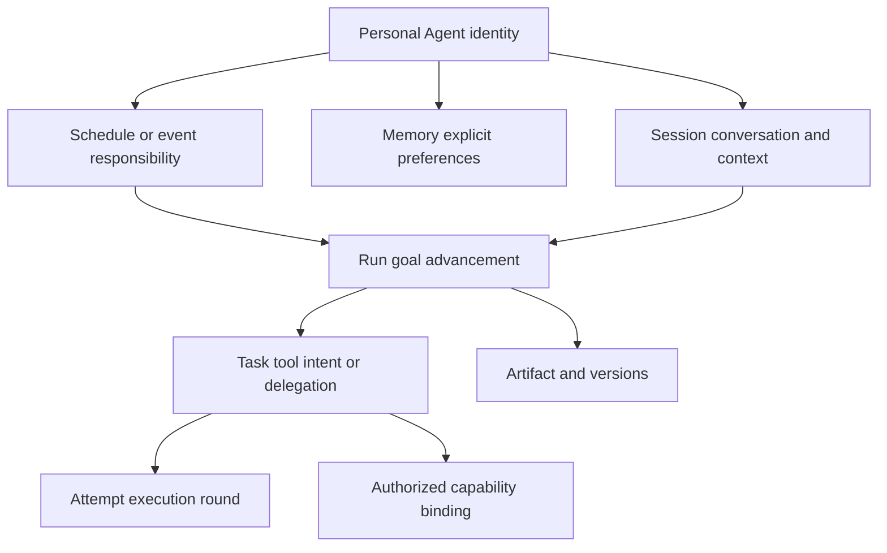

# Information architecture and model

[Index](README.md) · [简体中文](../zh-CN/information-architecture.md) · [Platform architecture](../../en/platform-architecture.md)

## Entry points

| Layer | Visible content | Entry |
|---|---|---|
| Home | Invitation, composer, attachments/context | Launch or new conversation |
| Conversation | Goal, replies, activity, necessary input, artifacts | Submit a goal or select history |
| Artifact | Document preview, edit, download, versions | Open an artifact; reveal only then |
| Tools and connections | Capabilities, resource scope, connection/readiness | Sidebar, composer, or resource blocker |
| History | Conversations, search, rename, archive | Sidebar or search shortcut |
| Attention | Needs your action, New results; return to the relevant work | Sidebar when nonempty; a counted entry remains reachable when collapsed or on phone |
| Auxiliary management | Schedules, memory, settings | More menu or contextual action |

Home has no task table, control console, global progress tracker, Agent-role picker, or infrastructure map. New conversation and search remain accessible. History resumes work without repeating a second set of recent-task cards.

Attention opens a lightweight list. Each entry shows a short goal, a concrete reason, and one primary action, then opens the relevant question/result in its original conversation. It projects the same facts as history rather than maintaining another to-do ledger. An empty panel is hidden and never displaces the home composer.

Wide desktop shows conversation and artifact together. Tablet and phone show the artifact in the main region and restore the conversation on close. Phone navigation is a drawer. A single focused management dialog replaces nested configuration layers.

## Objects and relationships

Conversation maps to Session; a round of execution maps to Run. A piece of work is the ordinary-language goal and its related execution and delivery, without a new Work/Project entity, creation form, or navigation level. Its stable origin is the initiating message and the particular goal within it; Runs and pending requests retain that origin and links to earlier execution. Scheduled work uses a particular occurrence as its origin. Independent goals in one message have separate references; the same goal retains its reference across messages/Runs. Revisions retain the goal origin and reference existing artifacts. These relationships fit existing records without a separate service.

Activity is a user-facing summary, not a Task for each token, mouse movement, or private reasoning step. A Session advances serially. Steering and answers to current blockers join its Run; questions do not change the goal by default. Independent follow-up requests remain pending Session messages and create Runs only when started. Revisions after termination use a linked new Run rather than reviving old execution.

Explicit replacement uses the new goal's origin in the replacement message and a new Run linked to the previous work. Stop new operations for the old goal and track in-flight ownership first, rather than rewriting what the old Run meant.

| Object | Durable information | UI exposure |
|---|---|---|
| PersonalAgent | Identity, owner, responsibilities, preference scope | Default Pamiya; no role setup required |
| Session | Messages and their treatment, selected context, draft, current Run, pending requests, title, archive flag, read position | History and conversation |
| Run | Goal origin, prior execution links, expected delivery, state, input, checkpoint, completion evidence, cancellation | Activity, required actions, result |
| Task / Attempt | Intent, action ID, provider/environment, attempt, acknowledgement | Hidden by default; relevant diagnostics on demand |
| Artifact | Content reference, type, digest, current version, provenance, history | Documents/files |
| Connection | Identity scope, capabilities, expiry, connection/readiness, errors | Connection UI; never secret credentials |
| Environment / Device | Working context / physical asset, ownership, readiness | Contextual selection; distinct objects |
| Delegation | Remote task/context IDs; supported query/input/cancel operations | Specialist activity, results, actual stop support |
| Schedule / Rule | Goal, source/frequency, timezone, enabled, missed policy, latest run | Schedules |
| Memory | Content, source, creation/edit time, scope | Preferences, not execution logs |

## Lifecycle of a piece of work

Language supplies the goal and expected delivery. Start when sufficient, asking only about consequential gaps. Delivery can be an answer, report, or a specific completed operation; no acceptance form is required. A concise current-goal/progress/next-step summary appears when useful. Replacement updates that summary while retaining the previous goal and existing results.

| Stage | What the user needs to know | Execution and ownership |
|---|---|---|
| Request | What will be done and delivered | Create the first Run and retain goal origin |
| Advance | Current activity and accepted changes | Advance the same Run; messages do not each create work |
| Wait | Specific missing input/resource and how to continue | Retain Run; answer, connect, or replace material to resume; terminate only when explicitly ended |
| Reconcile | Which important effect is uncertain | Query the original action and retain its links; do not rerun to reconcile |
| End this round | Delivered work, incomplete parts/reasons, or confirmed stop | Record completed/incomplete/stopped outcome; ordinary questions do not restart execution |
| Revise | Which artifact and constraints to carry forward | Link a new Run in the original conversation; retain artifact identity/versions rather than reviving an ended Run |

Recoverable faults and final incomplete outcomes have different exits. Read recovery before termination retains the Run and valid Task/Attempt relationship; another attempt after termination uses a linked new Run. Partial output does not prove goal completion. Required important effects still unknown prevent a completed claim. Automatic recovery without required user action does not enter attention.

The baseline continues the same work in its original conversation. Cross-conversation references only select context. Work still advancing offers a return-to-original action rather than copying execution or transferring control. An explicitly separate goal has a new origin and retains referenced artifact provenance/version. Another day, refresh, or client does not change goal origin.

Stop targets current execution; archive organizes conversations; schedule pause affects future triggers. Explain current execution, pending requests, and future schedules separately. Each actual schedule occurrence has its own Run and result; the schedule is not permanently running. This revision adds no new model for open-ended responsibilities.

## Attention projection on return

Attention derives from existing messages, Runs, artifact updates, and read positions, grouped by goal origin. Duplicate reports, tool progress, and successive versions of one artifact do not increase the count. Each entry shows remaining actions and the latest result.

| Group | Enter when | Leave when |
|---|---|---|
| Needs your action | Essential input/connection is missing, failure needs a choice, an important effect cannot be reconciled automatically, or held follow-ups need user action | Supply the input and resume, settle/end the work, or withdraw the request; opening/reading alone does not clear it |
| New results | Delivery, revision, final incomplete outcome, or stop conclusion has not been viewed | The user actually sees that result in its conversation; a later result can re-enter |

Ending ordinary waiting or withdrawing a request can resolve that item. An uncertain important effect requires business evidence or a recorded human verification; stopping, ending a conversation, or archiving cannot clear it.

Needs your action comes first, oldest waiting first; New results is newest first. Count the union of goal origins, once per piece of work. An entry with unresolved actions stays in the first group and can carry an unread-result indicator.

Ordinary execution, brief disconnection, and automatically retried faults require no user action. Refresh/reconnect restores authoritative state and read positions. Failed synchronization displays an error rather than an empty list. History pagination or archive cannot hide unresolved entries/unread results; a single client's temporary state is not authoritative. See [the attention entry](interactions.md#10-attention-on-return) for interactions.

## Boundaries

Archiving does not delete artifacts, revoke connections, or stop independently owned schedules. Deleting memory does not erase historical messages. Deleting uploaded material needs coordinated retention across references and artifacts. The prototype supports recoverable archive, with no permanent history/file deletion control.

A connection grants scoped resource access; selecting a tool is an execution decision. Connectivity does not authorize every action. Workspace reads/writes, external messages, and physical actions use their actual capability/authorization scope. Users do not edit ACLs or leases. An online Worker can lack a ready browser, camera, or HID capability.

All relationships include user/tenant scope. File/download authorization cannot rely on an object ID alone. The prototype has no accounts/backend; browser localStorage does not provide production isolation.

## UI state projection

The UI uses `running`, `waiting-input`, `waiting-connection`, `failed`, `stopping`, `stopped`, `reconciling`, `completed`, and `incomplete`; the prototype also uses `interrupted` for local interruption. An adapter projects runtime waiting-task/input/authorization, cancel-requested, reconciliation, and terminal facts into that view. UI names are not MQTT messages.

Production restores authoritative execution from persistence. A disconnected client does not recreate a tool intent. Stable message/Run request IDs prevent duplicate creation, event cursors restore missing activity, event IDs deduplicate repeats, and tool results are persisted before business acknowledgement.

Artifact edits use conditional version writes. Concurrent generated content and human edits retain both versions and require comparison rather than silent last-write wins. The prototype preserves versions within one page; cross-tab concurrent merge is not implemented.

## Context and memory

Messages, deliberately added files, and selected historical conversations form context. Selection is visible; the Agent does not scan all history or computer files by default. Long content is selected within context limits, with omissions explained. Unparsed binary files must not be described as read.

Long-term preferences support explicit save/edit/delete. Future candidate memory extraction needs provenance and correction, not unquestioned authority. External documents, skills, and tool results cannot grant permissions. Current explicit instructions override conflicting preferences.

## Production integration

One Session service provides messages, Runs, activity, and artifact references. Files use HTTPS/object storage; execution uses capability adapters; the browser does not connect directly to the Broker. Existing [protocol](../../en/capabilities-and-protocol.md) and [reliability](../../en/reliability.md) contracts remain authoritative.

Do not build a workflow DSL, separate event bus, or elaborate gateway for the prototype. Minimal implementation interfaces cover message submission/treatment and cursor sync, follow-up withdrawal/continuation, Run input/stop, attention/read sync, conditional artifact writes/downloads, connections, schedules, and memory CRUD. Each command defines idempotency, authorization, and failure semantics.
