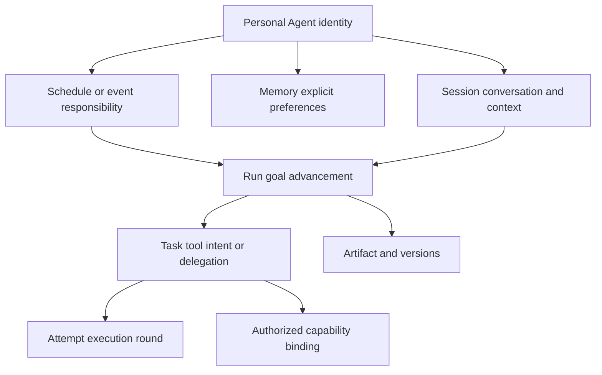

# Information architecture and model

[Index](README.md) · [简体中文](../zh-CN/information-architecture.md) · [Platform architecture](../../en/platform-architecture.md)

## Entry points

| Layer | Visible content | Entry |
|---|---|---|
| Home | Invitation, composer, attachments/context | Launch or new conversation |
| Conversation | Goal, replies, activity, necessary input, artifacts | Submit a goal or select history |
| Artifact | Document preview, edit, download, versions | Open an artifact; reveal only then |
| Tools and connections | Capabilities, resource scope, connection/readiness | Sidebar, composer, or resource blocker |
| History | Conversations, search, rename, archive | Sidebar or search shortcut |
| Auxiliary management | Schedules, memory, settings | More menu or contextual action |

Home has no task table, control console, global progress tracker, Agent-role picker, or infrastructure map. New conversation and search remain accessible. History resumes work without repeating a second set of recent-task cards.

Wide desktop shows conversation and artifact together. Tablet and phone show the artifact in the main region and restore the conversation on close. Phone navigation is a drawer. A single focused management dialog replaces nested configuration layers.

## Objects and relationships

Conversation maps to Session; a round of work maps to Run. Activity is a user-facing summary, not a Task for each token, mouse movement, or private reasoning step. A Session advances serially, accepts steering into its current Run, and starts another Run after the prior round terminates.

| Object | Durable information | UI exposure |
|---|---|---|
| PersonalAgent | Identity, owner, responsibilities, preference scope | Default Pamiya; no role setup required |
| Session | Messages, selected context, draft, current Run, title, archive flag | History and conversation |
| Run | Goal, state, input, checkpoint, completion evidence, cancellation | Activity, required actions, result |
| Task / Attempt | Intent, action ID, provider/environment, attempt, acknowledgement | Hidden by default; relevant diagnostics on demand |
| Artifact | Content reference, type, digest, current version, provenance, history | Documents/files |
| Connection | Identity scope, capabilities, expiry, connection/readiness, errors | Connection UI; never secret credentials |
| Environment / Device | Working context / physical asset, ownership, readiness | Contextual selection; distinct objects |
| Delegation | Remote task/context IDs; supported query/input/cancel operations | Specialist activity, results, actual stop support |
| Schedule / Rule | Goal, source/frequency, timezone, enabled, missed policy, latest run | Schedules |
| Memory | Content, source, creation/edit time, scope | Preferences, not execution logs |

## Boundaries

Archiving does not delete artifacts, revoke connections, or stop independently owned schedules. Deleting memory does not erase historical messages. Deleting uploaded material needs coordinated retention across references and artifacts. The prototype supports recoverable archive, with no permanent history/file deletion control.

A connection grants scoped resource access; selecting a tool is an execution decision. Connectivity does not authorize every action. Workspace reads/writes, external messages, and physical actions use their actual capability/authorization scope. Users do not edit ACLs or leases. An online Worker can lack a ready browser, camera, or HID capability.

All relationships include user/tenant scope. File/download authorization cannot rely on an object ID alone. The prototype has no accounts/backend; browser localStorage does not provide production isolation.

## UI state projection

The UI uses `running`, `waiting-input`, `waiting-connection`, `failed`, `stopping`, `stopped`, `reconciling`, and `completed`. An adapter projects runtime waiting-task/input/authorization, cancel-requested, reconciliation, and terminal facts into that view. UI names are not MQTT messages.

Production restores authoritative execution from persistence. A disconnected client does not recreate a tool intent. Stable message/Run request IDs prevent duplicate creation, event cursors restore missing activity, event IDs deduplicate repeats, and tool results are persisted before business acknowledgement.

Artifact edits use conditional version writes. Concurrent generated content and human edits retain both versions and require comparison rather than silent last-write wins. The prototype preserves versions within one page; cross-tab concurrent merge is not implemented.

## Context and memory

Messages, deliberately added files, and selected historical conversations form context. Selection is visible; the Agent does not scan all history or computer files by default. Long content is selected within context limits, with omissions explained. Unparsed binary files must not be described as read.

Long-term preferences support explicit save/edit/delete. Future candidate memory extraction needs provenance and correction, not unquestioned authority. External documents, skills, and tool results cannot grant permissions. Current explicit instructions override conflicting preferences.

## Production integration

One Session service provides messages, Runs, activity, and artifact references. Files use HTTPS/object storage; execution uses capability adapters; the browser does not connect directly to the Broker. Existing [protocol](../../en/capabilities-and-protocol.md) and [reliability](../../en/reliability.md) contracts remain authoritative.

Do not build a workflow DSL, separate event bus, or elaborate gateway for the prototype. Minimal implementation interfaces cover message submit/cursor sync, Run input/stop, conditional artifact writes/downloads, connections, schedules, and memory CRUD. Each command defines idempotency, authorization, and failure semantics.
