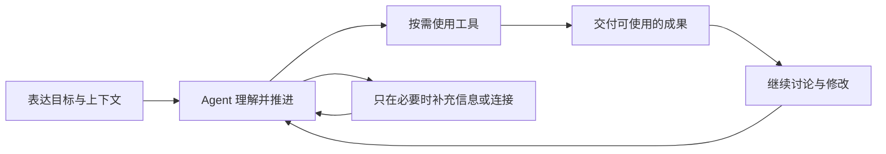

# Pamiya 产品与交互设计

[English](../en/README.md) · [仓库首页](../../../README.zh-CN.md) · [架构文档](../../zh-CN/README.md)

**设计基线 0.2 · 2026-10-15 · 现代个人 Agent。** Pamiya 首先是一个可以持续共事的 Agent：用户表达目标，它理解上下文、使用工具、推进工作并交付成果。任务、执行节点和协议支撑这段体验。

本组文档以已确认的首页视觉为起点，覆盖需求、领域与导航、完整交互、视觉规范和验收。它是一组可实施的设计决策，尚未经真实用户研究验证。目标中的生产能力与当前本地原型分别标注。

| 文档 | 用途 |
|---|---|
| [需求与范围](requirements.md) | 产品定位、用户场景、优先级、验收指标、首版边界 |
| [信息架构与模型](information-architecture.md) | 页面入口、对象关系、UI 与运行时映射、数据归属 |
| [交互规格](interactions.md) | 首次使用、持续协作、成果、连接、记忆、安排与异常 |
| [视觉与组件](design-system.md) | 已选视觉、尺寸、组件、响应式与无障碍 |
| [原型与验收](prototype-and-acceptance.md) | 已实现范围、操作脚本、验收矩阵和生产接入顺序 |

[打开原型说明](../../../prototype/README.md) · [查看已选首页](../../../prototype/design/selected-home.png)

## 体验主线

首页只有交流入口、历史和工具连接。执行后按需展开活动与成果。持续安排、记忆和设置放在辅助入口中；不先建设一个任务管理后台，再把 Agent 放进去。

当前原型提供真实的本地交互和浏览器保存；模型回答、工具执行和外部提交由确定脚本模拟，不是真实 Agent 运行时。定时安排只保存配置并支持手动模拟触发，不在关闭页面后运行。原型以中文呈现，产品与架构文档逐章提供中英文。
