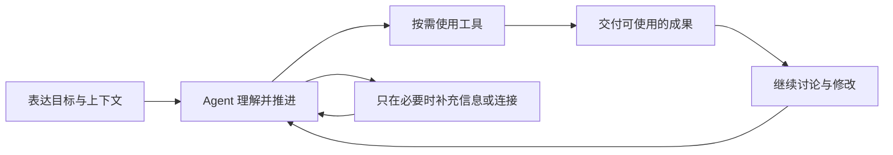

# Pamiya 产品与交互设计

[English](../en/README.md) · [仓库首页](../../../README.zh-CN.md) · [架构文档](../../zh-CN/README.md)

**产品设计基线 0.3 · 2026-10-16 · 现代个人 Agent。** Pamiya 首先是一个可以持续共事的 Agent：用户表达目标，它理解上下文、使用工具、推进工作并交付成果。任务、执行节点和协议支撑这段体验。此版本号指设计规格，不代表插件或原型的新发布。

本组文档以已确认的首页视觉为起点，覆盖需求、领域与导航、完整交互、视觉规范和验收。它是一组可实施的设计决策，尚未经真实用户研究验证。目标中的生产能力与当前本地原型分别标注。

| 文档 | 用途 |
|---|---|
| [需求与范围](requirements.md) | 产品定位、用户场景、优先级、验收指标、首版边界 |
| [信息架构与模型](information-architecture.md) | 页面入口、对象关系、UI 与运行时映射、数据归属 |
| [交互规格](interactions.md) | 首次使用、持续协作、成果、连接、记忆、安排与异常 |
| [视觉与组件](design-system.md) | 已选视觉、尺寸、组件、响应式与无障碍 |
| [原型与验收](prototype-and-acceptance.md) | 已实现范围、操作脚本、验收矩阵和生产接入顺序 |
| [开源基座选型](open-source-foundation.md) | MIT 候选、DSH 复用边界、兼容差异与采用门槛 |

[打开原型说明](../../../prototype/README.md) · [查看已选首页](../../../prototype/design/selected-home.png)

实际 DSH 扩展见[安装与使用](../../zh-CN/dsh-plugin.md)。插件复用原生 Agent；独立原型继续作为体验参考。

## 体验主线

首页保留交流入口、历史和工具连接，有内容时提供“待处理”；执行后按需展开活动与成果。持续安排、记忆和设置放在辅助入口中；不先建设一个任务管理后台，再把 Agent 放进去。

本次收敛三条主线：[一件事的生命周期与归属](information-architecture.md#一件事的生命周期)、[执行中新消息的处理](interactions.md#2-理解执行与补充方向)、[返回后的待处理入口](interactions.md#10-返回后的待处理入口)。它们沿用消息、Session、Run 与成果，不新增用户必须创建或管理的对象。新增规格与当前原型的差异及 A17–A26 验收见[原型与验收](prototype-and-acceptance.md)。

当前原型提供真实的本地交互和浏览器保存；模型回答、工具执行和外部提交由确定脚本模拟，不是真实 Agent 运行时。定时安排只保存配置并支持手动模拟触发，不在关闭页面后运行。原型以中文呈现，产品与架构文档逐章提供中英文。

原型现已按本地确定性规则演示目标关联、消息处置、后续请求、换资料与待处理。消息识别仅覆盖明确规则和手动澄清；没有真实模型、后台执行或服务端同步，不代表 DSH 插件已接入这些产品交互。
