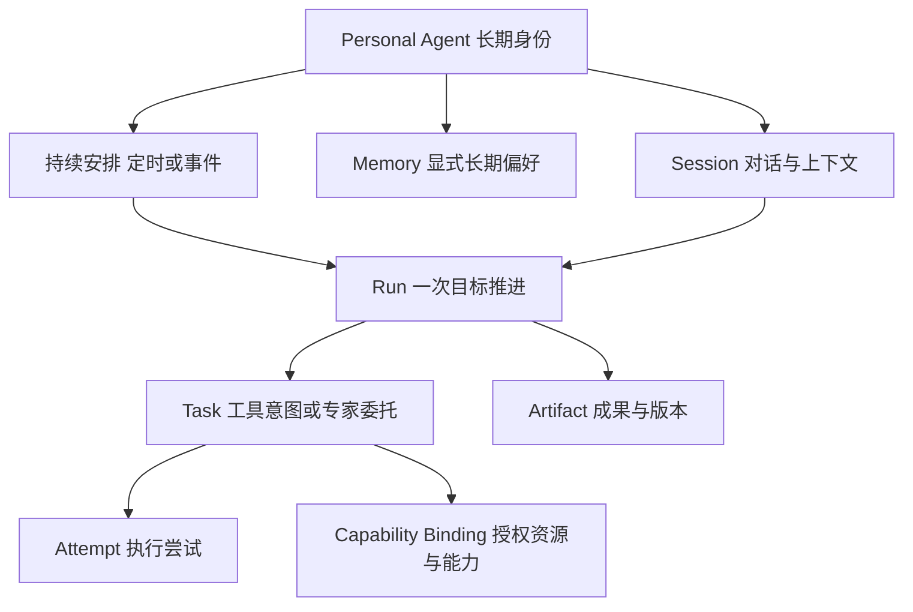

# 信息架构与模型

[索引](README.md) · [English](../en/information-architecture.md) · [平台架构](../../zh-CN/platform-architecture.md)

## 入口与层次

| 层次 | 用户看到的内容 | 进入方式 |
|---|---|---|
| 首页 | 一句邀请、输入区、附件与上下文 | 启动或新对话 |
| 对话 | 目标、回复、当前活动、必要输入、成果引用 | 发出目标或选择历史 |
| 成果区 | 文档预览、编辑、下载、版本 | 点击成果；仅此时展开 |
| 工具与连接 | 可用工具、资源范围、连接状态 | 侧栏、输入区，或工作被资源阻塞时 |
| 历史 | 对话列表、搜索、重命名和归档 | 侧栏或搜索快捷键 |
| 待处理 | 需要你处理、有新结果；按件返回原对话 | 有内容时在侧栏显示；收起侧栏和手机时仍有带数量的入口 |
| 辅助管理 | 持续安排、记忆、设置 | 更多菜单；相关操作也可在对话中进入 |

首页不提供任务表、控制面板、全局进度条、Agent 角色选择或基础设施拓扑。搜索与新对话随时可达。既有工作可以通过历史继续，首页不用再重复一组“最近任务”卡片。

“待处理”打开轻量列表，条目展示目标简称、具体原因和一个主要动作，进入原对话的相关问题或结果处。它与历史共用工作事实，不建立另一份待办账本；没有内容时不展示空面板，也不挤占首页输入区。

桌面足够宽时，对话与成果并排；中等宽度与手机以成果覆盖主区域，关闭成果回到原对话位置。手机侧栏是抽屉。一次只显示完成当前动作所需的管理弹窗，不叠加多层设置。

## 对象与关系

“对话”对应 Session；“本轮推进”对应 Run。“一件事”是用户的目标及相关推进、交付的自然称呼，不新增 Work/Project 对象、创建表单或导航层级。以发起消息及其中的具体目标为稳定来源，Run 与待执行请求保存该来源及前次推进的关联；安排触发则以某次发生为来源。同一消息中的独立目标分别关联，同一目标跨消息/Run 沿用关联。后续修订沿用目标来源并指向已有成果。关联只需保存在已有记录中，无需独立服务。

UI 中的活动是面向用户的摘要，不是把每个 token、鼠标移动或内部推理变成 Task。一个对话内串行推进，补充和当前阻塞的回答进入原 Run；询问不默认改变目标；后续独立请求保存在 Session 的待处理消息中，到开始时才创建 Run。上一轮明确终结后，修订使用关联的新 Run，不复活旧执行。

明确替换目标时，新目标使用替换消息中的来源与新 Run，关联旧工作；先停止旧目标的新操作并处理在途归属，不直接改写旧 Run 的目标含义。

| 对象 | 需要稳定保存的内容 | UI 暴露程度 |
|---|---|---|
| PersonalAgent | 身份、所有者、职责、偏好范围 | 默认只有 Pamiya，无需先创建多个角色 |
| Session | 消息及处理去向、所选上下文、草稿、当前 Run、待执行请求、标题、归档标记、已读位置 | 对话列表与正文 |
| Run | 目标来源、前次推进关联、交付预期、状态、补充输入、检查点、完成证据、取消状态 | 活动、需要用户的动作、结果 |
| Task / Attempt | 工具意图、动作 ID、提供者/环境、轮次与回执 | 默认隐藏；排查时可展开相关记录 |
| Artifact | 内容引用、类型、摘要、当前版本、来源、版本历史 | 文档与文件成果区 |
| Connection | 身份范围、能力、有效期、连接/就绪状态、错误 | 工具与连接；不展示秘密凭据 |
| Environment / Device | 工作现场/物理资产、归属、可用性 | 具体工作需要时选择，不混用对象 |
| Delegation | 远程任务 ID、上下文 ID、支持的查询/输入/取消操作 | 专家在做什么、成果、实际停止能力 |
| Schedule / Rule | 目标、来源/频率、时区、启停、错过策略、最近执行 | 持续安排 |
| Memory | 内容、来源、创建/修改时间、启用范围 | 可管理的偏好，不是执行日志 |

## 一件事的生命周期

目标与交付预期从自然语言形成；信息足够就开始，只为改变结果的重要缺口提问。交付预期可以是一句回答、一份报告或完成某个明确操作，不要求填写验收表。对话中按需显示一行当前目标、进展与下一步；目标替换时更新这行内容，原目标和已有结果仍可查。

| 阶段 | 用户应知道什么 | 推进与归属 |
|---|---|---|
| 提出 | 要做什么，准备交付什么 | 创建首个 Run，保存目标来源 |
| 推进 | 当前活动、已接受的修改 | 同一 Run 推进，不因每条消息新建工作 |
| 等待 | 缺哪项信息/资源，如何继续 | 保留 Run；回答、连接或替换资料后恢复；明确结束才终结 |
| 核对 | 哪个重要效果尚未确定 | 查询原动作，保留关联，不用重跑代替核对 |
| 本轮结束 | 已交付、未完成的部分与原因，或确认已停止 | 记录完成/未完成/停止结论；普通问答不重新启动执行 |
| 继续修改 | 修改哪份成果、沿用哪些约束 | 原对话中关联新 Run，保留成果身份和版本，不复活已结束 Run |

可恢复故障与最终未完成有不同出口：尚未终结的读取恢复沿用 Run 和合法的 Task/Attempt；已终结后再次做则创建关联的新 Run。部分成果不是目标完成证明；必要的重要效果仍未知时，不能把整件事标成已完成。无需人工动作的自动恢复不进入待处理。

首版在原对话继续同一件事。跨对话引用只是选取上下文；仍在推进的目标提供“回到原对话”入口，不复制运行或移交控制。明确另做一个目标时创建新的来源，保留所引用成果的来源与版本。跨天、刷新或换客户端不会改变目标来源。

停止针对当前执行；归档整理对话；暂停安排只影响未来触发。当前执行、待执行请求和未来安排分别说明处理结果。一次安排的每次实际发生有各自的 Run 和结果，安排本身不保持永久运行；开放式持续职责不在本次增加新模型。

## 返回后的待处理读模型

“待处理”由现有消息、Run、成果更新及已读位置派生，按目标来源合并。同一件事的重复回报、多个工具进度或同一成果连续版本不重复计数；条目中列出仍需处理的具体事项与最新结果。

| 分组 | 进入条件 | 离开条件 |
|---|---|---|
| 需要你处理 | 缺必要信息/连接、需用户选择的失败、无法自动核对的重要效果、暂存且等待用户处理的后续请求 | 实际补齐并恢复、确认处理/结束，或撤回对应请求；仅打开/已读不清除 |
| 有新结果 | 新交付、修订、最终未完成或停止结论尚未查看 | 用户在原对话实际看到对应结果；后续新结果可再次出现 |

结束普通等待或撤回请求可以解除对应处理项；未知重要效果必须有业务证据或人工登记的核对事实，不能因停止、结束对话或归档而清除。

先显示“需要你处理”，组内按等待时间从久到近；“有新结果”按结果时间从近到久。入口数量按两组目标来源的并集计算，同一件事只计一次。仍有需处理事项时优先展示在第一组，并附未读结果提示。

普通运行中、短暂断线、可自动重试故障不要求用户处理。刷新/重连先恢复权威状态和已读位置；读取失败显示无法同步，不把未知显示成空列表。历史分页或对话归档不截断未决条目和未读结果，列表不以单个客户端暂存为权威。详细操作见[返回后的待处理入口](interactions.md#10-返回后的待处理入口)。

## 关键边界

对话、推进、成果、长期偏好各有用途。归档对话不删除成果，不撤销连接，不停止已经独立归属的持续安排。删除记忆不会删除历史消息；真正删除上传资料需要协调成果与引用保留策略。原型只做可恢复归档，没有永久删除历史或文件的入口。

连接是资源授权；Agent 选择工具是执行决策。二者不混成“连接即允许所有操作”。普通工作区读写、外发消息和真实设备动作的范围由能力与授权表达，用户无需编辑 Topic ACL 或租约。在线的 Worker 也可能缺少浏览器、HID 或摄像头能力。

所有业务关联都包含所有者/租户作用域。文件与下载引用必须归属正确用户，不能只凭一个对象 ID 授权。原型没有账号与后端，这部分是生产约束，不是浏览器 localStorage 的能力。

## 状态读模型

UI 显示 `running`、`waiting-input`、`waiting-connection`、`failed`、`stopping`、`stopped`、`reconciling`、`completed`、`incomplete`；原型另用 `interrupted` 表示本地中断。这是表现层读模型，适配层映射运行时的等待任务、等待输入、等待授权、取消中、核对中和终态，不能把 UI 文案直接当作 MQTT 消息。

首版按数据库事实恢复对话与执行，客户端丢线不重建一次工具意图。以稳定请求 ID 创建消息/Run，重连按事件游标补齐；若流式事件重复，按事件 ID 去重。工具结果先持久化再确认，任务与尝试按架构协议关联。

成果编辑采用版本条件提交：客户端提交基于的版本；如果执行中生成的新版本与人工编辑冲突，保留双方版本并让用户比较，不静默最后写入覆盖。原型在同一页面保留版本；跨标签并发合并尚未实现。

## 上下文与记忆

用户主动添加的文件、引用的对话与当前消息构成本次上下文。是否使用某份资料应可见；不默认扫描所有历史与电脑文件。长内容按上下文预算选取，并告诉用户缺失部分；二进制文件在没有解析能力时显示“未解析”，不能假装已阅读。

长期偏好支持显式保存、编辑和删除。将来若引入候选记忆提取，应提供来源和纠错，不把旧记忆当成不可变事实。外部文档、技能与工具输出不授予权限。偏好冲突时，本次明确指令优先。

## 生产接入契约

前端通过同一个会话服务读取消息、Run、活动与成果引用；文件内容走 HTTPS/对象存储，执行节点经能力适配器连接，浏览器不直连 Broker。底层遵循现有[协议](../../zh-CN/capabilities-and-protocol.md)和[可靠执行约束](../../zh-CN/reliability.md)。

无需为原型先设计通用工作流 DSL、独立事件总线或全套 API 网关。实施时最小接口应覆盖消息提交/处置与游标同步、后续请求撤回/继续、Run 输入与停止、待处理/已读同步、成果条件更新/下载、连接管理、安排与记忆 CRUD；每个命令明确幂等范围、授权与失败语义。
