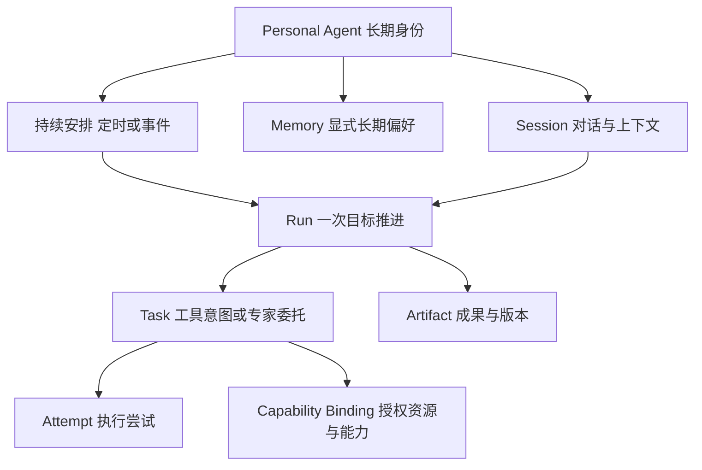

# 信息架构与模型

[索引](README.md) · [English](../en/information-architecture.md) · [平台架构](../../zh-CN/platform-architecture.md)

## 入口与层次

| 层次 | 用户看到的内容 | 进入方式 |
|---|---|---|
| 首页 | 一句邀请、输入区、附件与上下文 | 启动或新对话 |
| 对话 | 目标、回复、当前活动、必要输入、成果引用 | 发出目标或选择历史 |
| 成果区 | 文档预览、编辑、下载、版本 | 点击成果；仅此时展开 |
| 工具与连接 | 可用工具、资源范围、连接状态 | 侧栏、输入区，或工作被资源阻塞时 |
| 历史 | 对话列表、搜索、重命名和归档 | 侧栏或搜索快捷键 |
| 辅助管理 | 持续安排、记忆、设置 | 更多菜单；相关操作也可在对话中进入 |

首页不提供任务表、控制面板、全局进度条、Agent 角色选择或基础设施拓扑。搜索与新对话随时可达。既有工作可以通过历史继续，首页不用再重复一组“最近任务”卡片。

桌面足够宽时，对话与成果并排；中等宽度与手机以成果覆盖主区域，关闭成果回到原对话位置。手机侧栏是抽屉。一次只显示完成当前动作所需的管理弹窗，不叠加多层设置。

## 对象与关系

“对话”对应 Session；“本轮推进”对应 Run。UI 中的活动是面向用户的摘要，不是把每个 token、鼠标移动或内部推理变成 Task。一个对话内串行推进，在进行中的 Run 上补充方向；上一轮明确终结后才开始下一轮。

| 对象 | 需要稳定保存的内容 | UI 暴露程度 |
|---|---|---|
| PersonalAgent | 身份、所有者、职责、偏好范围 | 默认只有 Pamiya，无需先创建多个角色 |
| Session | 消息、所选上下文、草稿、当前 Run、标题、归档标记 | 对话列表与正文 |
| Run | 目标、状态、补充输入、检查点、完成证据、取消状态 | 活动、需要用户的动作、结果 |
| Task / Attempt | 工具意图、动作 ID、提供者/环境、轮次与回执 | 默认隐藏；排查时可展开相关记录 |
| Artifact | 内容引用、类型、摘要、当前版本、来源、版本历史 | 文档与文件成果区 |
| Connection | 身份范围、能力、有效期、连接/就绪状态、错误 | 工具与连接；不展示秘密凭据 |
| Environment / Device | 工作现场/物理资产、归属、可用性 | 具体工作需要时选择，不混用对象 |
| Delegation | 远程任务 ID、上下文 ID、支持的查询/输入/取消操作 | 专家在做什么、成果、实际停止能力 |
| Schedule / Rule | 目标、来源/频率、时区、启停、错过策略、最近执行 | 持续安排 |
| Memory | 内容、来源、创建/修改时间、启用范围 | 可管理的偏好，不是执行日志 |

## 关键边界

对话、推进、成果、长期偏好各有用途。归档对话不删除成果，不撤销连接，不停止已经独立归属的持续安排。删除记忆不会删除历史消息；真正删除上传资料需要协调成果与引用保留策略。原型只做可恢复归档，没有永久删除历史或文件的入口。

连接是资源授权；Agent 选择工具是执行决策。二者不混成“连接即允许所有操作”。普通工作区读写、外发消息和真实设备动作的范围由能力与授权表达，用户无需编辑 Topic ACL 或租约。在线的 Worker 也可能缺少浏览器、HID 或摄像头能力。

所有业务关联都包含所有者/租户作用域。文件与下载引用必须归属正确用户，不能只凭一个对象 ID 授权。原型没有账号与后端，这部分是生产约束，不是浏览器 localStorage 的能力。

## 状态读模型

UI 显示 `running`、`waiting-input`、`waiting-connection`、`failed`、`stopping`、`stopped`、`reconciling`、`completed`。这是表现层读模型，适配层映射运行时的等待任务、等待输入、等待授权、取消中、核对中和终态，不能把 UI 文案直接当作 MQTT 消息。

首版按数据库事实恢复对话与执行，客户端丢线不重建一次工具意图。以稳定请求 ID 创建消息/Run，重连按事件游标补齐；若流式事件重复，按事件 ID 去重。工具结果先持久化再确认，任务与尝试按架构协议关联。

成果编辑采用版本条件提交：客户端提交基于的版本；如果执行中生成的新版本与人工编辑冲突，保留双方版本并让用户比较，不静默最后写入覆盖。原型在同一页面保留版本；跨标签并发合并尚未实现。

## 上下文与记忆

用户主动添加的文件、引用的对话与当前消息构成本次上下文。是否使用某份资料应可见；不默认扫描所有历史与电脑文件。长内容按上下文预算选取，并告诉用户缺失部分；二进制文件在没有解析能力时显示“未解析”，不能假装已阅读。

长期偏好支持显式保存、编辑和删除。将来若引入候选记忆提取，应提供来源和纠错，不把旧记忆当成不可变事实。外部文档、技能与工具输出不授予权限。偏好冲突时，本次明确指令优先。

## 生产接入契约

前端通过同一个会话服务读取消息、Run、活动与成果引用；文件内容走 HTTPS/对象存储，执行节点经能力适配器连接，浏览器不直连 Broker。底层遵循现有[协议](../../zh-CN/capabilities-and-protocol.md)和[可靠执行约束](../../zh-CN/reliability.md)。

无需为原型先设计通用工作流 DSL、独立事件总线或全套 API 网关。实施时最小接口应覆盖消息提交/游标同步、Run 输入与停止、成果条件更新/下载、连接管理、安排与记忆 CRUD；每个命令明确幂等范围、授权与失败语义。
