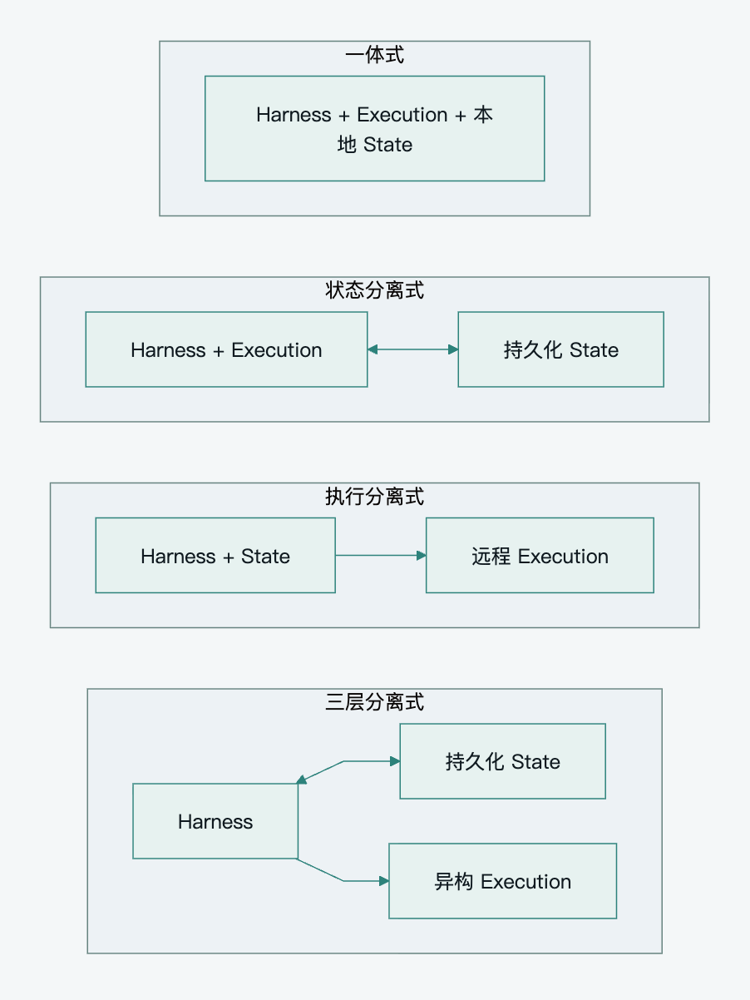

[English](../en/architecture-patterns.md) · **简体中文**

# Pamiya 架构形态与设计决策

平台面向多租户 Personal Agent：既能执行云端任务，也能连接用户电脑、企业内网和物理设备，并允许替换 Harness。为此采用三层分离作为目标架构，首版可将多数逻辑模块放在一个应用中，先固定状态归属、执行边界和恢复协议。

导航：[阅读指南](README.md) · [平台架构](platform-architecture.md)

## 三个基本边界

| 层 | 职责 | 必须明确的问题 |
|---|---|---|
| Harness | 组装上下文、调用模型、解释工具调用、推进或暂停循环 | 下一步由谁决定 |
| Execution | 执行代码、文件、浏览器、业务 API 和设备操作 | 操作在哪里发生 |
| State | 保存事件、进度、工具结果、审批、检查点和产物引用 | 新实例如何知道已经发生了什么 |

这里使用较窄的 Harness 定义。平台身份、调度、权限和状态服务不必全部归入 Harness。模型推理在哪里运行又是另一项部署选择：本地 Harness 可以请求远程模型，控制层在云端也可以调用本地执行环境。

## 四种工程形态

以下分类用于工程比较，不是厂商标准，也不是可靠性等级。

| 形态 | 控制与执行 | 状态归属 | 优势 | 主要代价 | 适用场景 |
|---|---|---|---|---|---|
| 一体式 | 同一进程组或工作单元 | 绑定本地工作现场 | 调试直接、文件访问简单 | 迁移与恢复依赖现场 | 本地开发、单用户工具 |
| 状态分离式 | 仍在同一运行单元 | 外部持久化 | 空闲时回收实例，交互可续接 | 文件、待执行动作也要持久化 | 间歇运行的 SaaS |
| 执行分离式 | Harness 调用远程执行端 | 仍可能由控制实例持有 | 执行隔离、接入多环境 | 控制进程恢复仍需设计 | 沙箱、用户设备、内网节点 |
| 三层分离式 | 控制与执行独立 | 独立持久化 | 分别扩容、替换与恢复 | 并发、投递、状态核对更复杂 | 多租户、长任务、异构执行网络 |

[查看 SVG](../../assets/diagrams/architecture-patterns.zh-CN.svg) · [可编辑 Mermaid](../../assets/diagrams/architecture-patterns.zh-CN.mmd)

Claude Agent SDK 的托管说明描述了由 SDK 启动 CLI 子进程、持有工作目录和本地会话文件的方式；Hybrid sessions 则让临时容器从外部 SessionStore 加载并保存会话，工作目录产物需要独立持久化。[Claude Agent SDK Hosting](https://code.claude.com/docs/en/agent-sdk/hosting)

Anthropic Managed Agents 将 Session 日志、Harness 和 Sandbox 拆为可替换接口，Harness 可以从外部日志恢复。这为三层分离提供了具体参考，但平台仍需自己处理外部操作的歧义和并发控制。[Managed Agents 架构](https://www.anthropic.com/engineering/managed-agents)

SDK、CLI、Gateway、托管服务描述接入或交付方式，不能直接代替上述分类。Always-on 描述长期职责和触发方式，也不构成第五种拓扑。

## 为什么采用逻辑集中管理与分布式执行

平台统一管理租户、身份、权限、会话、任务与能力目录；Execution Network 将实际操作放在合适的位置。需要用户本地文件时选择该用户的桌面节点，需要内网 API 时选择企业 Edge，操作手机时选择绑定设备的 Worker。

逻辑集中管理允许多 API、Scheduler 和 Harness 实例。它们通过共享持久化状态、版本控制和租约协调，不依赖一个永远存活的主进程。

三层分离不要求首日部署三个独立业务服务。首版可采用模块化应用，连接 PostgreSQL、对象存储和 Broker；模块边界在扩容或隔离需要出现时再成为部署边界。

## 首版实现基线

首版默认一个活跃调度实例、多个 Worker；同一 Session 串行推进，每个设备或有状态 Environment 固定一个执行归属。Control 保存任务意图与结果，Worker 主动连接 Broker，执行短工具任务或按目标委托远程 Runtime。掉线不自动把有副作用的任务交给另一个节点。

这是一种最小部署选择，不限制目标平台以后支持多实例、设备迁移、长任务和企业接入。采用固定归属后，数据库中的忙闲占用、Task/Attempt 条件更新和 Worker 本地串行队列已能解决首版并发，不必同时引入资源租约服务与 fencing 协议。

首版保留任务持久化、业务结果确认、消息去重、有效期、认证与 ACL、取消记录、文件引用，以及未知重要副作用的核对。审批只适用于超出既有授权或影响较大的操作；读取、导航和可恢复的工作区操作在授权范围内直接执行。只读和可重建任务允许自动重试，不因其他设备的不确定状态停止整个 Agent。

增加第二个活跃调度者、自动接管同一资源、跨节点迁移、离线自治或硬费用上限时，再启用对应增强机制。触发条件见 [复杂度评审](scope-and-decisions.md)。

### Harness 的兼容条件

更换模型、替换控制循环实现、迁移一个进行中的厂商会话，是三种不同能力。首版只承诺平台对象与工具契约稳定，不承诺任意 SDK 的内部会话都能无损迁移。

直接接入中心 Harness 的实现必须能将会产生副作用的工具调用交给 Task Runtime，并能保存工具调用关联、检查点和暂停状态。若 CLI 或 SDK 必须在自身工作目录执行内置 Shell，且无法完整截获或禁用这些操作，就将它作为 Remote Agent Runtime 委托；不能仅加一层 Adapter 就宣称执行已经分离。Claude Agent SDK 的子进程与工作目录模型说明了这个边界。[SDK 进程模型](https://code.claude.com/docs/en/agent-sdk/hosting)

迁移进行中的 Run 需要显式状态转换与兼容检查；缺少可用转换器时，让原 Runtime 完成或停止该 Run，新 Run 使用新 Harness。平台事件可移植，不等于厂商专用推理状态可移植。

## MQTT 的职责与适用条件

远程 Worker 主动建立出站长连接，不必公开入站服务端口。MQTT 适合设备和内网节点的双向命令、状态、心跳和小事件。图片、文件、长日志走授权后的 HTTPS 数据通道；视频和硬实时控制另选满足其时延要求的通道。

如果执行端全部是同一区域内可互换的云端服务，MQTT 不必成为默认选择；内部 HTTP、gRPC 或耐久队列可能更直接。当前方案选择 MQTT 的依据是异构设备和长期可达性，而非所有任务都需要 Broker。

| 需求 | 设计选择 |
|---|---|
| 远程节点双向通信、命令与事件 | MQTT 作为优先传输 |
| 任务归属、重试、恢复和最终状态 | PostgreSQL 任务运行时 |
| 云端或第三方 Agent 委托 | Agent Adapter，采用对方支持的 API 或 A2A |
| 外部业务工具 | HTTP 或 MCP Adapter |
| 大输入与产物 | 对象存储与受控 HTTPS |
| 云端分发吞吐超出数据库方案 | 按测量结果评估耐久消息队列 |

MQTT QoS 描述协议交付。应用处理、数据库记录和真实副作用仍须平台协议确认与核对，不能由 QoS 推导任务成功。[MQTT 5.0 第 4.3 节](https://docs.oasis-open.org/mqtt/mqtt/v5.0/os/mqtt-v5.0-os.html)

## 需要固化的设计决策

| 决策 | 方案 | 理由或条件 |
|---|---|---|
| 权威状态 | State Plane 持有平台 Session、Run、Task、Event 和产物引用 | Broker 与执行节点可独立重启 |
| 会话并发 | 首版单 Session 串行队列，任务写入使用唯一性与版本约束 | 多活 Harness 才增加会话租约与 fencing |
| 共享资源 | 首版固定归属与忙闲占用，未知重要效果只暂停相关资源 | 自动跨节点接管时增加资源 fence |
| 工具入口 | Capability Resolver 加统一 Router | Harness 与具体传输解耦 |
| 调度方式 | Scheduler 按能力、授权、槽位和环境显式分配 | Shared Subscription 不掌握业务约束 |
| 发布机制 | 首版 Task 表与 Dispatcher；复杂领域事件再采用 Outbox | 保证持久化意图可重新发现 |
| 反向可靠性 | 结果持久化后返回 RESULT_ACK | 避免 Worker 完成而平台丢失结果 |
| 操作重试 | 按副作用语义分类，未知结果先核对 | 租约与去重不能撤销外部动作 |
| 远程 Agent | 独立 Delegation 模型及 Adapter | 子 Agent 拥有自主决策与内部状态 |
| Harness 兼容 | 中心实现必须允许工具受控；不能截获的 Runtime 走委托 | 防止工具绕过任务和审批链路 |
| 主动触发 | Event Engine 先过滤与去重，再创建 Run | 长期职责无需持续消耗模型 |
| Broker 选型 | BifroMQ 优先评估，传输协议保持可替换 | 不依赖其内部状态实现业务核心 |
| Tenon | 可选事件集成，在 PoC 后决定引入 | 不承担核心耐久执行 |

上述“方案”固定职责和业务语义，不要求所有实现机制首版上线。首版基线、条件增强与上线检查分别由 03、04、05 约束。

这些是设计稿采用的方案，不表示所有外部集成、性能目标和固件能力已验收。相关决策条件见 [技术选型与实施路线](technology-and-roadmap.md)。
