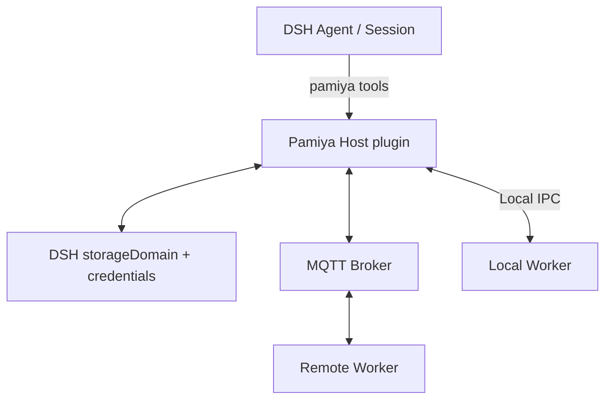

# Pamiya DSH 插件：安装、使用与实现边界

[阅读指南](README.md) · [English](../en/dsh-plugin.md)

普通用户先看[上手指南](quickstart.md)，或把[安装任务文档](install-with-dsh.md)交给 DSH；本页包含源码安装、完整运行说明与实现边界。

这是 `packages/dsh-plugin` 的实际实现说明。Pamiya 复用 DSH 的对话、模型、Agent 循环和 Session；插件增加远程工具、配置页、多节点管理与执行记录。`prototype/` 仍是独立的模拟交互原型。

## 当前实现组合



Host 与本机 Worker 在同一台电脑上，以独立进程运行。本机 Worker 使用进程 IPC；远程 Worker 主动向 Broker 建立出站连接，图中双向箭头表示消息流。Agent 与权威聊天历史仍由 DSH 提供。

## 安装

需要已有 DeepSeek Harness 和 Node.js 22.19 或更新版本。源码构建使用 npm；下载的 Worker 已包含运行依赖，无需单独安装 MQTT 库。

```sh
npm ci
npm run plugin:test
node scripts/install-dsh-plugin.mjs
```

macOS 安装器优先使用官方桌面应用自带的 CLI，不依赖额外注册全局命令。其他环境可用 `--dsh` 指定 CLI，`--profile web` 选择 Web profile。安装器备份已有 profile patch，只修改自己标记的配置段；遇到用户自定义 Pamiya 配置不会覆盖。若宿主未自动重载，完全退出后重新打开。

当前接受的宿主版本是 `0.2.0-rc.2`、`0.2.1-alpha.4`。桌面官方更新通道和 npm `latest` 在本次核对时仍提供前者；后者来自 npm `alpha`，不能把安装 alpha CLI 说成桌面应用已经升级。alpha 验证使用独立 Harness home，避免混用个人数据。

测试部署可运行 `node scripts/install-dsh-plugin.mjs --demo`：仅在尚未配置连接时，填入当前 RunMQTT 公共测试参数，启动一个本机节点并执行连接检查。普通安装不主动选定外部消息服务。

## 第一次使用

1. 打开 **Pamiya → 计算节点**。本机自动加入，无需配置 MQTT、额外终端或配对；主动停止后不会自动再次启动。
2. 等待“可用”，检查连接或运行节点体验，状态与结果来自真实 Worker。
3. 节点详情可检测、安装、配置 DSH、Codex、Claude Code、Pi，默认复用 DSH 模型与鉴权，也可选择独立配置。
4. 回到对话，用 `pamiya_workers` 查询能力、`pamiya_execute` 执行动作、`pamiya_delegate` 委派完整 Agent；长任务的完成结果返回发起对话。

本机通过 IPC 工作。只有接入远端时才设置 MQTT；公共 RunMQTT 只用于合成验证，账号从官方页面读取，不写死轮换密码。远端真实业务使用私有连接。[RunMQTT 参数及限制](https://runmqtt.com/public-broker)

完整步骤、模型来源、自定义动作、续接、回调与产物见[Agent 与自定义动作](agent-workers.md)。

## 添加其他电脑或服务器

选择“添加节点 → 另一台电脑或服务器”，命名后创建配对。界面提供单文件 Worker 下载、Node.js 安装链接、macOS/Linux 与 Windows PowerShell 启动命令和 30 分钟配对提示。若剪贴板不可用，可选择“显示命令以手动复制”。命令中的配对信息包含连接凭据和节点密钥，只交给自己的电脑，不能放进公开文档、Issue 或截图。每台电脑分别生成配对。

Worker 在自己的用户目录保存配置和执行日志，目录/文件采用相应平台可支持的私有权限。已配对节点不因原配对码过期而停止；再次启动使用界面显示的节点 ID：

```sh
node pamiya-worker.mjs start --id <worker-id>
```

运行进程退出后，远程节点会离线。本机托管节点随 DSH 启动；远程服务器长期运行可以由自己的进程管理器托管同一个 `start` 命令，不假装浏览器关闭后还有平台调度器运行。

连接地址、模式或账号变更保留节点身份与执行日志，修改前先处理在途任务。Host 会重连，本机仍使用 IPC；远程节点在详情中选择“更新连接 / 重新配对”，先停止旧进程，再运行新命令，保留原节点身份及执行日志。

## 对话执行节点

输入框底部工具栏可选择“自动”或固定节点，并由当前对话分别持久保存。固定选择由 Host 强制用于 Pamiya 执行；工具传入冲突 ID 会被拒绝，不能绕过界面选择。自动时允许用名称指定任意节点，未指定则优先本机。切换只影响新任务；相同工具调用的重试读取原任务，不按新选择重放。离线、暂停、正忙、已移除或缺少能力时不静默改派。

Host 将当前选择及能力注入模型上下文，并提醒原生 DSH 工具仍在本机；这属于模型指引，不是对所有 DSH 原生工具的拦截或迁移。“管理节点”直达管理页。多节点比较时选择“自动”。详细操作见[上手指南](quickstart.md)。

## 多节点管理

- 支持按名称搜索、状态筛选、重命名、暂停/恢复分配、连接检查、本机进程启停、重新配对和移除。
- 暂停只阻止新分配，不把在途工作当作已停止。移除不删除历史记录；存在未完成或待核对任务时先处理结果。远程进程需在远程电脑停止。
- 一次工具执行绑定一个节点、boot 和 Attempt。显式指定节点时不静默改派；自动模式未指定节点时优先本机，再选择一个可用且提供该能力的节点。
- “体验多节点”向每个可用节点发送相同合成文本，可以比较真实结果。它要求至少两个可用节点，不用假数据凑节点数量。
- 当前每个 Worker 容量为 1。Agent 可并行调用不同节点；同一节点正忙、暂停、离线或有未知结果时不会分配新动作。

## 文件与命令能力

本机 IPC 或自有私有 MQTT 连接可使用 `fs.list`、`fs.read`、`fs.write`。本机节点详情可设置允许读写的已有文件夹，并单独选择是否允许命令执行；保存后重启节点，存在未完成或待核对任务时先处理任务。远程配对命令可以添加 `--workspace` 指定工作目录；路径检查拒绝越界与指向外部的符号链接。目录内读写不等于操作系统隔离。

`shell.run` 还需要在 Worker 启动时显式添加 `--allow-shell`。它以 Worker 所属用户身份执行命令，工作目录不是系统沙箱；只给自己信任的 Host 配对。非零命令退出码保留输出并报告失败。Worker 已适配四种完整 Agent，能力遵循各 Agent 原生运行环境；不另带浏览器引擎、桌面控制或 ESP32 固件。

## 状态与恢复

| 状态 | 含义 |
|---|---|
| 已发送 | Host 已保存意图与执行归属，并尝试投递 |
| 执行中 | Worker 已持久记录并确认接收 |
| 已完成/未完成 | 实际业务结果已回到 Host 并持久保存 |
| 正在请求停止 | 尚未得到节点的确定结果 |
| 已停止 | 可取消动作已由 Worker 确认；不撤销此前效果 |
| 结果待核对 | 断线、超时或重启后缺少确定结果，不自动重放或换节点执行 |

聊天日志仍以 DSH Session 为准；资源和 Task/Attempt 记录保存在 DSH `storageDomain` 的 `pamiya` 域。当前采用已安装宿主的 JSON 后端，不额外建设 PostgreSQL。MQTT 凭据与每节点密钥使用 DSH credential store，不返回给状态查询或模型工具。Worker 使用本地原子执行日志，落盘后才确认接收，结果在收到 Host ACK 前持续重报。

原生工具经过 DSH 自身的工具执行链；UI RPC 使用宿主已经认证的 `/api` Fetch 路由，不新开未认证的控制服务。MQTT 为 QoS 1、小型非 retained 消息；每节点 AES-256-GCM 密钥与方向绑定，拒绝修改或过期消息。重复分派查询同一日志，不再次执行。

“核对结果”只查询节点。只有人已在节点确认事实时，才可为未知任务登记状态及说明；这会记录核对来源，不重新执行。命令取消、写入取消与进程崩溃可能已经产生效果，保留未知状态等待核对。

## 当前通信契约

插件采用一个精简的版本 1 契约；[平台协议提案](capabilities-and-protocol.md)不是它当前的线格式。

- Topic：`sandbox/pamiya/<namespace-id>/workers/<worker-id>/down` 用于 Host 命令，`/up` 用于 Worker 事件；QoS 1，不使用 retained。
- 明文消息字段：`v`、唯一消息 `id`、时间戳 `at`、`workerId`、`bootId`、`kind`、可选 `taskId` 与 `payload`。`kind` 为 `status`、`dispatch`、`accepted`、`result`、`resultAck`、`query` 、`cancel`、`progress`、`model`、`files` 或 `continue`。
- 传输层使用 AES-256-GCM，`iv`、`tag`、`data` 为 Base64url，附加认证数据为 `<namespace>|<workerId>|<up-or-down>`。消息需属于选定节点，且与本机时间相差不超过 120 秒；机器时钟需要同步。
- Agent Session 与 DSH `callId` 生成持久意图键；Task UUID 绑定一个 Worker、boot 与 Attempt 1。重复分派查询 Worker 日志，传输消息 ID 不充当业务去重键。
- 分派载荷为 `{action, input, deadline}`；结果为 `{status, result?, error?, bootId?}`，Host 持久保存后才确认。状态包含已开放能力与容量；心跳间隔 5 秒，Host 在 18 秒无响应后认为在线信息已过期。
- 输入上限 24 KB，接收方拒绝超过 96 KB 的数据包；大结果返回截断预览，保留实际执行状态。模型上下文在现有加密通道中分帧，单次模型请求/响应最多 4 MB；任务产物支持登记引用与分块读取，见 Agent 文档。
- 重连保留 Broker 连接空间与节点身份；不引入续租、fencing、签名授权、自动重放或第二套调度器。

准确实现以 `packages/dsh-plugin` 的 `src/protocol.js`、`src/controller.js`、`src/worker.js` 为准。

## 验证与限制

自动化覆盖真实本地 MQTT 双 Worker、意图与消息去重、停止确认、暂停分配、Host 重启、Worker 进程强制退出、路径越界、私有文件/命令执行、宿主 API 契约和安装配置保留。公共 RunMQTT 上已用两个独立 Worker 验证连接与结果回传；这不等于已验证任意远程机器。

浏览器验收使用真实 DSH 宿主，而非原型模拟。多租户托管、控制器多活、自动故障改派、操作系统沙箱、海量节点调度、跨域事务和生产级部署均未作为本轮能力交付。物理机部署、模型端到端调用与跨平台情况以实际验收记录为准，不由单元测试推定。


[实际验收证据与剩余检查](dsh-verification.md)。

## Skills 文件与依赖准备

见[完整指南](skills.md)：对话和节点界面均支持选择、检查、按需同步与准备并继续。远端 Skill 内容走 HTTPS 文件中转，双方只需出站；MQTT 的 `files` 消息仅交换引用。等待准备为 `needs_preparation`，尚未启动 Agent；继续使用同一 Task ID、节点和固定内容版本。继续阶段带独立准备序号，旧结果与 ACK 不会覆盖新阶段。普通工具新增 `pamiya_skills`；`pamiya_task` 新增 `prepare` 操作。
