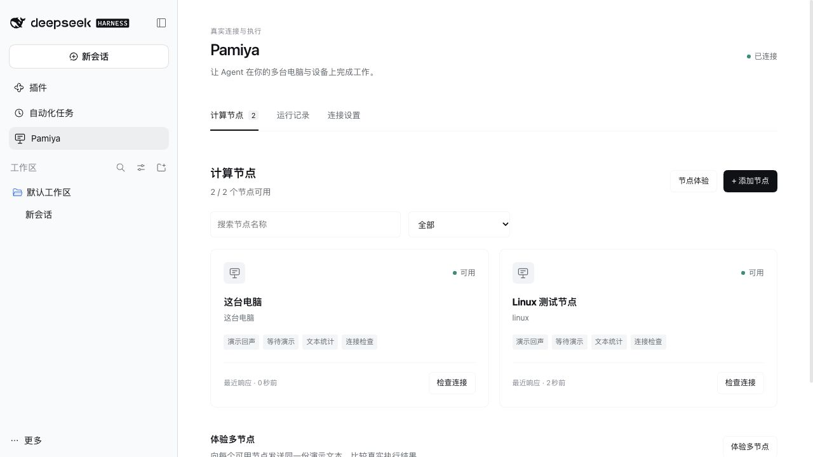

# DSH 插件验收记录

[使用指南](dsh-plugin.md) · [English](../en/dsh-verification.md)

验证日期：2026-10-16。本页公开截图来自真实 DSH Web Host，不是 `prototype/`；原生桌面与模型验收结果另列在下方。

## 已验证

- DSH `0.2.0-rc.2` Web 组合和 `0.2.1-alpha.4` Web 组合均成功加载插件、侧栏、认证 API 与工具。原生桌面 `0.2.0-rc.2` 也已完成插件加载、本机自动加入、远端配对及双节点实际执行。
- `0.2.1-alpha.4` 中，本机 macOS Worker 与独立 Linux x64 服务器 Worker 通过 RunMQTT 公共测试连接在线；同一演示文本的统计任务均得到真实完成结果。
- 在实际界面启动远端 90 秒等待任务并请求停止，界面收到“已停止”，远端日志确认取消结果已获 Host ACK。
- Linux Worker 采用独立 Node.js 24.22.0（来自官方发布并校验 SHA-256），由 systemd 托管；服务重启后自动恢复连接，执行日志保留，配置/日志文件权限为 600。
- 插件重载后本机托管 Worker 恢复；自动化另验证主动停止的节点不会自动重启，也不会重复创建本机节点。
- 中英文文案切换、远端配对默认选中、已存在本机节点时禁止重复创建、任务列表与状态回显均在真实宿主操作。
- 自动化共 15 项，覆盖真实 MQTT 双 Worker、去重、停止确认、暂停、Host 重启、Worker 强制退出、路径范围、私有文件/命令、本机能力配置、预先取消的工具、宿主 API 与配置保留。
- 插件生产依赖审计为 0 项漏洞；仓库文档渲染依赖另有既存 KaTeX/Mermaid 低风险提示，不通过跨主版本升级混入本次实现。

## 公开安装包验证

`v0.1.0` 的公开 GitHub Release 地址已在全新、隔离的 DSH `0.2.0-rc.2` Web profile 中验证：通过 URL 成功安装 `@pamiya/dsh-plugin@0.1.0`，组合配置已选中插件层；重新公开下载的文件与发布的 SHA-256 一致。使用者无需源码构建，桌面界面安装步骤见[上手指南](quickstart.md)。

## 原生 Agent 端到端验证

在桌面宿主的“极简模式”中，使用已有 DeepSeek-V41-Flash / High 模型配置。Agent 调用 Pamiya 工具，在两个实际节点分别执行 `system.check` 和 `text.stats`，将真实结果返回对话。Host 中四条任务均保存了同一 DSH Session 关联，并得到 `succeeded`；远端执行日志已收到 Host 的结果确认。

| 节点 | 系统 | Node.js | `Hello Pamiya` 统计 |
|---|---|---|---|
| 本机 | darwin | 24.18.1 | 12 字符、1 行、2 词 |
| Linux 测试节点 | linux | 24.22.0 | 12 字符、1 行、2 词 |

手动显示/隐藏配对命令也已在原生窗口验证。Linux 服务已从隔离 alpha 测试宿主切换到桌面宿主；仍由同一个 systemd 服务管理，之前的测试日志已保留。

## 对话节点选择（v0.1.1）

原生 DSH 输入框上方已验证“执行节点”选择、“管理节点”直达及新对话首条消息前选择；完整重启桌面应用后仍保留所选节点。在专用验收对话选中 Linux 后，不在消息中写节点名，发送“检查所选电脑的系统信息，再统计 Hello Pamiya”，两条新增真实任务均绑定 Linux 并完成，系统为 linux / Node.js 24.22.0。另一个新对话请求未开放的 ping 命令，模型明确说明该节点缺少 Shell 能力，没有产生代替执行的 Pamiya 任务。

新增自动化覆盖对话隔离、选择持久化、固定目标实际执行、冲突 ID 拒绝、暂停/移除后不改派，以及切换选择后重试仍读原任务。模型提示负责解释执行位置；插件不拦截所有 DSH 原生工具。

## 尚未验证

Windows/其他桌面系统的进程行为仍待验收。真实模型测试使用桌面已有配置，没有将个人 API Key 复制到隔离测试 Host；输入均为合成内容。私有文件和显式授权的命令执行已通过本地真实进程测试，未通过公共服务测试。

这些证据证明当前实现链路，不代表多租户生产平台、操作系统沙箱或故障自动改派已交付。

[远端停止确认界面](../../packages/dsh-plugin/design/remote-cancel.zh-CN.png)。
