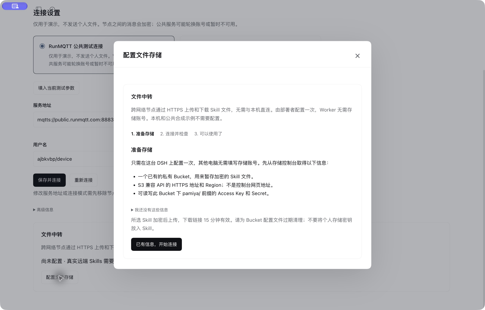

# 配置文件中转存储

[English](../en/file-storage.md) · [Skills 使用指南](skills.md)

只有将自己的 Skills 带到远端时才需要配置。本机和公共合成示例可直接体验。配置只在运行 DSH 的电脑上完成一次，Worker 不填存储账号，也不需要与本机直连。



## 界面会带你完成

首次真实远端 Skill 任务缺少存储时，任务停在“需要准备”，Agent 尚未启动。打开 **Pamiya → 运行记录 → 该任务 → 配置文件存储**，按三个步骤操作：

1. **准备存储**：引导说明所需信息；已有 Bucket 时继续，没有时按下节准备，或请维护者协助。
2. **连接并检查**：填写信息，点击“检查连接并保存”。Pamiya 实际上传一个测试文件，用签名链接下载并核对内容，再清理测试文件。失败时保留表单与原来的有效配置。
3. **可以使用了**：点击“返回并继续刚才的任务”，继续同一个任务、节点与 Skill 版本。

也可提前打开 **Pamiya → 连接设置 → 文件中转**。不要把存储密钥发到对话里；在密码输入框填写。

## 先准备哪些信息

从已有 S3 兼容服务的控制台准备：

| 字段 | 应填写什么 |
|---|---|
| HTTPS endpoint | S3 API 地址，例如 `https://s3.example.com`；不是控制台首页或某个文件的分享链接 |
| Bucket | 已创建的私有存储桶名称，不含 `s3://` 或目录后缀 |
| Region | 服务控制台提供的签名区域；`us-east-1` 只是初始值，按实际服务修改 |
| Access Key ID / Secret Access Key | 可访问此 Bucket 的专用凭据，保存在 DSH 凭据服务 |
| 路径式 Bucket 地址 | 高级选项；根据服务对 `endpoint/bucket/key` 与 `bucket.endpoint/key` 的要求选择 |

没有现成存储时，在自己使用的 S3 兼容服务中创建 Bucket 和专用密钥。当前插件不会代开云账号、创建付费资源或为每个 Worker 分配云账号。Bucket 保持私有即可，限时签名链接允许 Worker 下载特定对象。[签名链接说明](https://docs.aws.amazon.com/AmazonS3/latest/userguide/ShareObjectPreSignedURL.html)。

## 访问权限与清理

Pamiya 仅在 `pamiya/` 前缀下写文件。兼容 AWS IAM 策略的服务可使用下面的对象权限模板，替换 `YOUR_BUCKET`；其他服务按其控制台授予等价权限。模板用于应用 API，不含云控制台浏览权限。[S3 权限参考](https://docs.aws.amazon.com/AmazonS3/latest/userguide/example-policies-s3.html)。

```json
{
  "Version": "2012-10-17",
  "Statement": [
    {
      "Effect": "Allow",
      "Action": ["s3:GetObject", "s3:PutObject", "s3:DeleteObject"],
      "Resource": "arn:aws:s3:::YOUR_BUCKET/pamiya/*"
    }
  ]
}
```

为 `pamiya/` 配置合适的对象生命周期清理，例如 7 天。节点本地已有的版本缓存不受影响；缺失版本会从 Host 固定快照重新上传。不要让外部清理程序在正在下载时立即删除文件。上传和下载可能产生存储、请求与流量费用，按所用服务计费。

## 连不上时怎么处理

| 现象 | 处理 |
|---|---|
| 找不到主机 / TLS 错误 | 检查 API 地址和证书，确保 Host 与 Worker 均可通过 HTTPS 出站访问；不要填仅本机可达的地址 |
| Access denied / Invalid key | 检查专用密钥及 `pamiya/` 前缀读写权限 |
| Bucket 不存在 | 先在服务控制台创建 Bucket，确认拼写和所在区域 |
| 签名不匹配 / 重定向 | 检查 Region、API endpoint、地址形式和机器时间；使用服务给出的直接 API 端点 |
| Host 检查通过，Worker 下载失败 | Worker 可能处于另一网络，检查它的出站策略和 DNS；双方无须彼此可达，但都要能访问存储域名 |

测试只检查连接、对象读写和签名下载，不承诺任意地域、代理或第三方实现均兼容。当前真实 Linux 合成验收使用公开 HTTPS 测试文件；私人 Bucket 的自动化适配检查与实际部署验收分别记录在[验收页](dsh-verification.md)。
