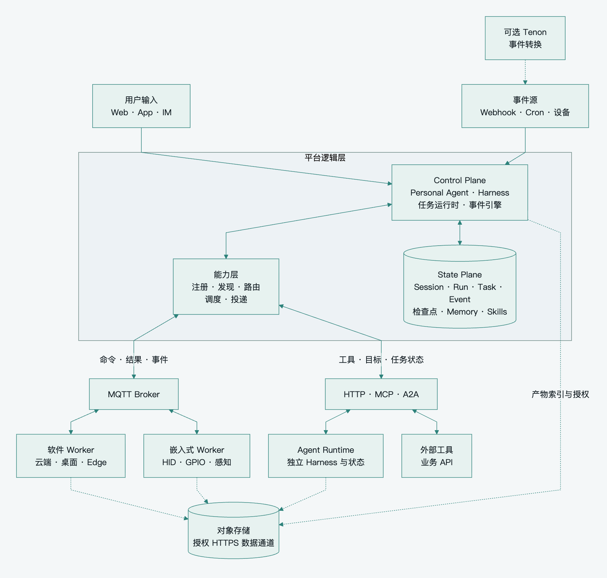
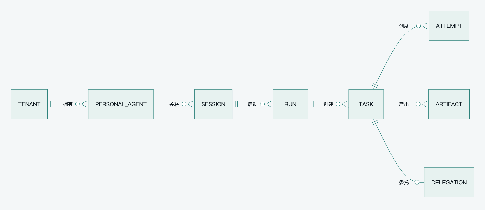
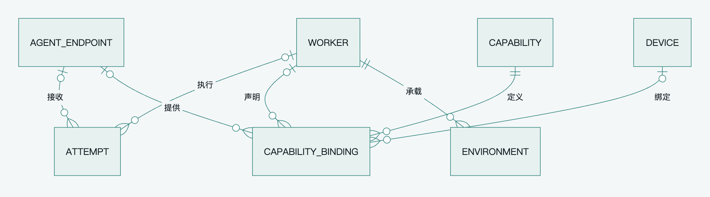
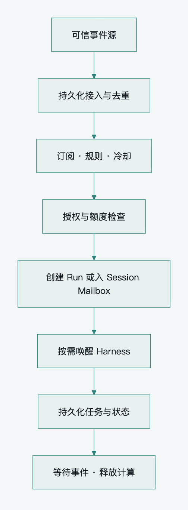

[English](../en/platform-architecture.md) · **简体中文**

# Pamiya 平台架构与核心模型

平台由入口与事件接入、Control Plane、State Plane、能力发现与路由、传输和 Execution Network 组成。Personal Agent 持续承担用户目标，Harness 按需运行，能力网络承接具体工具操作或远程 Agent 子任务。

导航：[阅读指南](README.md) · [架构决策](architecture-patterns.md) · [通信协议](capabilities-and-protocol.md)

## 总体架构

[查看 SVG](../../assets/diagrams/readable-overview.zh-CN.svg) · [布局源码](../../scripts/render_readable_architecture.py)

Control 直接读写 State；MQTT 承担 Worker 控制与回报，工具和 Agent 适配器使用提供方接口。所有执行类型通过授权 HTTPS 传输文件。总览展示目标拓扑，各类执行端按实施路线逐步接入，首版保持单活协调和固定设备归属。

### 详细模块关系

[查看 SVG](../../assets/diagrams/platform-overview.zh-CN.svg) · [可编辑 Mermaid](../../assets/diagrams/platform-overview.zh-CN.mmd)

图中是逻辑模块，不表示全部需要拆为独立服务。State Plane 与 Broker 并列：Control 直接读写状态，Broker 负责执行端消息。执行端 HTTPS 数据通道表示所有执行类型共用的 Artifact 传输方式；首版上传后校验和关联，不要求默认经过独立 finalize 管道。详细调用顺序见 [完整执行时序](reliability.md#完整执行时序)。

## 模块职责

| 模块 | 持有或负责 | 边界 |
|---|---|---|
| Gateway | 入口协议、用户身份、租户、会话路由 | 不以进程内状态保存长任务 |
| Personal Agent Manager | 目标、职责、会话关系、唤醒与运行配置 | 不直接管理 MQTT 连接 |
| Harness Adapter | 上下文、模型循环、工具调用转换、检查点 | 不承担具体 Broker 与设备实现 |
| Event Engine | 事件校验、去重、规则、触发记录和 Run 创建 | 不对每条遥测启动模型 |
| Task Runtime | 状态机、审批、取消、结果接入与恢复 | 不以消息到达证明业务成功 |
| Registry 与 Resolver | 能力元数据、资源归属、授权后的发现 | Worker 自报能力不等于被授权 |
| Scheduler | 能力匹配、容量、环境亲和性、Attempt 与执行归属 | 不将 Broker 共享订阅视为完整调度 |
| Dispatcher 与 Router | 重试可恢复的发布、协议绑定和结果关联 | 不替代数据库提交与业务确认 |
| State Plane | 平台权威事件、任务、检查点和产物引用 | 不承诺掌握第三方 Agent 全部内部状态 |
| Worker | 接单、本地工具、状态与结果重报 | 不拥有跨租户全局调度权 |
| Remote Agent Runtime | 委托目标、自有推理循环、内部工作状态 | 按约定报告可查询任务和产物 |
| Tenon | 可选转换、聚合、协议与数据源集成 | 不取代 Harness、Scheduler 或状态库 |

## Personal Agent 与 Harness

Personal Agent 表示用户长期委托的主体：它关联身份、目标、规则、权限和记忆。Harness 表示某次推进工作的引擎：加载上下文、调用模型、发起工具任务、暂停或结束。

因此一个 Agent 可以关联多个 Session 和 Run。Run 完成后释放 Harness，Agent 的目标、状态与下一次触发规则仍然存在。支持迁移时既要转换模型上下文，也要保留未完成任务、审批、产物和外部操作记录。是否可以迁移正在运行的厂商会话，受 [Harness 兼容条件](architecture-patterns.md#harness-的兼容条件) 约束。

## 核心对象与关系

以下是首版需要保留的领域关系。对象不等于独立表或服务；能力定义、触发状态、审批和检查点可以作为已有记录的结构化字段。

[查看 SVG](../../assets/diagrams/domain-model.zh-CN.svg) · [可编辑 Mermaid](../../assets/diagrams/domain-model.zh-CN.mmd)

模型拆成工作链路与执行能力两个视图，ATTEMPT 在两张图中是同一个对象。

[查看 SVG](../../assets/diagrams/execution-model.zh-CN.svg) · [可编辑 Mermaid](../../assets/diagrams/execution-model.zh-CN.mmd)

| 对象 | 含义 | 建议关键字段 |
|---|---|---|
| PersonalAgent | 长期目标与职责主体 | tenant_id、owner_id、policy_ref、harness_config、memory_scope |
| Session | 连续交互与上下文边界 | agent_id、version、当前 Run、待处理消息 |
| Run | 一次目标推进或触发执行 | session_id、trigger_event_id、status、运行限额、checkpoint、completion_evidence |
| Task | 单个工具意图或委托 | run_id、tool_call_id、kind、capability_version、binding_id、args 或 payload_ref、action_id、审批状态、执行期限 |
| Attempt | Task 的一次执行归属 | task_id、attempt_no、worker_id 或 agent_endpoint_id、environment_id、status、开始及结束时间 |
| Worker | 能力提供节点 | identity、tenant_id、protocol_version、recovery_profile、capacity、boot_id、connection_id、heartbeat_at |
| AgentEndpoint | 具有委托语义的远程 Agent 接入点 | tenant_id、adapter、endpoint_ref、agent_card_ref、auth_scope、supported_operations |
| Environment | 工作目录、浏览器会话或设备操作现场 | worker_id、owner_scope、type、status、generation、snapshot_ref |
| Device | 手机、板卡、摄像头等物理资产 | owner、device_id、model、firmware、association、revocation_state |
| Capability | 能力定义及输入输出契约 | name、version、description、input_schema、output_schema、execution_mode |
| CapabilityBinding | 某提供者提供某能力的绑定 | worker_id 或 agent_endpoint_id、capability_version、device_id、environment_constraints、readiness |
| Event | 可去重的发生事实 | event_id、source、occurred_at、received_at、处理状态；按来源需要增加 source_event_id、source_epoch |
| Event 的触发记录 | 一条规则对一次事件的处理，可内嵌 Event | event_key、rule_id、run_id、disposition |
| Artifact | 输入或成果的持久化引用 | tenant_id、object_key、digest、size、media_type、保留期限；存储支持时加 object_version |
| Delegation | 平台与子 Agent 任务的对应 | task_id、delegation_id、remote_task_id、remote_context_id、adapter、remote_state、status_cursor、cancel_state |

涉及多个物理设备或执行提供者时，可把关联关系实现为关联表。Tool Binding 与 Attempt 关联 Worker，Delegation 关联 AgentEndpoint，二者采用互斥约束，不能要求第三方 Agent 拥有 MQTT boot_id 或 Worker 心跳。首版设备固定执行归属，有状态 Environment 保存当前占用 Task；Device 和 Environment 即使共用存储也保留不同语义。主外键、唯一性和查询保留租户作用域。

`task_id` 标识逻辑意图，`attempt_no` 标识执行轮次，`action_id` 标识工具意图中的副作用单元。重试同一单元时保持 action_id；用户要求再次操作则创建新的 ID。复合工具的多个效果使用稳定子 action_id 并分别记录；委托任务用 delegation_id 标识远程创建意图，不能把所有子 Agent 操作挤进同一个 action_id。

Task 的粒度是上层工具意图或委托目标，Worker 内部的鼠标移动、校准采样、按键扫描码和网络分片无需逐个创建 Task。复合工具只有需要独立重试或核对的效果才细分 action_id，普通可恢复工具不预先引入多步骤执行账本。

### 持久化约束

唯一性覆盖 `(tenant_id, run_id, tool_call_id)` 的任务意图、`(tenant_id, task_id, attempt_no)`、来源与 event_id，以及 delegation_id 到远程任务的映射。首版将稳定工具调用关联与检查点保存在 Task、Run 和事件记录中；工具调用 ID 在同一 Run 内唯一，不要求单独实现 RuntimeStep 子系统。Task 的 current_attempt 与版本通过条件更新维护。

关联校验必须包含 tenant_id。仅分别声明 tenant_id 和对象 ID 的外键不能阻止跨租户误关联；采用组合外键或等效数据库约束，并让未绑定 Device 的 Binding 具备明确的空值语义。数据库唯一与外键约束的机制见 [PostgreSQL Constraints](https://www.postgresql.org/docs/current/ddl-constraints.html)。

审批可以保存为 Task 上的参数摘要、批准范围、状态与有效期；能力定义与提供者 Binding 可以共用注册表。模型回复保存到 Run 的事件或检查点。只有历史查询、并发或规则复杂度需要时再拆表。

多活控制循环增加 Session Lease；自动接管共享资源增加 ResourceLease 与资源 fence；离线授权增加签名 ExecutionGrant；并行子 Agent 需要严格费用上限时增加 BudgetReservation。它们是有触发条件的机制，不是每个首版 Task 的必选字段。

## Run 状态与目标完成

Run 区分运行、等待、取消中与终态。WAITING_TASKS、WAITING_INPUT、WAITING_APPROVAL 和 RECONCILING 按实际接入功能使用，不为首版未支持的流程提前实现转换。等待时保存检查点并释放 Harness，不占用长期数据库事务。

工具 Task 成功只满足该能力的契约。Run 转为 SUCCEEDED 需要 Harness 提交目标完成证据，且没有仍可产生副作用的必需 Task 或子 Agent；允许脱离父 Run 的任务必须显式登记独立归属。失败或取消时先停止派生新任务，跟踪在途子任务；不能结束父 Run 后任由子 Agent 继续行动。

先保存模型回复和稳定工具调用 ID，再在版本保护的事务中登记 Task 与检查点。模型响应未保存时可重新请求；已登记的工具意图通过唯一约束复用，不能发出第二次动作。首版使用 Session 串行队列，等待工具或用户时释放运行资源，保留检查点。

## Worker Environment Device 分别建模

一台云端 Worker 可以管理多个隔离浏览器 Environment；同一个 Shell Environment 连续运行的命令依赖同一工作目录。不能在每个 Tool Call 之间随机换节点，除非环境已经恢复或可迁移。

桌面 Worker 提供文件、浏览器和桌面能力，任务权限仍限定到该用户、工作区和登录上下文。ESP32 Worker 可控制一部绑定手机；手机属于 Device，摄像头标定与操作现场属于 Environment。MQTT 在线并不保证 HID 连接或摄像头就绪。

Environment 需要生命周期：创建、就绪、占用、失效、恢复或销毁。迁移工作现场必须处理文件、登录态、标定和未完成操作，Worker ID 相同不能证明 Environment generation 没有改变。

需要固定节点的能力把 binding_id、Worker 和 Environment 锁定到 Task；允许换节点的能力按同一版本 Schema 和资源约束重新选择 Binding。发现阶段的候选能力不能代替任务分配的持久化绑定。

## 工具执行与 Agent 委托

| 维度 | Tool Execution | Agent Delegation |
|---|---|---|
| 输入 | browser.click、camera.capture 等具体操作 | 开发功能、研究问题等目标 |
| 下一步决定权 | 上层 Harness | 子 Agent Harness |
| 任务状态 | 平台定义的 Task 与 Attempt | 平台映射远程任务状态 |
| 内部控制状态 | 平台或对应 Harness 管理 | 可以属于远程 Runtime |
| 平台需要掌握 | 输入、执行归属、结果、副作用 | 目标、远程 ID、预算、权限、进度、产物 |
| 恢复方式 | 查询、重发结果、恢复环境或安全重试 | 按远程 ID 查询并续接跟踪 |

子 Agent 的模型上下文、内部推理和工作目录不必复制到平台 State Plane。平台保存委托关系、外部可观察状态和产物，Adapter 提供创建、查询、补充输入、取消和重新跟踪接口。对方不支持的操作须明确返回能力限制。

子 Agent 的权限不能超过父任务可授权范围。首版用派生深度、并发数、运行时长、模型调用次数和可用的提供者费用上限限制执行，记录实际用量。多个子 Agent 共享严格费用预算时再实现原子预留；没有提供者硬限额支持时不承诺绝不超额。

## Always-on 的事件链路

[查看 SVG](../../assets/diagrams/event-activation.zh-CN.svg) · [可编辑 Mermaid](../../assets/diagrams/event-activation.zh-CN.mmd)

事件源可以是 MQTT、用户消息、Webhook、日程和定时器。触发记录以事件或窗口、规则和规则版本建立去重键，Run 创建与触发记录原子提交。高频遥测允许按声明的丢失策略采样；重要业务事实采用持久化源或 [EVENT_ACK 与重放](capabilities-and-protocol.md#事件接入与可靠触发)。

分别保存 occurred_at 和 received_at，过期现场不能直接触发当前设备动作。首版采用简单事件匹配和 Cron 发生标识去重，错过定时触发先选择跳过或合并。事件时间窗口、历史重放和规则版本迁移只在业务确实需要时建设。

事件只是输入，执行权限来自当前用户授权和策略。自动触发同样受审批、设备所有权、预算和撤销状态约束。

## Memory Skills 与恢复状态

Memory 保存可复用知识，Session 保存交互事实，Task 保存执行意图和进度。三者不能互相替代。Memory 的权威内容也需要持久化和来源关联；可重建的是其索引与缓存，已发生操作的记录和不能重建的记忆内容需要独立保留。

Skills 采用平台可管理的版本化定义与资源引用。Run 记录实际使用的版本，避免规则或技能更新改变未完成任务的含义。Harness 专用会话数据通过 Adapter 保存必要的恢复引用，但平台任务模型不绑定单一厂商格式。

Skill 文本、检索记忆、外部工具输出和设备观测都可能包含不可信内容，不能修改执行权限。产物、记忆和技能资源的删除与授权生命周期必须协调；审批绑定的输入使用不可变版本及摘要，不能在审批后通过同一个对象 key 偷换内容。

## 执行隔离与凭据边界

认证证明消息来自哪个节点，不证明结果一定正确。验证与风险相称：普通查询和可恢复工作使用工具结果；对外发布、不可逆业务操作和重要物理动作再结合业务查询或观测核对。工具输出按外部数据处理，不作为新的授权。

云端执行生成代码时，租户文件系统、进程、网络与资源限额通过沙箱边界约束；平台管理凭据、Broker 发布权限和其他租户凭据不进入该沙箱。Worker 宿主控制进程持有执行凭据，按最小权限代理访问外部工具。仅提供不同 cwd 或工作目录不是安全隔离。

桌面和企业 Edge 使用各自授权边界，明确可访问工作区和网络。设备固件通常不能实现容器隔离，依靠固定指令集、独立身份和本地控制守卫限制权限。通用 Shell、桌面操作与固定 HID 能力不能因共享 Worker 模型就宣称拥有相同隔离保证。
