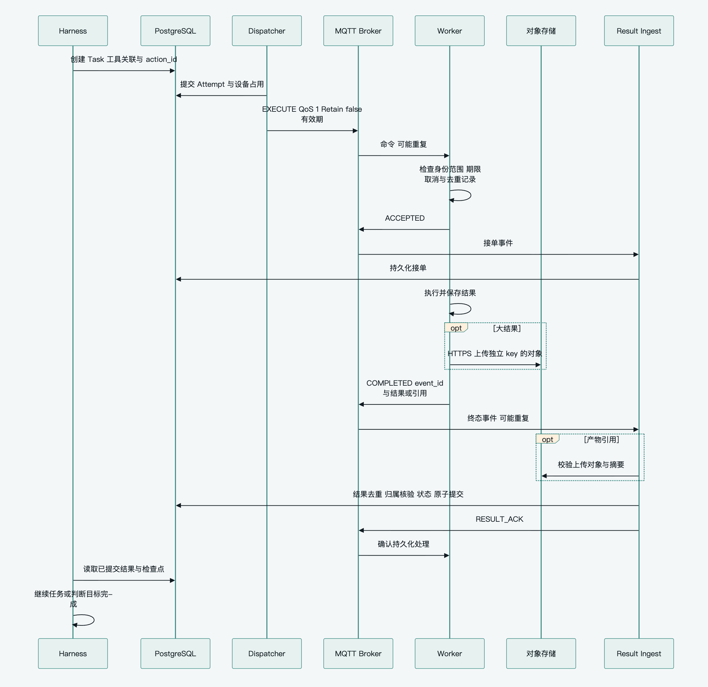
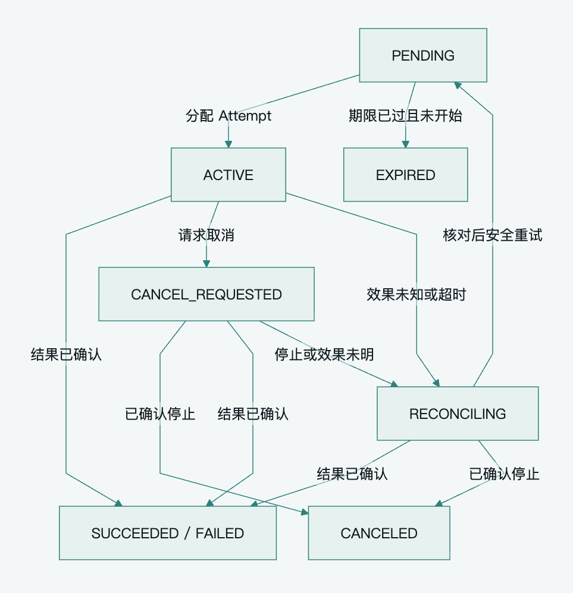

[English](../en/reliability.md) · **简体中文**

# Pamiya 可靠执行与故障恢复

可靠执行依靠持久化意图、明确归属、业务确认和合适的重试规则。首版采用 [单活调度与固定设备归属](architecture-patterns.md#首版实现基线)，不同时建设多活接管、离线授权和自动灾备。平台支持至少一次投递，不能保证所有外部动作恰好执行一次。

导航：[阅读指南](README.md) · [通信协议](capabilities-and-protocol.md) · [实施路线](technology-and-roadmap.md)

## 首版必须保证的边界

1. Task 与执行意图提交后才下发，崩溃后能重新发现未完成工作。
2. 重发同一 Attempt 不重新执行；未知的重要副作用先核对。
3. 结果入库后才返回 RESULT_ACK，协议 ACK 不代表工具完成。
4. 同一 Session 和有状态设备串行处理；旧结果不能覆盖新 Attempt。
5. Worker 登记取消后不接受该 Task 的旧动作；取消请求不等于已停止。
6. 不把工具完成、用户目标完成、未知效果和通信超时混成一个成功或失败状态。

这些是业务正确性要求。它们可以由已有表、条件更新和 Worker 本地记录实现，不要求各自建立服务。

## 持久化意图驱动执行

Harness 先保存 Task、稳定 tool_call_id、输入、action_id、目标与期限，再由 Dispatcher 领取。分配事务登记 Attempt、Worker、Environment 与忙闲占用，确认 Task 未取消且权限有效，提交后通过 MQTT 发布。不要持有数据库行锁等待网络确认。

首版一个活跃 Dispatcher，用条件更新防止重复领取；需要多个消费者并发扫描时再采用 FOR UPDATE SKIP LOCKED。PostgreSQL 支持它用于减少队列式表的锁竞争，但它不是完整业务队列。[PostgreSQL SELECT](https://www.postgresql.org/docs/current/sql-select.html)

Task/Attempt 保存投递状态、下次重试时间、次数和错误。发布失败或进程崩溃后重新扫描，重发保持 task_id、attempt_no 和 action_id。未收到 PUBACK 或 ACCEPTED 不能直接创建第二次动作；先重投同一意图或查询节点状态。

业务事务需要向多个系统可靠发布领域事件时再使用 Outbox；数据库扫描已经覆盖的 Task 投递不再重复引入另一套恢复入口。首版设置消息大小、并发、重试次数和运行时间上限，永久错误停止重试并保留原因。复杂公平调度、分级队列和死信重放根据真实积压增强。

## 完整执行时序

[查看 SVG](../../assets/diagrams/execution-sequence.zh-CN.svg) · [可编辑 Mermaid](../../assets/diagrams/execution-sequence.zh-CN.mmd)

唤醒 Harness 的通知可以作为优化，检查点与数据库扫描保证通知丢失后仍可继续。文件已上传但数据库未提交时重新校验和关联；上传失败只补传文件，不重新执行已经发生的工具。

## 业务确认与执行记录

Worker 用一份 Task 执行记录保存接单、结果和 canceled 标记。重复 Attempt 返回当前状态或重报相同 event_id 的终态，内容冲突拒绝。重要副作用先可靠保存执行意图再开始；只读能力可以使用轻量缓存。volatile 设备断电后对未知重要动作报告 unknown，不承诺跨断电去重。

Control 将去重记录、结果事实和 Task 状态在同一事务提交后返回 RESULT_ACK。确认丢失时再次接收并确认 duplicate。结果的 event_id 防重复消息，current_attempt 与版本约束防止旧轮次覆盖新状态；二者不能互相替代。

超时不使真实结果失去核对价值。若任务正在 RECONCILING，可据迟到结果完成核对；已有新执行时不由旧结果直接改写当前状态。异常与冲突写入可查询的错误记录，首版无需独立隔离服务。

小体量执行、去重和取消记录保留到命令有效期、离线重报与重试窗口结束。RESULT_ACK 允许回收大结果的重报缓存，不立即删除去重依据。使用统一保留期限先闭环，存储规模或审计要求出现后再分层归档。

## Task 与 Attempt 状态

Task 表示逻辑意图，Attempt 表示一次执行归属；两者共用实现也保留不同标识和状态。等待输入仅在实际接入子 Agent 时使用，审批仅在策略要求时使用，不为未上线功能提前实现整套工作流。

| Task 状态 | 含义 |
|---|---|
| PENDING | 已保存，等待分配 |
| WAITING_APPROVAL | 参数与资源范围待批准 |
| WAITING_INPUT | 已有子任务等待补充信息 |
| ACTIVE | 已分配或执行中 |
| RECONCILING | 需要先核对执行效果 |
| CANCEL_REQUESTED | 取消已登记，停止尚待确认 |
| SUCCEEDED | 能力契约成功，结果已保存 |
| FAILED | 已知失败且不再重试 |
| CANCELED | 未开始或已确认停止，既有副作用保留 |
| EXPIRED | 开始期限已过且确认未开始 |

Attempt 记录 ASSIGNED、ACCEPTED、RUNNING、COMPLETED、FAILED、REJECTED、LOST 或 CANCELED。LOST 是通信或归属不明，不是证明执行失败。effect_status 分别记录 not_started、confirmed、partial 或 unknown；Task 失败也可能产生部分效果。

[查看 SVG](../../assets/diagrams/task-lifecycle.zh-CN.svg) · [可编辑 Mermaid](../../assets/diagrams/task-lifecycle.zh-CN.mmd)

图中展示执行与核对的主路径；等待输入、审批及具体终态的约束见状态表与下文。

转换使用版本条件。迟到 RUNNING 不将终态改回运行；执行超时不能直接标为未开始的 EXPIRED。WAITING_APPROVAL 在未分配时批准后回 PENDING，在远程任务已存在时恢复原 Delegation；拒绝已存在的任务先请求停止。

回 PENDING 的重试满足尚未取消、权限有效和次数限额，并按操作语义判断。unknown 不自动等于必须人工介入：可以通过新观测、查询或安全重试解决时由系统处理；无法核对的重要副作用才进入人工处理。

## 按操作语义重试

| 类别 | 例子 | 首版处理 |
|---|---|---|
| 只读 | 查询、拍照、读文件 | 期限内自动重试 |
| 可恢复操作 | UI 导航、滚动、工作区生成或编辑 | 观察当前状态后继续或重做，不逐步审批 |
| 目标状态或支持幂等键 | 设置指定配置、具备幂等 API 的操作 | 保持 action_id，在条件仍有效时重试或收敛 |
| 重要一次性副作用 | 对外发送、重要删除、付款或物理一次动作 | 查询或观测先核对，无法确定时不盲目重放 |

风险由能力、参数和当前任务决定。普通 hid.click 的导航与点击发送按钮不能套用同一审批要求；camera.capture 的复拍与电机相对转动也不能套用同一重试策略。

未决状态只限制可能冲突的设备或 Environment，不冻结其他设备、独立 Run 和只读能力。现场电机等控制使用本地时限与安全停止机制，不依赖中心模型实时循环。

## Session 与设备串行

首版在一个活跃控制实例内按 Session 串行处理，待处理消息、Run 检查点和 Task 持久化。等待工具、人工输入或审批时提交检查点并释放 Harness。Task 上的稳定 tool_call_id 与唯一约束防止同一模型回复重建任务，检查点写入使用 Session/Run 版本条件。

设备固定执行归属，Control 保存占用，Worker 按本地容量和队列串行执行。有状态 Shell、浏览器和手机任务保留 Environment 亲和性。只读或可重建环境可换节点；未知重要效果不能因 Last Will 或断线就自动接管。

多个活跃 Harness 同时推进同一 Session 时，才增加会话租约或 Actor 所有权；跨节点自动接管同一资源时才增加资源 fence。单个进程队列不等于已解决多实例串行，但单活部署不需要先实现多活接管协议。

## 审批与取消

既有授权内的读取、导航、生成文档和可恢复工作区编辑直接执行。对外发布、重要删除或较大影响物理操作检查其授权范围；用户已经明确授权具体动作时无需再次确认。只有范围不足或策略要求额外批准时进入审批，关联 Task、参数摘要和资源；实质变化后重新检查，不默认每工具调用都签名或回调授权服务。

Control 先保存 CANCEL_REQUESTED，停止新的 EXECUTE，再发送 CANCEL。未分配任务可直接取消；已发布任务没有 ACCEPTED 也不能断言未开始。Worker 在 Task 记录中保存 canceled，包括尚未见过 EXECUTE 的任务；收到并登记 CANCEL 后拒绝迟到动作。再次执行创建新 Task，不复活原任务，因此无需 cancel_generation 和独立墓碑服务。

取消登记与实际停止分别报告。取消之前已在途的单次动作仍可能发生，首版是可查询的尽力停止语义；要求严格即时撤销的业务再增加执行前在线检查或更强资源控制。未知效果只暂停相关动作，用户可以继续其他工作。

子 Agent 等待输入或授权时保持 remote_task_id，不新建替代任务。父 Run 取消时停止派生并跟踪在途子任务，不支持取消的 Runtime 明确报告能力限制。普通手机画面漂移由重观测处理，目标不明且误操作后果较大时再暂停或确认。

## 条件增强机制

| 触发条件 | 需要增加 | 首版替代 |
|---|---|---|
| 多个控制者自动接管 Session | Session Lease、旧所有者写入隔离 | 单活控制与版本条件 |
| 不同 Worker 接管同一设备或共享环境 | ResourceLease、资源作用域 resource_fence、共同资源守卫 | 固定归属、占用与未决冲突不接管 |
| 长任务需要持续授权、续权或撤权 | 显式续租、lease_revision | 开始期限与本地 max_runtime_ms |
| 离线自治或跨组织不信任传输 | 签名 ExecutionGrant 与撤销窗口 | TLS、Broker ACL、固定能力范围 |
| 严格并行费用预算或按量结算 | 原子 BudgetReservation、幂等结算 | 迭代、时长、派生与并发限额、用量记录 |
| 自动灾备恢复或旧控制者可能存活 | control_epoch、自动账本对账和资源代际隔离 | 停止派发、人工对账后恢复 |

resource_fence 必须在资源作用域递增并由实际写入端校验，Task 的 Attempt 号不能代替它。租约失效不是停止证明。签名、Epoch 或预留账本只有在对应需求出现时才值得引入，不能当作所有短任务的默认开销。

## 数据恢复与结束条件

恢复旧数据库前停止派发，确认旧控制进程不再工作，核对 Worker 记录与已知业务效果，隔离可能滞留的命令后恢复。不能立即重跑旧 PENDING 队列；首版将它写为操作规程，不要求自动灾备系统。

Run 使用迭代次数、运行时间、子任务数量和并发上限限制消耗，记录实际用量；提供者不支持硬费用上限时不承诺绝不超额。等待输入释放 Harness，按目标结果与必需 Task 判定结束。一个设备的不确定状态不阻止其他独立目标，但仍需清楚报告尚未核对的效果。

## 故障验收矩阵

| 首版场景 | 必须观察到的行为 |
|---|---|
| Task 提交后、发布前崩溃 | 扫描器重新发现，不永久停滞 |
| 命令确认丢失、重复送达 | 同 Attempt 返回已有状态，不重复执行已登记动作 |
| Worker 在动作与结果记录之间断电 | 重要效果报告 unknown 并核对，只读任务可重试 |
| 结果提交后、RESULT_ACK 前崩溃 | Worker 重报，Control 去重并确认 |
| 旧 Attempt 或迟到进度回报 | 不覆盖当前归属或终态 |
| 同进程重连后旧 LWT 到达 | 按当前 connection_id 处理，结合业务心跳判断 |
| CANCEL 已登记后收到 EXECUTE | 旧动作不执行，取消与停止分别记录 |
| 同设备收到不同 Task | Control 占用与 Worker 串行防止冲突 |
| 文件上传成功、结果提交前崩溃 | 重新核验和关联，不重新执行工具 |
| 重要事件重报或建 Run 时崩溃 | 入库去重、触发原子记录、未决事件可补处理 |
| 未授权来源或越权参数 | Broker 或执行端拒绝，不能推进任务 |
| 普通 UI 状态改变 | 自动重观测，重要提交目标不明时暂停 |
| 数据库从旧备份恢复 | 暂停队列，对账后恢复，不自动重放未知动作 |

条件增强验收按实际启用功能追加：多活接管验证旧所有者隔离；资源 fence 验证跨 Task 作用域；续租验证迟到版本；签名授权验证有效与撤销窗口；并行预算验证原子预留。未启用这些功能时不将其故障注入作为首版门槛。

首版记录投递与执行时长、失败和重复次数、未确认结果、未知重要效果及 Run 用量即可。分位数 SLO、租户公平性、长期审计索引和全面追踪根据实际运维需求增强。
