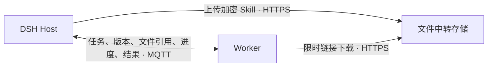

# Skills 随任务按需准备

[English](../en/skills.md) · [上手指南](quickstart.md) · [Agent 与节点](agent-workers.md)

Pamiya 把选中的 Skill、脚本和资源带到执行节点，检查声明的依赖，再交给 DSH、Codex、Claude Code 或 Pi 使用。用户无需在每台电脑上手工复制整个 Skills 目录。

## 第一次体验

1. 打开 **Pamiya → 计算节点 → Skills**，选择 Agent。
2. 点 **运行合成示例**。第一次会同步文件并发现缺少示例依赖，显示“需要准备，Agent 尚未启动”。
3. 点 **准备并继续**。Worker 在独立目录安装内置依赖，继续同一个任务；Agent 读取 Skill 和资源，执行脚本。
4. 看到脚本回传的 JSON，其中 `proof` 为 `PAMIYA_SKILL_OK:48656c6c6f2050616d697961`。运行记录保留节点、版本、检查项和过程。

已缓存、已准备的节点会直接执行。合成示例只使用固定的 `Hello Pamiya` 测试资源，不需要个人文件或外部服务凭据。公共连接只允许这个固定 Skill。

## 使用自己的 Skill

能力列表自动读取 DSH 可见且具有文件来源的 Skills。也可展开 **从本机文件夹添加**，填写 Skill 文件夹或 `SKILL.md` 的路径。选择本次需要的项，点击 **检查所选能力** 或 **准备所选能力**。

- 检查只传文件和检查环境，不安装依赖，也不改变默认选择。
- 成功“准备所选能力”后，该节点对应 Agent 的后续委派默认使用这些 Skills。对话可显式指定其他列表；传入 `[]` 表示这次不用托管 Skills。
- 缺少可安装的 Node/Python 包时，点击“准备并继续”自动补齐。系统命令、环境变量、平台或 Agent 不兼容时，界面说明缺项，用户处理后再次继续。
- 一个任务最多选择 8 个 Skill；每个 Skill 最多 64 MB 原始文件、5000 个文件。大型数据集、视频和模型使用文件引用或专用数据存储，避免与能力包反复同步。

普通 Skill 需要 YAML frontmatter 中的 `name`、`description`，可带 `scripts/`、`references/`、`assets/` 等目录。保留可执行位。排除 `.git`、`node_modules`、`.venv`、`.env` 等生成物与环境文件；不打包指向目录外的链接。

## 在对话中触发

可以说：

> 查看 Linux 测试节点可用的 Skills，用 DSH 运行内置 Skill 合成示例；如果缺依赖，先告诉我。

收到“需要准备”后说：

> 准备并继续刚才的任务。

工具契约如下。先使用 `pamiya_workers` 确认目标节点，`pamiya_skills` 的 `list` 返回不透明 Skill ID；导入本机文件夹使用 `operation=import, path=...`。真实业务委派使用 `pamiya_delegate`，填写目标、提示词与所选 Skill ID。公共连接必须使用 `synthetic=true`，只执行固定示例。

```json
{
  "operation": "check",
  "workerId": "worker-uuid-from-pamiya_workers",
  "agent": "dsh",
  "skills": ["sample:pamiya-skill-check"]
}
```

上例为 `pamiya_skills` 的参数。继续准备使用 `pamiya_task`：

```json
{
  "operation": "prepare",
  "taskId": "task-uuid-from-the-previous-result"
}
```

它继续原任务、原节点与原版本。准备状态和完成结果各自回调到原对话；不会因节点离线而改到其他电脑，不重放结果未知的 Agent 任务。

## 文件如何跨网络传输



两端只需出站连接，不要求互相可达，也不需要 SSH、端口映射或额外监听端口。

- 本机直接读取 Host 固定版本的快照，不经过 MQTT 或对象存储。
- 远端 Skill 内容通过 HTTPS 下载。MQTT 的 `files` 控制消息只返回小型文件引用，不传 Skill 文件体。
- 真实远端 Skills 使用 S3 兼容存储。Host 用节点已有密钥加密后上传，Worker 解密并验证内容哈希。Worker 不接收存储 Access Key；下载链接有效期 15 分钟，失效后可重新请求引用。
- 公共合成示例从固定提交的公开 HTTPS 地址下载，只含测试资源。该验证不代表私人 Bucket 已部署或验收。
- 按内容版本缓存；命中时无需请求引用或再次下载。下载中断不会启动 Agent，重试重新下载该文件；当前不支持分段断点续传。

**部署者配置一次：Pamiya → 连接设置 → 文件中转 → 设置文件存储。** 填写 HTTPS endpoint、Bucket、Region、Access Key ID 与 Secret Access Key，选择地址形式，点击“检查连接并保存”。存储 Bucket 需提前创建；账号需要该 Bucket 下 `pamiya/` 前缀的读写，清理连接检查临时对象时还需删除权限。凭据保存到 DSH 凭据服务，界面不回显 Secret。

保存会实际上传和下载一个合成检查文件。Worker 所在网络也必须能访问签名链接的域名。建议为 `pamiya/` 配置对象生命周期清理；不需要每个 Worker 配置存储账号。未配置时明确提示，不退回 MQTT 传文件。

这是本次 Skills 文件通道。已有模型通道仍使用加密 MQTT 分帧；已有小型文件/产物读取接口有严格大小限制，不能当作大文件传输方案。

## 声明依赖

Agent Skills 标准中的 `compatibility` 是给人和 Agent 阅读的说明，不是完整依赖锁。可在 Skill 根目录增加 `pamiya.json`，声明 Pamiya 能检查的要求：

```json
{
  "version": 1,
  "agents": ["dsh", "codex", "claude", "pi"],
  "platforms": ["darwin", "linux"],
  "requires": {
    "commands": ["node", "python3"],
    "env": ["EXAMPLE_SERVICE_TOKEN"],
    "node": [{"name": "example-helper", "version": "^1.0.0"}],
    "python": ["example-parser>=1,<2"]
  }
}
```

示例包名仅展示契约，不代表需要安装的推荐依赖。Node 包也可用 `source` 指向包内相对目录，例如合成 Skill 的 `dependencies/helper`。

准备时在所选版本集合的独立目录运行 npm，并为 Python 创建 venv。Node 的 CJS/ESM、依赖命令和 Python 脚本使用这个环境；不会全局安装或覆盖节点自己的 Skills。准备可能运行依赖包的安装脚本，应选择自己信任的 Skill 和依赖。

检查依据显式声明：无 `pamiya.json` 时仍同步完整内容，但不声称已推断全部依赖；`compatibility` 原样显示供人工判断。系统软件、密钥和未声明的运行条件仍可能需要用户处理。

## 版本与会话

每次委派保存内容哈希；准备等待和进程重启后仍使用这个版本。源目录更新后，界面显示“有更新”，新任务获取新版本。已有 Agent 会话的 Skill 集合固定，更新能力时开启新会话，避免中途替换规则。

同步的目录通过文件路径索引交给 Agent，Agent 使用原生读取和命令工具加载；这不会将完整 Skill 正文强塞进每轮上下文。MCP、插件、登录态、项目文件和个人凭据不随 Skill 自动复制。节点自有原生能力继续按所选 Agent 的规则工作。

[首次 S3 配置引导、权限模板与排错](file-storage.md)。缺少存储时任务等待配置；完成后返回并继续原任务。

续接会话时省略 `skills`，Host 自动沿用该会话先前固定的快照；即使源 Skill 已更新也不改变。新会话才解析最新内容。
