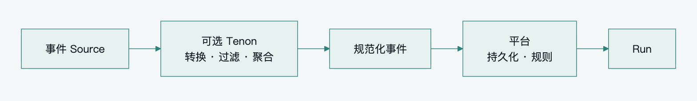

[English](../en/technology-and-roadmap.md) · **简体中文**

# Pamiya 技术选型与实施路线

产品实现优先验证现成的开源 Agent 与 UI，不从零重建 Harness。[基座评审](../product/zh-CN/open-source-foundation.md)首先推荐验证 DSH，明确持久化、完成判断、安排与远程执行的兼容边界。先用一个 Host、一个 Worker 与现有持久化验证 Pamiya 扩展包。下文是分布式部署方案，不是安装插件的必备设施；约束表达目标行为，不代表每层都要自行实现。

首版以单活的模块化 Control 应用、PostgreSQL、对象存储、MQTT Broker 和轻量 Worker 实现闭环。先完成固定执行归属、可恢复任务和必要授权，再按需求扩展远程 Agent、多活接管与事件集成。首版边界统一见 [实现基线](architecture-patterns.md#首版实现基线)。

导航：[阅读指南](README.md) · [平台架构](platform-architecture.md) · [可靠执行](reliability.md)

## 技术选择与引入条件

| 能力或组件 | 首版建议 | 增强或替换条件 |
|---|---|---|
| PostgreSQL | 平台权威状态、Task 队列、Inbox、触发记录 | 依据吞吐、延迟与恢复指标优化 |
| S3 兼容对象存储或 R2 | 输入、文件和产物；数据引用与授权接口隔离厂商 | 按数据区域、成本和访问约束选择实现 |
| Harness Adapter | 选择能把副作用工具交给 Task Runtime 的控制循环 | 不能截获内置工具的 Runtime 走 Agent 委托 |
| Task Runtime 与 Scheduler | 自建必要的状态机、显式调度和恢复扫描 | 复杂长流程出现后再评估工作流引擎 |
| MQTT Broker | 优先评估 BifroMQ，保持 MQTT 5 协议边界 | 对比实际连接、认证、恢复与运维指标 |
| Registry 与 Resolver | 数据库目录、授权过滤、能力 Binding | 增加跨协议索引和复杂语义查询 |
| Event Engine | 轻量接入、确定性规则、去重与按需唤醒 | 大量事件源或复杂流处理再增强 |
| Transactional Outbox | 以 Task 表可扫描发布先闭环 | 一个业务事务产生多个领域事件时引入 |
| 独立耐久消息队列 | 首版不引入第二套 MQ | 数据库分发已测量成为瓶颈或需独立消费积压治理 |
| A2A、MCP Adapter | 先固定内部模型，不强制所有端点实现标准 | 实际第三方接入出现时锁定版本并测试 |
| Tenon | 第二阶段可选 PoC | 多数据源、转换 Pipeline 或 Edge 集成有明确收益 |

表中的必需能力不意味着每项都是独立部署服务，也不意味着某个供应商产品不可替换。

## BifroMQ 的位置

BifroMQ 用作 MQTT 连接与消息基础设施候选。它支持多租户和 MQTT 3.x/5.0，但任务恢复、能力目录、审批和 Agent 会话仍由平台实现。[Apache BifroMQ 项目](https://github.com/apache/bifromq)

生产部署必须配置认证和授权。官方连接文档说明，未配置 AuthProvider 时默认不强制认证和授权；客户端在 username 中填写租户前缀不构成安全身份。平台需要把可信认证结果、Worker 凭据、Topic ACL 和任务授权连起来。[BifroMQ 连接与认证](https://bifromq.apache.org/docs/user_guide/basic/connect/)

选型 PoC 应覆盖目标连接数、重连峰值、TLS 与认证耗时、离线消息过期、Broker 重启、连接限额和跨租户拒绝行为。普通共享订阅与厂商扩展只作为局部优化，平台核心协议不依赖其内部数据结构。

## Tenon 的职责与限制

Tenon 是 Apache BifroMQ 的卫星项目，提供独立 Runner、Source/Sink 插件和 Lua 数据处理，可连接具备相应插件的外部系统，不限于 BifroMQ。其构建目标面向 Linux/macOS 的 x86-64 和 AArch64，不是 ESP32 固件。[Tenon 项目说明](https://github.com/apache/bifromq-tenon)



[查看 SVG](../../assets/diagrams/event-integration.zh-CN.svg) · [可编辑 Mermaid](../../assets/diagrams/event-integration.zh-CN.mmd)

Tenon 的队列、Lua 状态和计时器是易失状态。其交付完成策略还依赖插件的确认和重放行为，不提供耐久消息日志、分布式事务或端到端 exactly-once。因此它减少事件集成代码，不能取代 Task Runtime 和 State Plane。[Tenon Documents 与交付语义](https://apache.googlesource.com/bifromq-tenon/+/HEAD/guide/tenon-document.md)

Lua 可以做过滤、去抖、窗口聚合和格式统一，但相关内存状态在重置后会丢失。重要业务事件应先由可靠源保留，或在转换之前进入持久化接入层；仅在 Tenon 输出之后落库，无法补回此前已经丢失的输入。[Tenon Lua 状态与计时器](https://apache.googlesource.com/bifromq-tenon/+/HEAD/guide/lua.md)

Tenon 管理写权限具有执行工作负载的权限。其默认管理接口没有请求级授权，mTLS 本身也不分配操作权限，插件不会自动进入独立容器或文件系统隔离。适合作为受信管理员管理的集成运行时；互不信任的租户或插件需要部署层隔离和独立授权。[Tenon 安全模型](https://apache.googlesource.com/bifromq-tenon/+/HEAD/SECURITY.md)

### Tenon 的两个候选位置

云端集成层处理遥测过滤、字段和单位规范化、跨系统转发。它把事件转换成平台能理解的输入，Agent 的长期目标和任务恢复仍由 Control 与 State 管理。

企业 Edge Gateway 在内网做协议和数据格式适配，再发送规范化事件或调用本地系统。Tenon 与 Worker 可以部署在同一网关，但逻辑职责、凭据和任务确认链路分别管理。

### Tenon PoC 的验收

使用一个明确链路：ESP32 原始事件 → Tenon 转换与过滤 → 规范化 Topic → 平台持久化 → Event Engine → Run。按业务事件是否允许丢失，分别配置可靠源、重放和去重。

| 验收场景 | 判定重点 |
|---|---|
| Runner、插件重启 | 哪些状态丢失，上游是否可重放，平台是否去重 |
| Source 或 Sink 断线 | 背压、积压上限与恢复行为符合约定 |
| Lua 规则更新或失败 | 是否丢失窗口状态，旧输出与新输入如何关联 |
| 重复或乱序输入 | event_id、时间和来源语义仍可核对 |
| 配置与插件权限 | 非可信用户无法改写工作负载或获取其他租户凭据 |
| 绕开 Tenon | 核心任务派发、结果确认与恢复仍正常 |

PoC 通过后再决定承载生产流量，记录确切版本或提交号。源文档链接到 HEAD 便于查阅，正式部署应固定依赖版本和实际测试结果。

## ESP32 iPhone Worker 的接入

现有 esp32-iphone-agent 将视觉、规划和动作逻辑放在电脑端，UxPlay 接收 AirPlay，ESP32-S3 通过 Wi-Fi 接收简单命令并作为 USB HID 操作 iPhone。它提供“电脑控制端加嵌入式执行桥”的参考，不是在 ESP32 上运行完整 Agent。[原项目架构](https://github.com/onehumanbeing/esp32-iphone-agent)

| 接入路线 | 改动 | 价值与限制 |
|---|---|---|
| 包装现有电脑端 | 给 Python 服务增加 Worker 或 Delegation Adapter | 更快验证手机任务，依赖主机与 AirPlay |
| 轻量 MQTT Worker | ESP32 增加 MQTT、认证、命令与结果协议 | 验证通用设备接入，推理仍在上层 |
| 摄像头加 HID Worker | 增加采集、上传、标定与画面验证 | 独立观测链路，硬件、固件和图像质量需验证 |

首个实验优先包装现有服务，验证任务和设备授权。随后用轻量设备协议检验 ESP32 的资源、存储、断电和恢复边界；摄像头方案作为独立硬件里程碑，避免把拍照能力默认写成现有功能。

目标链路为：camera.capture → 上传画面 → 视觉模型分析 → hid.click/type → 再次采集 → 判断结果。任务应固定手机、Environment generation、标定版本和观测新鲜度，手机操作按单设备串行调度。

摄像头可减少对 AirPlay 画面源的依赖，但不能读取锁屏隐藏内容或绕过解锁。USB 供电、连接、HID 唤醒、BLE 实现与摄像头整合均需在目标硬件和 iOS 环境中实测。

嵌入式 Worker 至少需要设备绑定、TLS 与独立凭据、连接代际、能力就绪状态、去重账本与取消墓碑、有效期校验、授权撤销和本地停止。若资源不足以保留耐久账本，声明 volatile 恢复能力，断电后的副作用任务转为核对，不承诺重复命令永不重复执行。OTA 增加签名校验、版本协商与失败回滚策略；完整 Session 和 Run 状态仍放在平台。电机或安全设备的本地联锁不能依赖云端 Agent。

## Dot 与 Codex 的架构启发

OpenAI 的公开文档说明，Dot 能使用后台 Agent、启动云端线程，并在连接电脑上创建 Work 或 Codex 任务；云端编码可使用用户配置的 Codex 环境。[Dot 的任务与会话](https://learn.chatgpt.com/docs/dots#tasks-and-conversations)

这个产品关系可以映射为 Personal Agent → Delegation Adapter → 专业 Agent Runtime → Execution Environment。平台跟踪目标、委托关系、状态和产物，专业 Agent 管理自己的控制循环。

这属于对产品行为的架构类比，不推导 OpenAI 内部使用 MQTT 或与本方案共享相同实现。对接任何远程 Agent 时，应按实际提供的接口验证创建、查询、输入补充、取消、预算和恢复能力。

## 标准与互操作范围

| 标准或项目 | 借鉴内容 | 平台采用方式 |
|---|---|---|
| MQTT 5.0 | 连接、QoS、会话、过期、遗嘱、请求响应元数据 | Worker 首版传输基础 |
| MCP | Tool 描述、输入输出 Schema、发现与调用 | 上层工具接口与协议 Adapter |
| A2A | Agent Card、目标任务、状态、产物 | 远程 Agent 委托映射 |
| EMQX MQTT for AI | A2A/MCP 的 MQTT 扩展 | 按需验证后兼容，不替代内部耐久任务模型 |
| Sparkplug | Topic、Birth/Death 与设备状态生命周期 | 借鉴发现思想，工业设备按需适配 |
| W3C WoT | Property、Action、Event 和 Thing Description | 复杂设备模型与跨供应商描述按需映射 |
| Ditto 与 AsyncAPI | 数字孪生建模、消息接口描述 | 后续候选，本组不预设引入 |

Sparkplug 提供工业 MQTT 的 Topic、Payload 与状态契约；WoT Thing Description 提供设备属性、动作和事件描述。它们不替代 Agent 审批、子任务委托和可靠执行状态机。[Sparkplug 规范](https://sparkplug.eclipse.org/specification/)、[WoT Thing Description 1.1](https://www.w3.org/TR/wot-thing-description11/)

A2A over MQTT 和 MCP over MQTT 是要单独验证的协议 Binding。不能认为“Broker 支持 MQTT 5”就自动支持完整 A2A/MCP，也不能把外部协议的版本变化直接传导到嵌入式固件。[MQTT for AI](https://github.com/emqx/mqtt-for-ai)

## 分阶段交付与验收

### 阶段一 最小可靠闭环

部署一个活跃 Control 应用、PostgreSQL、对象存储、MQTT Broker 和一个软件 Worker。完成身份与 Topic ACL、Task/Attempt、Manifest、连接标识、任务扫描、结果确认、简单取消记录，以及 Session 和设备串行。Worker 用同一执行记录保存接单、取消和结果，不要求额外的租约服务、签名授权或预算账本。

Event Engine 先支持一种事件或定时器，保存事件处理状态与 run_id，验证去重与按需唤醒。大产物使用独立对象 key、存储原生条件写入或版本与摘要校验，上传后关联结果，不建设默认的 staging/finalize 管道。

验收通过条件：任务可跑通，Control 与 Worker 重启可恢复跟踪；重复消息不重执行已登记动作；取消登记后拒绝迟到动作；设备串行；结果、产物与触发记录可补处理；未知重要效果不盲目重放，未授权调用被拒绝。准备暂停派发后恢复备份与人工对账的规程，不把 control_epoch 和自动灾备设成首版前置。详细场景见 [首版故障验收](reliability.md#故障验收矩阵)。

### 阶段二 异构能力与 Agent 委托

加入桌面或企业 Edge 节点，验证跨网络授权、环境亲和性和背压；接入一个远程 Agent，完成平台 Task 与 remote_task_id 映射。增加动态 MCP 暴露，按权限提供工具集合。

ESP32 先提供有限且可核对的能力，验证 TLS、重连、固件重启、结果缓存和设备撤销。需要事件转换时启动 Tenon PoC，不将其并入核心任务确认链路。

验收通过条件：上层目标能调用软件与设备能力、委托子 Agent；等待输入后继续原任务，取消后仍跟踪在途工作。用深度、数量、时长、迭代和并发限额控制派生，只有要求严格共享费用上限时增加预算预留。声明第三方不支持取消或硬限额的限制。

### 阶段三 按真实负载扩容

实际需要多活控制或自动接管时，横向扩展 Harness、Scheduler 与 Result Ingest，增加 Session 所有权、资源作用域 fencing 和相应故障验收。只有长任务需要持续授权与接管时增加显式续租，自动灾备需要时增加 control_epoch。普通 API 扩容不必与全部增强绑定。

根据数据库分发延迟、积压和锁竞争决定是否引入独立耐久队列。跨组织信任、离线自治或强内容审查出现时，再评估签名 Grant、授权代理、staging/finalize 与动态策略。

需要环境迁移时增加文件快照、登录态处理和工作现场恢复；需要复杂设备互操作时增加 WoT、数字孪生或标准 MQTT Profile。每项增强需证明解决了实际负载、集成或恢复问题。

## 首版部署结构

```text
Platform Application
  Gateway / Personal Agent Manager / Harness Adapter
  Event Engine / Capability Registry / Resolver
  Task Runtime / Scheduler / Dispatcher / Result Ingest

PostgreSQL             Object Storage
MQTT Broker           Worker Runtime / SDK
```

逻辑模块保留接口，首版无需分别部署。Worker 与用户设备独立运行；本地健康和物理控制不等待平台每一步指令。平台数据库和对象存储需要备份与恢复演练，任务恢复不能只验证进程重启。

## 实施前需确定的参数与决策

| 项目 | 需要确定 | 验证方式 |
|---|---|---|
| 目标负载 | 活跃租户、连接、Task 并发、事件频率、产物大小 | 真实业务样本与负载测试 |
| 恢复目标 | 最大任务失联时长、状态恢复时间、事件允许丢失范围 | 故障注入与数据库恢复演练 |
| MQTT 生命周期 | Keep Alive、Session Expiry、Will Delay、消息上限 | 断线、短时重连和积压测试 |
| 可信接入 | Tenant 控制连接池、ClientID/Topic ACL 绑定、桥接身份 | 伪造字段、跨租户消费和管理发布测试 |
| 执行期限 | 首版开始期限、最大运行时间、查询重试；启用接管后再设租约 | 不同能力的延迟与风险分析 |
| 权限与审批 | 工具范围、设备归属、敏感参数、撤销策略 | 拒绝路径与取消竞态测试 |
| Harness | 工具截获、检查点格式、进行中会话可迁移范围 | 工具绕过测试、跨重启及替换 PoC |
| 远程 Agent | 协议版本、幂等创建、查询、取消、预算、产物保留 | Adapter 契约测试 |
| 嵌入式设备 | 硬件、存储、TLS 内存、时钟、OTA 与控制安全 | 固件断电、升级与资源测试 |
| 数据生命周期 | Task 执行记录、取消标记、事件和产物的统一保留窗口 | 旧命令、产物校验、清理与恢复 |
| 灾难恢复 | 首版暂停派发和人工对账；自动恢复再考虑 Epoch | 备份恢复后不盲目重放未知动作 |

验证按已上线能力选择：没有跨 Worker 接管就不测试 fencing，没有离线授权就不建设撤销协议，没有硬费用承诺就不实现账务级预留。目标能力与触发条件仍保留，实施顺序不提前支付全部复杂度。

这些参数在业务规模和执行对象明确后设定，不用讨论中的示例值代替生产配置。满足阶段一验收后即可建立可持续扩展的基础，不需要等所有标准和设备能力同时到位。
